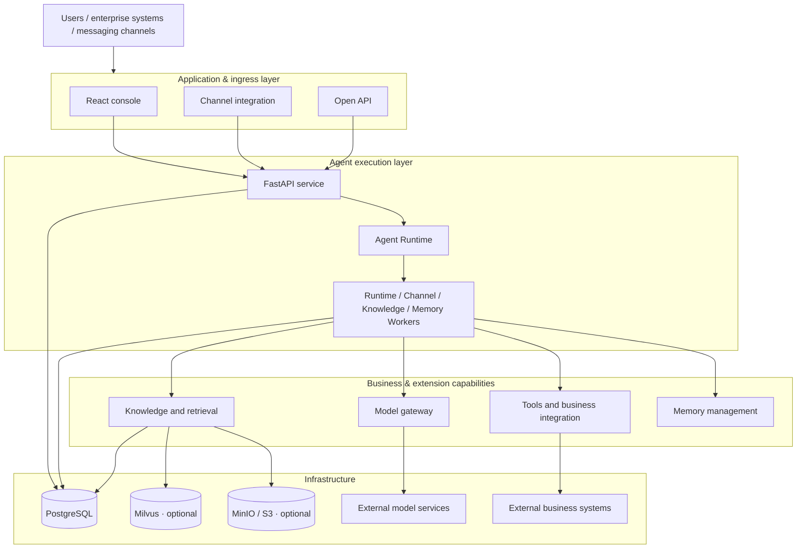
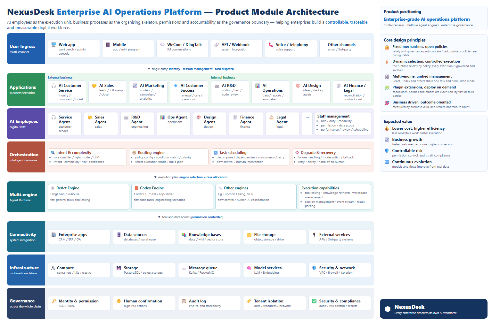

# NexusDesk

**English** · [简体中文](README.zh-CN.md) · [Documentation](https://groundedcoreai.github.io/nexusdesk/en/) · [Website](https://www.aidet.top/en/index.html)

[](https://groundedcoreai.github.io/nexusdesk/en/) [](https://github.com/GroundedCoreAI/nexusdesk/actions/workflows/ci.yml) [](LICENSE) [](https://github.com/GroundedCoreAI/nexusdesk/releases) [](https://hub.docker.com/r/groundedcore/nexusdesk-quickstart) [](https://www.aidet.top)

> **Join us! Kill the Staff.**

**NexusDesk is an open-source, self-hostable, and extensible enterprise AI operations platform.**

AI should do more than answer questions or run isolated tool calls. It should take part in real
business tasks continuously, within the permissions, responsibilities, and execution boundaries an
enterprise defines.

NexusDesk treats the AI employee as its unit of execution, business processes as its organizational
backbone, and permissions and responsibility as its governance boundary. On that basis it builds the
foundational capabilities for managing, coordinating, and operating AI employees.

"Kill the Staff" here is not about replacing people with AI. It is about rethinking how enterprise
work is organized: let AI carry more of the work that can be automated, and let people concentrate
on judgment, creation, decision-making, and oversight.

**AI customer service is NexusDesk's first complete open-source reference application.** It
validates agent knowledge retrieval, tool calls, task handling, human collaboration, and execution
governance in real business scenarios. These capabilities will gradually extend into internal
operations, R&D, sales, finance, and other business domains.

NexusDesk is built around **ReAct Agent and Harness Engineering**:

- **ReAct Agent**: reasons, acts, and observes, advancing the task dynamically from context and tool
  execution results.
- **Harness Engineering**: provides engineering control around agent execution, including task
  management, permission constraints, execution boundaries, human collaboration, and audit.
- **Business capabilities and applications**: organize validated business capabilities into reusable
  modules and deliver them to users through concrete applications.

The Harness is not another agent, and it does not require every business process to be orchestrated
in advance as a fixed workflow. It gives the agent's dynamic execution a controllable, traceable, and
governable engineering boundary.

## Quickstart

Requires Docker and Docker Compose v2. On Docker Desktop, use Linux containers.

**Option 1: build locally**

The first run requires network access and compiles the frontend.

```bash
# Linux / macOS
sh nexusdesk quickstart
```

```powershell
# Windows PowerShell
.\nexusdesk.ps1 quickstart
```

**Option 2: use the published image**

```bash
NEXUSDESK_IMAGE_REGISTRY=docker.io/groundedcore/ NEXUSDESK_VERSION=latest \
  docker compose -f deploy/quickstart/compose.yaml up -d
```

Once it is running, open **https://localhost:8080** and go to **Service applications**. Quickstart
installs four immutable service-application examples (game, shopping, creator, and mobility).
Open an example preview, then copy it into your workspace before configuring connections or
editing skills.

Quickstart mode ships with a self-signed certificate, so the first visit warns that the certificate
is untrusted. See the [deployment guide](deploy/README.md#体验模式的-https) for certificate
setup and LAN access.

Prefer not to deploy locally? Read the [online documentation](https://groundedcoreai.github.io/nexusdesk/en/) for features, configuration and the API.

Nine industry case sets are also preloaded: 9 knowledge bases, 18 Agent drafts, and 36 documents.
Every resource name carries the `[案例]` (case) prefix, and the agent list can be filtered with
Scope → Cases only.

> **Security note**
>
> Quickstart mode uses a mock model and does not represent real answer quality. The default
> credentials `admin / nexusdesk` are for local evaluation only and are not a production
> authentication boundary. Keep the default `127.0.0.1` binding; to expose the service, restrict
> access to trusted IPs with a security group or firewall.

## Production deployment

Copy the configuration template, fill in role tokens and the external PostgreSQL connection, and
configure Milvus / S3 as needed:

```bash
# Linux / macOS
cp deploy/production/.env.example deploy/production/.env
# Edit deploy/production/.env
sh nexusdesk deploy
```

```powershell
# Windows PowerShell
Copy-Item deploy/production/.env.example deploy/production/.env
# Edit deploy/production/.env
.\nexusdesk.ps1 deploy
```

The default URL is **http://localhost:8080**.

The platform can start without a default model. Configure and publish a Chat profile in the model
gateway, bind it to an agent, and then you can start a conversation.

The production topology includes six long-running services — API, Runtime Worker, Channel Worker,
Knowledge Worker, Memory Worker, and Web — plus a one-shot migration job.

Both Compose files ship a demo business upstream (`mock-business`, started with the stack by
default) for wiring up service-application connections: 25 business endpoints, a uniform
`{code,message,data}` envelope, and on-demand 5xx injection. Inside the Compose network it answers
at `http://mock-business:8010`; from the host use `http://127.0.0.1:8010`.

To start only the app and its database, name the services explicitly:

```bash
docker compose -f deploy/quickstart/compose.yaml up -d postgres app
```

It authenticates nobody, so remove it from the production topology once real business systems are
wired up. See the [deployment guide](deploy/README.md#演示业务接口mock-business) for details and
caveats.

See the [deployment guide](deploy/README.md) for HTTPS, backup, upgrade, and external access
configuration.

## Core capabilities and architecture

What defines NexusDesk is not a single agent conversation capability but a complete system built
around agent execution, business capability extension, and enterprise application delivery.

### 1. Agent Runtime

The runtime owns the agent execution lifecycle and gives the business applications above it a
consistent way to execute agents.

| Capability | Description |
| --- | --- |
| Agent configuration and execution | Configure, publish, and roll back agents; run reasoning and tool calls through an asynchronous LangGraph ReAct loop |
| Context and memory | Manage conversation context, memory reads and writes, extraction and confirmation modes, and injection limits |
| Task execution | Support task management and state maintenance during agent execution |
| Tool calls | Call available tools according to agent configuration, and handle tool parameters and execution results |
| Execution records | Record the agent execution process and related operations, as the basis for runtime observability and troubleshooting |

### 2. Extension Architecture

Modularity and extension contracts connect models, tools, knowledge, channels, and business systems
to the agent execution environment.

| Extension area | Capability |
| --- | --- |
| Model gateway | Centrally manage connections and versioned profiles for Chat, Embedding, Rerank, OCR, and speech models |
| Tools and business integration | Connect business APIs and manage credentials, parameters, permissions, and execution results |
| Knowledge and retrieval | Manage documents, chunks, indexes, and published versions, with keyword retrieval and optional Milvus |
| Memory | Configure memory read and write, extraction, confirmation, and injection policies |
| Channel integration | Connect internal and external enterprise messaging platforms through channel interfaces |
| Open interfaces | Expose capabilities through application APIs, signed webhooks, and SSE |

The extension architecture emphasizes stable module boundaries and clear separation of
responsibilities. Not every business capability has to be implemented as a dynamic plugin; whether a
capability is opened for extension should depend on its stability, reuse value, and security
boundary.

### 3. Enterprise AI Capabilities

NexusDesk targets real enterprise business scenarios and gradually builds up reusable AI business
capabilities.

The following capabilities are currently built around the AI customer service reference application:

- **Knowledge service**: Q&A and retrieval grounded in enterprise knowledge.
- **Business tools**: query and operate external business systems through tool integrations.
- **Human collaboration**: conversation takeover, ticket drafting, and human confirmation.
- **Model management**: configure and manage different types of model services in one place.
- **Runtime observability**: review execution records, model and tool calls, evaluation results, and
  operation audit.
- **Channel integration**: bring agent capabilities into the messaging channels and business systems
  an enterprise already uses.

Enterprise permission governance, AI employee collaboration, and cross-process business management
will mature as the product evolves; they are not all delivered in the current version.

### 4. Design Principles

NexusDesk follows these design principles:

**Dynamic reasoning combined with deterministic control**

Questions that need dynamic judgment go to the agent, which advances the task from context and tool
results. Business rules, permission checks, and execution constraints that must be deterministic are
the system's responsibility.

**ReAct + Harness Engineering**

ReAct provides dynamic decision-making and action; the Harness provides engineering constraints
during execution. The two work together rather than replace each other.

**Human-in-the-loop**

High-risk operations and actions that need business accountability should keep explicit human
confirmation, takeover, and audit mechanisms.

**Modular and extensible**

Clear module responsibilities and extension contracts connect models, tools, knowledge, channels, and
business applications, so business logic does not become deeply coupled to the Agent Runtime.

**Self-hosted, with infrastructure that scales on demand**

The default deployment needs only PostgreSQL. PostgreSQL also carries data storage, the job queue,
and cross-process messaging; as throughput, latency, isolation, or availability requirements grow,
infrastructure such as Redis, a dedicated message queue, or Kubernetes can be added as needed.

### 5. Architecture Overview

#### Technical architecture

NexusDesk is currently a modular monolith: the API and workers share one backend codebase and are
deployed as separate processes.



By default, PostgreSQL carries business data storage, the job queue, and cross-process messaging.
Milvus, MinIO / S3, and external parsing services are enabled per feature.

#### Business architecture

From an enterprise operations perspective, NexusDesk's long-term business structure rests on three
core elements:

| Core element | Positioning | Role |
| --- | --- | --- |
| AI employee | Unit of execution | Takes on concrete tasks and completes work through agent capabilities and business tools |
| Business process | Organizational backbone | Defines the context, collaboration relationships, and progression of business tasks |
| Permission and responsibility | Governance boundary | Defines what AI may do, when human confirmation is required, and who bears final responsibility |

On this foundation, NexusDesk builds enterprise AI operations capabilities such as AI employee
management, business collaboration, execution monitoring, permission governance, and operational
analytics.

AI customer service is the first reference application for this business architecture: it combines
agent execution, knowledge retrieval, business tools, human collaboration, and ticket handling into a
business experience for real users.



> The diagram above is the **platform module architecture blueprint (target state)**: the full layering from multi-channel ingress, AI employee roles, business orchestration, and multi-engine execution through to unified governance. For what is implemented today, see *Current status and limits* below.

#### Technology stack

| Layer | Technology |
| --- | --- |
| Frontend | TypeScript, React, Ant Design, Vite |
| Backend and execution | Python, FastAPI, LangGraph |
| Data and migrations | PostgreSQL, SQLAlchemy, Alembic |
| Knowledge storage | Milvus, MinIO / S3 (configure as needed) |
| Deployment | Docker Compose, Nginx |

Using external model services requires no GPU on the application server. See the
[middleware guide](docs/operations/middleware.md) for detailed dependencies.

#### Channels and integrations

| Category | Supported |
| --- | --- |
| Messaging platforms | WeCom, WeChat Customer Service, Feishu, DingTalk, Slack, Telegram, Discord |
| Enterprise identity | OIDC, WeCom, DingTalk, Feishu |
| Model access | Any OpenAI-compatible service; Chat / Embedding / Rerank / OCR / speech |
| Knowledge sources | External parser, TXT / Markdown; Milvus vector index and MinIO / S3 archive enabled as needed |
| Open access | Embedded chat widget, channel API, signed webhooks, idempotency keys, SSE streaming |
| UI languages | Simplified Chinese, Traditional Chinese, English, Hindi |

#### Current status and limits

NexusDesk is still under active development. Note the following capability boundaries:

- **Knowledge retrieval**: the runtime defaults to keyword retrieval; Milvus vector retrieval is not
  yet validated end to end.
- **Tool integration**: built-in tools and HTTP integrations are available; the MCP adapter is still
  planned.
- **Quickstart**: uses a mock model, connects to no real business system, and does not represent real
  model answer quality.
- **Deployment model**: Docker Compose only; no Kubernetes or Helm yet.
- **Overall status**: the project is under continuous development and not yet production ready out
  of the box.

See the [module delivery notes](docs/archive/modules-delivery.md) for module-level delivery status.

## Documentation

| I want to... | Document |
| --- | --- |
| Browse the online docs | [Documentation site](https://groundedcoreai.github.io/nexusdesk/en/) |
| Browse all documentation | [Documentation index](docs/README.en.md) |
| Use the customer service workbench | [Platform guide](docs/guides/platform.md) |
| Deploy, upgrade, or migrate data | [Docker deployment guide](deploy/README.md) |
| Understand middleware and configuration | [Middleware guide](docs/operations/middleware.md) |
| Start a local development environment | [Local development](docs/development/local-development.md) |
| Understand the architecture and extension modules | [Module architecture](docs/architecture/overview.md) |
| Understand agent execution | [Runtime documentation](docs/architecture/runtime.md) |
| Configure the knowledge base | [Knowledge workspace](docs/guides/knowledge-workspace.md) |
| Integrate model services | [Model gateway protocol](backend/src/agent_platform/core_platform/platform_services/model_gateway/PROTOCOL.md) |
| Integrate business applications | [API reference](docs/reference/api.md) · [Open platform](docs/guides/open-platform.md) |
| See what changed in a release | [Changelog](CHANGELOG.md) |

## Open source and next steps

NexusDesk will keep its open, self-hostable, and extensible direction. It validates product
capabilities through real business applications and turns that experience into reusable,
maintainable product modules.

The long-term vision is to grow into an enterprise AI operations platform: AI employees take part in
enterprise operations within explicit permission, responsibility, and business boundaries, while
enterprises manage AI employees, organize business collaboration, and keep evaluating and improving
how AI performs.

Further development follows two complementary tracks:

| Roadmap | Focus |
| --- | --- |
| Platform Roadmap | Build stable, trustworthy, and extensible agent execution and governance capabilities, including task lifecycle, module boundaries and extension contracts, permissions, human confirmation, audit, observability, evaluation, and failure recovery. |
| Open-source Application Roadmap | Make AI customer service a complete, real-world open-source reference application, including knowledge Q&A with citations, tickets and human takeover, business tools, channel integration, deployment, monitoring, evaluation, and user documentation. |

See the [module architecture](docs/architecture/overview.md) for module-level plans.

## Contributing

Contributions are welcome through issue reports, documentation improvements, test cases, and code.

- Use the [issue templates](https://github.com/GroundedCoreAI/nexusdesk/issues/new/choose) and include reproduction steps, deployment mode, and sanitized logs.
- Read the [contributing guide](CONTRIBUTING.md) before contributing code.
- Use [Discussions](https://github.com/GroundedCoreAI/nexusdesk/discussions) for design-level topics.

Do not include API keys, access tokens, or customer privacy data in issue reports, screenshots, or
code.

## License

This project is licensed under the [Apache License 2.0](LICENSE).
