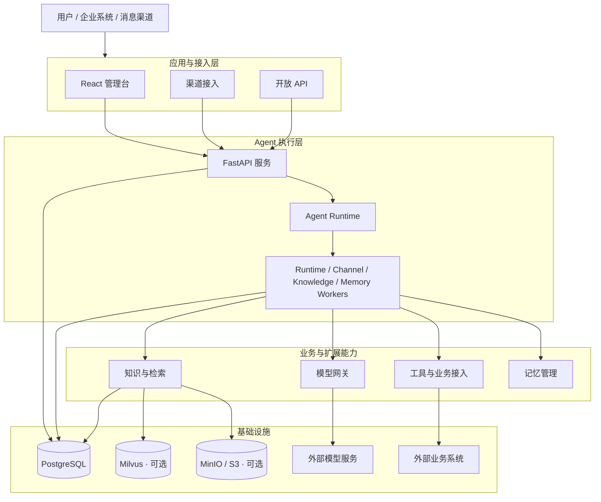
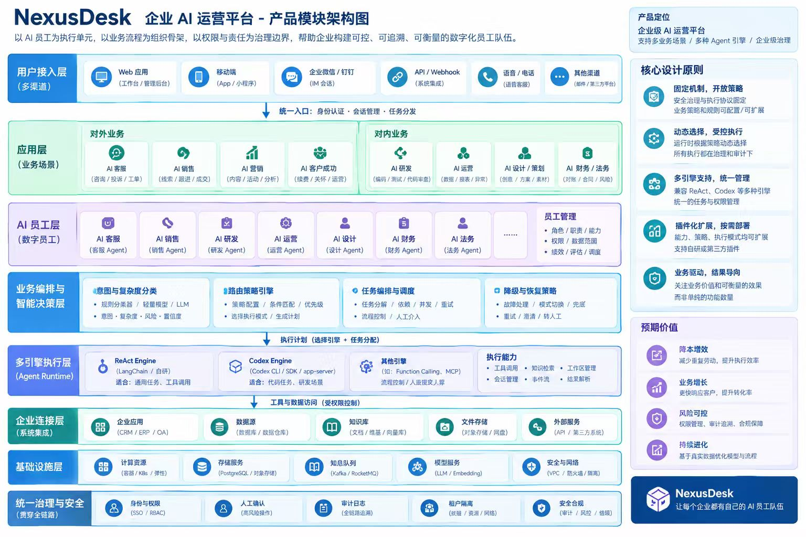

# NexusDesk

**简体中文** · [English](README.md) · [官网](https://www.aidet.top)

[](https://github.com/GroundedCoreAI/nexusdesk/actions/workflows/ci.yml) [](LICENSE) [](https://github.com/GroundedCoreAI/nexusdesk/releases) [](https://hub.docker.com/r/groundedcore/nexusdesk-quickstart) [](https://www.aidet.top)

> **Join us! Kill the Staff.**

**NexusDesk 是一个开源、可自托管、可扩展的企业 AI 运营平台。**

我们希望让 AI 不再只是回答问题或执行孤立的工具调用，而是能够在企业明确的权限、责任和执行边界内，持续参与并完成真实业务任务。

NexusDesk 以 AI 员工为执行单元，以业务流程为组织骨架，以权限与责任为治理边界，逐步构建企业管理、协作和运营 AI 员工的基础能力。

这里的「Kill the Staff」并不是简单地用 AI 替代人，而是重新思考企业工作的组织方式：让 AI 承担更多可自动化的工作，让人专注于判断、创造、决策和监督。

**AI 客服是 NexusDesk 当前的首个完整开源参考应用。** 它用于验证 Agent 在真实业务场景中的知识检索、工具调用、任务处理、人工协同和执行治理能力。未来，这些能力将逐步延伸到企业内部运营、研发、销售、财务及其他业务领域。

NexusDesk 围绕 **ReAct Agent 与 Harness Engineering** 构建：

- **ReAct Agent**：通过推理、行动和观察，根据上下文与工具执行结果动态推进任务。
- **Harness Engineering**：围绕 Agent 的执行过程提供工程控制，包括任务管理、权限约束、执行边界、人工协同和审计。
- **业务能力与应用**：将经过验证的业务能力组织成可复用模块，并通过具体应用交付给用户。

Harness 不是另一个 Agent，也不是要求所有业务都预先编排成固定流程。它负责让 Agent 的动态执行具备可控、可追踪和可治理的工程边界。

## 快速体验

需要 Docker 与 Docker Compose v2。Docker Desktop 请选择 Linux 容器模式。

**方式一：本地构建**

首次运行需要联网并编译前端。

```bash
# Linux / macOS
sh nexusdesk quickstart
```

```powershell
# Windows PowerShell
.\nexusdesk.ps1 quickstart
```

**方式二：使用已发布镜像**

```bash
NEXUSDESK_IMAGE_REGISTRY=docker.io/groundedcore/ NEXUSDESK_VERSION=latest \
  docker compose -f deploy/quickstart/compose.yaml up -d
```

启动后打开 **https://localhost:8080**，进入 `sample-support` 会话：

- 输入「发货需要多久？」体验知识问答。
- 输入「帮我创建工单」体验工单拟定、人工确认和创建流程。

体验模式自带自签证书，首次访问会提示证书不受信任。证书配置和局域网访问说明见[部署手册](deploy/README.md#体验模式的-https)。

同时预置 9 个行业案例：9 个知识库、18 个 Agent 草稿和 36 篇文档，资源名均带 `[案例]` 前缀，Agent 列表可用「范围 → 仅看案例」筛选。

> **安全提醒**
>
> 体验模式使用模拟模型，不代表真实回答质量。默认账号 `admin / nexusdesk` 仅用于本地体验，不构成生产认证边界。请保持默认 `127.0.0.1` 绑定；如需开放访问，请使用安全组或防火墙限制可信 IP。

## 生产部署

复制配置模板，填写角色 Token 和外部 PostgreSQL，按需配置 Milvus / S3：

```bash
# Linux / macOS
cp deploy/production/.env.example deploy/production/.env
# 编辑 deploy/production/.env
sh nexusdesk deploy
```

```powershell
# Windows PowerShell
Copy-Item deploy/production/.env.example deploy/production/.env
# 编辑 deploy/production/.env
.\nexusdesk.ps1 deploy
```

默认访问 **http://localhost:8080**。

平台无需默认模型即可启动；在模型网关配置并发布 Chat 方案、绑定 Agent 后即可对话。

生产拓扑包含 API、Runtime Worker、Channel Worker、Knowledge Worker、Memory Worker、Web 六个常驻服务和一次性的迁移任务。

HTTPS、备份、升级与外部访问配置见[部署手册](deploy/README.md)。

## 核心能力与架构

NexusDesk 的核心不是单一的 Agent 对话能力，而是围绕 Agent 执行、业务能力扩展和企业应用交付形成的完整体系。

### 1. Agent Runtime

Runtime 负责 Agent 的执行生命周期，为上层业务应用提供统一的 Agent 执行能力。

| 能力 | 说明 |
| --- | --- |
| Agent 配置与执行 | 配置、发布和回滚 Agent，通过异步 LangGraph ReAct 循环执行推理与工具调用 |
| 上下文与记忆 | 管理对话上下文、记忆读写、抽取与确认模式、注入限制 |
| 任务执行 | 支持 Agent 执行过程中的任务管理与状态维护 |
| 工具调用 | 根据 Agent 配置调用可用工具，并处理工具参数与执行结果 |
| 执行记录 | 记录 Agent 执行过程及相关操作，为运行观测和问题排查提供依据 |

### 2. Extension Architecture

通过模块化和扩展契约，将模型、工具、知识、渠道及业务系统连接到 Agent 执行环境。

| 扩展领域 | 能力说明 |
| --- | --- |
| 模型网关 | 统一管理 Chat、Embedding、Rerank、OCR 和语音模型的连接与版本方案 |
| 工具与业务接入 | 接入业务 API，管理调用凭据、参数、权限和执行结果 |
| 知识与检索 | 管理文档、分片、索引和发布版本，支持关键词检索与按需启用 Milvus |
| 记忆能力 | 配置记忆读写、抽取、确认及注入策略 |
| 渠道接入 | 通过渠道接口接入企业内外部消息平台 |
| 开放接口 | 通过应用 API、签名 Webhook 和 SSE 对外提供能力 |

扩展架构强调稳定的模块边界和清晰的职责划分。并非所有业务能力都必须实现为动态插件；是否开放扩展，应根据能力的稳定性、复用价值和安全边界决定。

### 3. Enterprise AI Capabilities

NexusDesk 面向企业真实业务场景，逐步沉淀可复用的 AI 业务能力。

当前已围绕 AI 客服参考应用建设以下能力：

- **知识服务**：基于企业知识提供问答与检索能力。
- **业务工具**：通过工具接入查询和操作外部业务系统。
- **人工协同**：支持会话接管、工单拟定和人工确认。
- **模型管理**：统一配置和管理不同类型的模型服务。
- **运行观测**：查看执行记录、模型与工具调用、评估结果和操作审计。
- **渠道集成**：将 Agent 能力接入企业已有的消息渠道和业务系统。

企业级权限治理、AI 员工协作、跨业务流程管理等能力将随着产品演进逐步完善，不代表当前版本已全部交付。

### 4. Design Principles

NexusDesk 遵循以下设计原则：

**动态推理与确定性控制相结合**

适合动态判断的问题交给 Agent，根据上下文和工具结果推进任务；必须确定的业务规则、权限校验和执行约束由系统负责。

**ReAct + Harness Engineering**

ReAct 提供动态决策和行动能力，Harness 提供执行过程中的工程约束。两者协同，而不是相互替代。

**Human-in-the-loop**

高风险操作和需要业务责任确认的动作，应保留明确的人工确认、接管和审计机制。

**模块化与可扩展**

通过清晰的模块职责和扩展契约连接模型、工具、知识、渠道和业务应用，避免业务逻辑与 Agent Runtime 深度耦合。

**自托管与基础设施按需扩展**

默认部署只需要 PostgreSQL。PostgreSQL 同时承担数据存储、任务队列与跨进程消息通道；当吞吐、延迟、隔离或可用性要求提升时，可以按需扩展 Redis、专用消息队列或 Kubernetes 等基础设施。

### 5. Architecture Overview

#### 技术架构

NexusDesk 当前采用模块化单体架构，API 与 Worker 共用后端代码，按进程独立部署。



默认情况下，PostgreSQL 同时承担业务数据存储、任务队列与跨进程消息通道。Milvus、MinIO / S3 与外部解析服务按功能启用。

#### 业务架构

从企业运营视角，NexusDesk 的长期业务结构围绕三个核心要素展开：

| 核心要素 | 定位 | 作用 |
| --- | --- | --- |
| AI 员工 | 执行单元 | 承担具体任务，通过 Agent 能力与业务工具完成工作 |
| 业务流程 | 组织骨架 | 定义业务任务的上下文、协作关系和推进方式 |
| 权限与责任 | 治理边界 | 明确 AI 可以做什么、何时需要人工确认，以及由谁承担最终责任 |

在此基础上，逐步构建 AI 员工管理、业务协作、执行监控、权限治理和运营分析等企业 AI 运营能力。

AI 客服是这一业务架构的首个参考应用：它将 Agent 执行、知识检索、业务工具、人工协同和工单处理组合成面向真实用户的业务体验。



> 上图为**平台模块架构蓝图（目标形态）**：从多渠道路由、AI 员工分工、业务编排、多引擎执行到统一治理的完整分层。当前已交付范围见下方[当前状态与边界](#当前状态与边界)。

#### 技术栈

| 层次 | 技术 |
| --- | --- |
| 前端 | TypeScript、React、Ant Design、Vite |
| 后端与执行 | Python、FastAPI、LangGraph |
| 数据与迁移 | PostgreSQL、SQLAlchemy、Alembic |
| 知识存储 | Milvus、MinIO / S3（按需配置） |
| 部署 | Docker Compose、Nginx |

使用外部模型服务时，应用服务器无需 GPU。详细依赖见[中间件说明](docs/operations/middleware.md)。

#### 渠道与集成

| 类别 | 已支持 |
| --- | --- |
| 消息平台 | 企业微信、微信客服、飞书、钉钉、Slack、Telegram、Discord |
| 企业身份 | OIDC、企业微信、钉钉、飞书 |
| 模型接入 | 任意 OpenAI 兼容服务；Chat / Embedding / Rerank / OCR / 语音 |
| 知识来源 | 外部 Parser、TXT / Markdown；Milvus 向量索引、MinIO / S3 归档按需启用 |
| 开放接入 | 嵌入聊天组件、渠道 API、签名 Webhook、幂等键、SSE 流式输出 |
| 界面语言 | 简体中文、繁体中文、英文、印地语 |

#### 当前状态与边界

NexusDesk 仍在持续开发中，以下能力边界需要注意：

- **知识检索**：Runtime 默认使用关键词检索；Milvus 向量检索尚未完成端到端验证。
- **工具接入**：内置工具与 HTTP 接入可用；MCP 适配仍在规划中。
- **快速体验**：使用模拟模型，不连接真实业务系统，不代表真实模型回答质量。
- **部署形态**：目前仅提供 Docker Compose，暂无 Kubernetes / Helm。
- **整体状态**：项目仍在持续开发，尚未达到开箱即用的生产可用程度。

具体模块交付情况见[模块交付说明](docs/archive/modules-delivery.md)。

## 文档导航

| 我想要…… | 文档 |
| --- | --- |
| 浏览在线文档 | [文档站](https://groundedcoreai.github.io/nexusdesk/) |
| 浏览全部文档 | [文档总索引](docs/README.md) |
| 使用客服工作台 | [平台使用说明](docs/guides/platform.md) |
| 部署、升级或迁移数据 | [Docker 部署手册](deploy/README.md) |
| 了解中间件与配置 | [中间件说明](docs/operations/middleware.md) |
| 启动本地开发环境 | [本地开发](docs/development/local-development.md) |
| 了解架构和扩展模块 | [模块架构](docs/architecture/overview.md) |
| 理解 Agent 执行机制 | [Runtime 文档](docs/architecture/runtime.md) |
| 配置知识库 | [知识库工作台](docs/guides/knowledge-workspace.md) |
| 接入模型服务 | [模型网关协议](backend/src/agent_platform/core_platform/platform_services/model_gateway/PROTOCOL.md) |
| 接入业务应用 | [API 说明](docs/reference/api.md) · [开放平台](docs/guides/open-platform.md) |
| 查看版本更新 | [更新日志](CHANGELOG.md) |

## 开源与后续方向

NexusDesk 将保持开放、可自托管和可扩展的项目方向，通过真实业务应用验证产品能力，并将实践经验持续沉淀为可复用、可维护的产品模块。

项目长期愿景是逐步发展为企业 AI 运营平台：让 AI 员工能够在明确的权限、责任和业务边界内参与企业运营，让企业能够管理 AI 员工、组织业务协作，并持续评估和改进 AI 的工作表现。

项目后续发展围绕两条相互配合的路线推进：

| Roadmap | 重点 |
| --- | --- |
| Platform Roadmap | 建设稳定、可信、可扩展的 Agent 执行与治理能力，包括任务生命周期、模块边界与扩展契约、权限、人工确认、审计、可观测性、评估与失败恢复。 |
| Open-source Application Roadmap | 将 AI 客服做成完整、真实可用的开源参考应用，包括带引用的知识问答、工单与人工接管、业务工具、渠道接入、部署、监控、评估和用户文档。 |

各模块规划见[模块架构](docs/architecture/overview.md)。

## 参与贡献

欢迎通过问题反馈、文档改进、测试用例和代码贡献参与 NexusDesk 建设。

- 提交问题请使用 [Issue 模板](https://github.com/GroundedCoreAI/nexusdesk/issues/new/choose)，并提供复现步骤、部署方式和脱敏日志。
- 贡献代码前请阅读[贡献指南](CONTRIBUTING.md)。
- 方案讨论欢迎前往 [Discussions](https://github.com/GroundedCoreAI/nexusdesk/discussions)。

请勿在问题报告、截图或代码中包含 API Key、访问令牌及客户隐私数据。

## 许可证

本项目采用 [Apache License 2.0](LICENSE) 许可。
