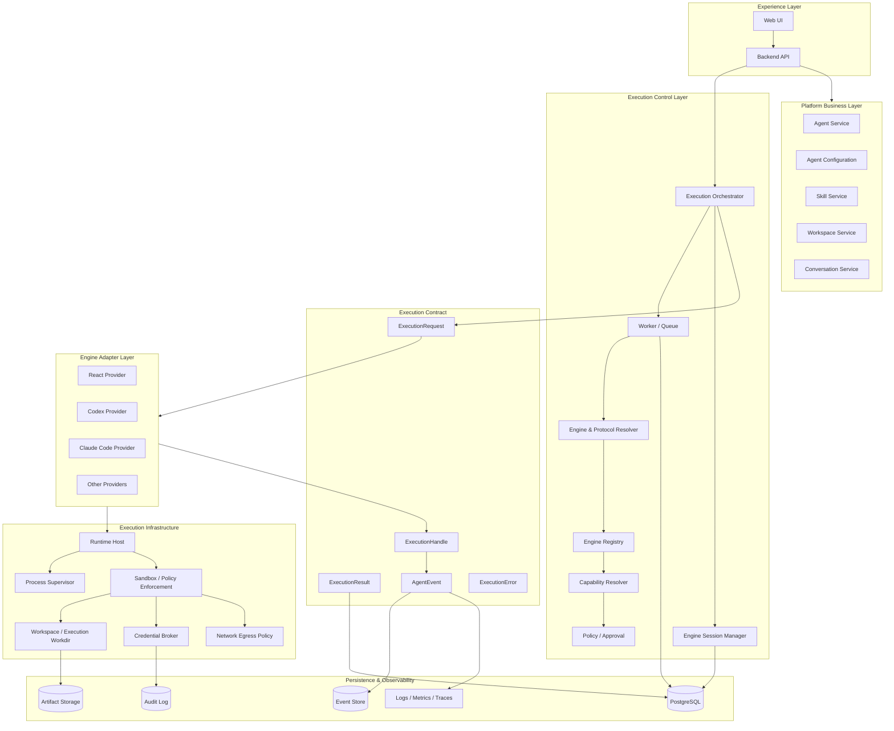
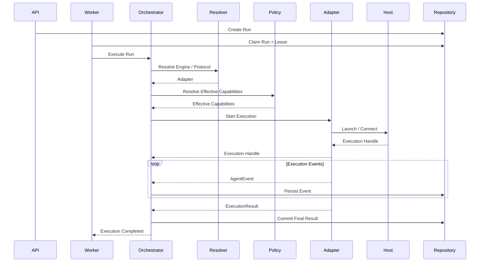

# NexusDesk Agent Execution Platform

## Technical Architecture & Evolution Plan v2.0

| Item | Value |
|---|---|
| Project | NexusDesk |
| Architecture | Extensible Agent Execution Platform |
| Status | Architecture Baseline |
| Version | 2.0 |
| Target branch | `integration` |
| Implementation strategy | Incremental refactoring, backward compatibility, security by design |

> This document defines the target architecture and an incremental implementation plan. It is not a claim that every component described here already exists. Existing implementation details must be revalidated against the target commit before each implementation phase.

---

# 1. Background and Goals

## 1.1 Current architectural constraints

NexusDesk already has a useful execution foundation: Agent Runtime, persistent Worker queue, Lease/Heartbeat, Run lifecycle management, runtime events, Agent configuration, and runtime composition.

The current execution path is nevertheless centered on the LangGraph ReAct Runtime:

- The Runtime Engine owns model invocation, reasoning loops, tool calling, and execution budgets.
- Worker invokes the existing Runtime directly and depends on its output/history shape.
- Runtime Factory constructs a fixed Runtime implementation.
- The runtime extension contract does not yet provide a complete, independent Engine Provider contract.
- Engine Session, Run, Workspace, and Engine Native Events do not yet have a complete cross-engine lifecycle model.
- External CLI process management, credential injection, and isolated execution environments need dedicated abstractions.

Directly adding Codex, Claude Code, OpenClaw, ACP, or other agent engines on top of this structure would risk creating parallel execution paths and engine-specific branches in Worker and Runtime.

## 1.2 Target

Evolve from:

`Platform Runtime = LangGraph ReAct Engine`

to:

`Platform Runtime = Agent Execution Platform`

The platform owns execution governance and infrastructure:

- Agent and configuration lifecycle
- Engine / Protocol / Adapter registration and resolution
- Execution orchestration and lifecycle
- Worker scheduling and reliability
- Capability resolution and policy enforcement
- Engine Session management
- Runtime Host and process supervision
- Workspace and execution isolation
- Credential management
- Events, artifacts, usage, audit, and observability

Each Engine retains its own reasoning loop, tool execution model, and native protocol.

**Unify platform governance; do not force every Engine to use the same internal reasoning or tool-calling implementation.**

## 1.3 Design principles

| Principle | Meaning |
|---|---|
| Engine agnostic | The platform is not coupled to one Agent Engine |
| Protocol agnostic | One Engine may be integrated through multiple protocols |
| Incremental evolution | Refactor existing components; avoid a big-bang rewrite |
| Contract first | Stabilize public execution contracts before adding providers |
| Capability driven | Effective functionality depends on engine support and platform policy |
| Security by design | Workspace, credentials, sandbox, and network boundaries are architectural concerns |
| Event driven | Standardize the event envelope while preserving native events |
| Backward compatible | Existing Agent configurations and historical Runs remain usable |
| Modular monolith first | Establish module boundaries before considering microservices |

---

# 2. Target Architecture

## 2.1 Logical architecture



## 2.2 Layer responsibilities

### Platform Business Layer

Owns product and domain concepts: Agent / Agent Version, Agent Configuration, Conversation, Skill Catalog / Binding, Workspace, and Task. It does not start Engine processes or implement protocol details.

### Execution Control Layer

Owns Engine resolution, capability and policy evaluation, Session coordination, Worker integration, and the Execution lifecycle. It determines which Engine runs, which capabilities are effective, and how execution is governed.

### Execution Contract

Defines the stable boundary between the platform and Engine Adapters: Request, Handle, Result, Event, Capabilities, and Error. Native Engine details remain in adapter-owned metadata or native events.

### Engine Adapter Layer

Implements a specific Engine + Protocol integration. Adapters translate requests, native events, cancellation, and results. They do not own tenant authorization, global scheduling, or Run persistence.

### Execution Infrastructure

Provides process lifecycle management, work directories, sandboxing, credentials, network policy, and resource limits.

### Persistence and Observability

Persists Runs / Executions, Sessions, Events, Artifacts, Usage, Audit, and telemetry.

---

# 3. Core Domain Model

## 3.1 Task, Execution, and Run

These concepts should be distinguished:

- **Task**: the user's intent or requested unit of work.
- **Execution**: one concrete attempt to perform a Task.
- **Run**: the existing NexusDesk runtime record and lifecycle abstraction.

For the first migration, define:

`Run = one Execution attempt`

Do not introduce a separate Task table immediately. Reuse the existing Run model and add the required execution metadata. Introduce a first-class Task entity later when cross-engine retries, task aggregation, or multiple executions per user intent become real product requirements.

Potential Run metadata:

- `engine_id`
- `protocol_id`
- `adapter_version`
- `engine_session_id`
- `workspace_id`
- `execution_config_snapshot`
- `effective_capabilities_snapshot`
- `execution_metadata`

## 3.2 Conversation, Engine Session, and Run

| Entity | Responsibility | Lifecycle |
|---|---|---|
| Conversation | Business conversation between user and Agent | Long-lived |
| Engine Session | Native session owned by a specific Engine | Engine-dependent |
| Run / Execution | One execution attempt | Short-lived |

A Conversation may have multiple Engine Sessions. An Engine Session may be associated with multiple Runs. Engines without persistent sessions may create a new session for each Run. Session persistence and resume are optional capabilities, not universal requirements.

## 3.3 Workspace and execution storage

Keep these concepts separate:

| Resource | Responsibility |
|---|---|
| Workspace | Long-lived user or Agent working area |
| Execution Workdir | Isolated directory for one execution |
| Skill Store | Shared, versioned Skill content |
| Runtime Cache | Engine runtime cache |
| Artifact Store | Execution outputs and generated artifacts |
| Credential Mount | Temporary, authorized credential exposure |

A typical logical layout:

```text
workspace/<tenant>/<workspace-id>/
execution/<execution-id>/{workdir,temp,logs}/
skills/{shared,tenant}/
artifacts/<execution-id>/
```

The physical storage layout may differ. Execution directories must not be confused with durable Workspace data. Define explicit export, retention, and cleanup policies.

---

# 4. Engine, Protocol, and Adapter

## 4.1 Separate the concepts

An Engine is not the same thing as its connection protocol.

For example, Codex is an Engine and may be integrated through:

- Codex CLI Exec
- Codex App-Server

Represent the integration as:

`(engine_id, protocol_id, adapter_version)`

Examples:

```text
(react, native, v1)
(codex, cli_exec, v1)
(codex, app_server, v1)
```

| Concept | Responsibility | Example |
|---|---|---|
| Engine | Agent execution engine | `codex` |
| Protocol | Communication / invocation mechanism | `cli_exec`, `app_server` |
| Adapter | NexusDesk implementation of that protocol | `codex_cli_adapter` |

This allows one Engine to expose multiple protocols without duplicating the Engine identity.

## 4.2 Registry responsibilities

Introduce an Engine Registry, Protocol Registry, and Adapter Registry. They should:

1. Register Engine, Protocol, and Adapter metadata.
2. Validate supported Engine / Protocol combinations.
3. Resolve an adapter from a versioned identifier.
4. Expose adapter availability and health.
5. Reject unknown or incompatible configurations clearly.

Do not put all discovery, construction, and execution logic into the existing Runtime Factory.

## 4.3 Adapter contract

The following is an interface sketch, not an implementation claim:

```python
class AgentEngineAdapter(Protocol):
    @property
    def engine_id(self) -> str: ...

    @property
    def protocol_id(self) -> str: ...

    @property
    def adapter_version(self) -> str: ...

    async def get_capabilities(self) -> EngineCapabilities: ...

    async def start(
        self, request: ExecutionRequest
    ) -> ExecutionHandle: ...

    async def stream_events(
        self, handle: ExecutionHandle
    ) -> AsyncIterator[AgentEvent]: ...

    async def cancel(self, handle: ExecutionHandle) -> None: ...

    async def collect_result(
        self, handle: ExecutionHandle
    ) -> ExecutionResult: ...
```

Contract requirements:

- Adapter does not operate the Worker queue.
- Adapter does not decide tenant permissions.
- Adapter does not commit the platform Run's final state.
- Adapter does not bypass Runtime Host for host process lifecycle management.
- Adapter may preserve native Session identifiers and metadata.
- Adapter must define error and cancellation semantics.
- Unsupported capabilities must be explicit.

The exact method shape may be refined to accommodate streaming, long-running process handles, and protocol-specific interaction.

---

# 5. Execution Contract

## 5.1 ExecutionRequest

Suggested initial model:

```python
class ExecutionRequest(BaseModel):
    execution_id: str
    tenant_id: str
    agent_id: str
    conversation_id: str | None = None

    engine_id: str
    protocol_id: str
    adapter_version: str

    engine_session_id: str | None = None
    workspace_id: str | None = None
    execution_workdir: str | None = None

    input: str
    config: dict
    effective_capabilities: dict

    timeout_seconds: int | None = None
    trace_id: str | None = None
```

Security and consistency rules:

- `config` is produced from validated typed configuration.
- `effective_capabilities` is calculated by the platform, never trusted from the client.
- `tenant_id` comes from trusted authentication context.
- Persist the configuration and policy snapshot used for each Execution.
- Do not expose host process details to untrusted clients.

## 5.2 ExecutionHandle

Represents a running execution:

```python
class ExecutionHandle(BaseModel):
    execution_id: str
    engine_id: str
    protocol_id: str
    provider_session_id: str | None = None
    process_id: int | None = None
    status: str
    metadata: dict = {}
```

Process identifiers and host-specific fields are internal infrastructure details and should not be exposed through public APIs.

## 5.3 ExecutionResult

```python
class ExecutionResult(BaseModel):
    execution_id: str
    status: str
    output: str | None = None
    artifacts: list[dict] = []
    usage: dict = {}
    engine_metadata: dict = {}
    error: dict | None = None
```

Keep common fields stable. Store Engine-specific result data in adapter-owned metadata.

## 5.4 Error taxonomy

| Error | Example | Default retry |
|---|---|---|
| ConfigurationError | Invalid Engine config | No |
| EngineUnavailable | Engine not installed / unavailable | Policy-dependent |
| ProtocolError | Invalid protocol response | Policy-dependent |
| AuthenticationError | Invalid credential | No |
| PermissionDenied | Policy denies operation | No |
| ResourceExhausted | Resource quota reached | Possibly after delay |
| Timeout | Execution exceeded deadline | Task-dependent |
| Cancelled | User cancellation | No |
| WorkspaceError | Workdir setup / access failure | Policy-dependent |
| InternalError | Platform internal failure | Conditional |

Retry policy must account for side effects. A timeout does not prove that an Engine performed no work.

---

# 6. Capability Model

## 6.1 Three capability layers

Do not treat an Engine's declared technical capabilities as authorization.

1. **Declared**: what the Adapter claims to support.
2. **Available**: what the current deployment and runtime environment can actually provide.
3. **Effective**: what the platform permits for this particular Execution after policy evaluation.

```text
Declared
   |
   v
Available
   |
   v
Policy Resolution
   |
   v
Effective
```

Example: Codex may technically support terminal execution, but a tenant policy may prohibit arbitrary shell execution. The Effective capability must then deny it.

## 6.2 Initial capability schema

```python
class EngineCapabilities(BaseModel):
    streaming: bool = False
    persistent_session: bool = False
    session_resume: bool = False
    cancellation: bool = False
    human_approval: bool = False
    interactive_input: bool = False
    tool_calling: bool = False
    file_operations: bool = False
    terminal_execution: bool = False
    native_events: bool = False
    workspace_required: bool = False
```

This Boolean model is a starting point. More complex capabilities may later require structured parameters, constraints, and protocol-version metadata.

## 6.3 Capability Resolver

Introduce a dedicated resolver to:

1. Read Adapter-declared capabilities.
2. Check environment availability and version compatibility.
3. Load tenant, Agent, and Execution policies.
4. Calculate Effective capabilities.
5. Persist the effective capability snapshot.
6. Expose the task's available features to the UI.

**Capability describes technical support; Policy decides whether the platform allows it.**

---

# 7. Execution Orchestrator and Worker

## 7.1 Orchestrator responsibilities

The Execution Orchestrator is the platform execution control center. It coordinates:

- Run lifecycle
- Engine / Protocol resolution
- Capability and policy evaluation
- Session coordination
- Workspace preparation
- Adapter invocation
- Event collection
- Result submission
- Cancellation and timeout

It does not implement the Engine's reasoning loop.

## 7.2 Execution flow



## 7.3 Worker migration

Keep the existing Worker queue, Lease / Heartbeat, cancellation, timeout, event persistence, and terminal-state responsibilities.

The main change is:

**Worker calls the Orchestrator instead of directly invoking a concrete Runtime Engine.**

Target interaction:

```python
result = await orchestrator.execute(run_context)
```

Worker should not need to know whether the current Engine is React or Codex, whether it uses CLI or App-Server, or how its internal reasoning loop works.

## 7.4 Terminal-state protection

A cancelled or timed-out Run must not be overwritten by a late success result. A Worker that has lost its Lease must not submit a valid state transition. Implement this with repository-level conditional updates and, as the reliability phase matures, Lease Epoch / Fencing Token.

---

# 8. Runtime Host and Process Supervisor

## 8.1 Why a Runtime Host is required

CLI-based Engines may require OS processes, stdin/stdout/stderr handling, process-tree cleanup, workdir management, environment injection, timeouts, resource controls, and network restrictions.

These concerns should not be embedded in each Engine Adapter.

## 8.2 Responsibility boundaries

| Component | Responsibility |
|---|---|
| Engine Adapter | Understands Engine and Protocol |
| Runtime Host | Provides a managed execution environment |
| Process Supervisor | Owns process lifecycle and cleanup |
| Sandbox | Enforces isolation and execution policy |
| Credential Broker | Authorizes and injects credentials |
| Workspace Provider | Prepares work directories and mounts |

Suggested module boundary:

```text
agent_execution/host/
  runtime_host.py
  process_runner.py
  process_supervisor.py
  process_registry.py
  resource_manager.py
  host_models.py
```

## 8.3 Process lifecycle

Define explicit states:

```text
Start -> Ready -> Running
                  |
                  +-> Cancel Requested -> Terminating -> Exited
                  |
                  +-> Timeout -> Terminating -> Exited
```

Coroutine cancellation is not equivalent to process termination. Cancellation must:

1. Signal the Engine process.
2. Escalate to forced termination after a deadline.
3. Clean up child processes and process groups.
4. Release allocated resources.
5. Persist a correct terminal state.

## 8.4 Isolation

Do not run untrusted Agent commands with the full permissions of the NexusDesk API or Worker host.

Build toward:

- Isolated Runtime Host.
- Container or equivalent sandbox.
- CPU, memory, PID, disk, and time limits.
- Workspace path restrictions.
- Network egress policy.
- Task-scoped credentials.

If untrusted users can submit code-execution tasks, sandboxing, tenant isolation, credential isolation, and network policy are launch blockers for that capability, not optional future enhancements.

---

# 9. Workspace and File Management

Introduce a Workspace Provider responsible for Workspace access, Execution Workdir creation, file mounts, Skill mounts, artifact export, and cleanup.

Suggested boundary:

```text
agent_execution/workspace/
  workspace_provider.py
  workspace_manager.py
  execution_workdir.py
  workspace_policy.py
```

Execution lifecycle:

```text
Create / Resolve Workspace
          |
          v
Prepare Execution Workdir
          |
          v
Mount Repository / Skills
          |
          v
Run Engine
          |
          v
Collect Changes / Artifacts
          |
          v
Persist Results
          |
          v
Cleanup or Retain
```

Initially reuse existing storage where safe. Evaluate dedicated volumes, tenant volumes with execution subdirectories, shared read-only Skill Store, overlays / snapshots, and object storage only after measuring capacity, latency, and cost.

All filesystem operations must prevent path traversal, symlink escape, cross-tenant access, and unauthorized overwrites.

---

# 10. Credential Broker and Security

## 10.1 Target flow

```text
Credential Vault
       |
       v
Credential Broker
       |
       v
Tenant / Execution Authorization
       |
       v
Short-lived Credential
       |
       v
Runtime Host / Sandbox
```

Vault responsibilities:

- Encrypted credential storage.
- Credential versioning.
- Rotation and revocation.
- Future integration with KMS / Secret Manager.

Broker responsibilities:

- Verify tenant identity.
- Verify Agent / Execution authorization.
- Verify target Engine and credential scope.
- Inject short-lived credentials.
- Record usage audit.

## 10.2 Security requirements

Never:

- Store plaintext API keys in Agent Configuration.
- Write tokens to logs or ordinary Runtime Events.
- Copy the host's `~/.codex/auth.json` into tenant execution environments by default.
- Share credential directories across tenants without isolation.

An initial implementation may use controlled environment-variable injection or secret mounts, but its interface should allow evolution to a dedicated Credential Broker.

---

# 11. Engine Instructions and Skills

## 11.1 Engine Instruction Provider

Different Engines may use different instruction filenames, discovery rules, Skill formats, and context injection mechanisms.

Introduce an Instruction Provider boundary:

```text
agent_execution/instructions/
  instruction_provider.py
  react_instruction_provider.py
  codex_instruction_provider.py
  instruction_renderer.py
```

Common inputs may include System Prompt, Conversation Context, Memory / Summary, Skill Definitions, and Workspace Context. Each provider renders these into the format expected by its Engine.

## 11.2 Platform Skills and Engine Skill Adapters

A Platform Skill should have at least:

- name
- description
- version
- content
- permissions
- source
- checksum

Engine Skill Adapters convert Platform Skills into Engine-specific directory layouts and instruction formats.

Do not make one Engine's Skill file format the platform-wide standard. Skills require versioning, source validation, and permission checks.

---

# 12. Event Architecture

## 12.1 Unified event envelope

Extend existing Runtime Events rather than replacing the event system wholesale.

Suggested envelope:

```python
class AgentEvent(BaseModel):
    event_id: str
    schema_version: str
    execution_id: str
    engine_session_id: str | None = None
    sequence: int
    event_type: str
    source: str
    timestamp: datetime
    payload: dict
    trace_id: str | None = None
```

Fields:

- `event_id`: globally unique event identity for deduplication.
- `schema_version`: event schema version.
- `sequence`: ordering within an Execution.
- `source`: platform or engine_native.
- `payload`: event-specific content.

## 12.2 Platform Events and Native Events

Platform Events represent stable business semantics, for example:

```text
run.started
run.completed
run.failed
run.cancelled
engine.session.started
engine.session.completed
message.delta
tool.started
tool.completed
approval.required
approval.resolved
artifact.created
usage.updated
execution.error
```

Native Events preserve Engine-specific semantics, for example:

```text
codex.turn.started
codex.command.started
codex.command.completed
codex.file.changed
codex.approval.requested
```

Do not convert every native command or event into a ReAct Tool Calling abstraction.

## 12.3 Reliability improvements

Continuously improve:

- Event schema versioning.
- Sequence and duplicate detection.
- Event persistence and transactional outbox.
- SSE reconnect and cursor-based replay.
- Native event retention.
- Parser failure diagnostics.
- Idempotent usage aggregation.
- Consistency between terminal Run state and final events.

---

# 13. Engine Session Management

Introduce a dedicated Session Manager and repository when the first persistent-session Engine requires it.

Suggested table: `agent_engine_sessions`

| Field | Description |
|---|---|
| id | Platform Session ID |
| tenant_id | Tenant |
| conversation_id | Related Conversation |
| engine_id | Engine |
| protocol_id | Protocol |
| adapter_version | Adapter version |
| provider_session_id | Native Engine Session ID |
| workspace_id | Workspace |
| status | Session status |
| metadata | Engine-specific metadata |
| created_at / updated_at | Timestamps |
| expires_at | Expiration time |

Requirements:

- Session persistence is optional per Engine.
- Resume must re-check authorization and policy.
- Expired Sessions must release associated resources.
- Engine-specific metadata must remain versioned and adapter-owned.

---

# 14. Agent Configuration Evolution

## 14.1 Backward compatibility

Existing Agent configuration includes fields such as `system_prompt`, `tool_names`, `knowledge_base_ids`, `max_model_rounds`, model profile identifiers and versions, reply language, and summary / memory settings.

Do not break existing published Agent snapshots or force users to edit all existing configurations.

## 14.2 Target configuration shape

Illustrative YAML:

```yaml
engine:
  engine_id: react
  protocol_id: native
  adapter_version: v1

react:
  model_profile_id: default
  model_profile_version: 1
  max_model_rounds: 10

codex:
  approval_mode: on-request
  sandbox_mode: workspace-write
  timeout_seconds: 1800
```

Requirements:

- `engine` selects the generic Engine / Protocol.
- Engine-specific sections use typed configuration.
- Default missing Engine selection to `react`.
- Map legacy fields through a compatibility layer.
- Avoid an unbounded generic configuration dictionary.
- Snapshot the resolved configuration, Adapter version, policy version, and Effective capabilities for every Execution.

---

# 15. Mapping to Existing NexusDesk Modules

The following mapping is based on the previously inspected `integration` branch. Revalidate against the target commit before implementation.

| Existing module | Current responsibility | Target evolution |
|---|---|---|
| `agent_runtime/engine.py` | LangGraph ReAct execution | Wrap / migrate as React Engine Provider |
| `agent_runtime/worker.py` | Queue, Lease, Run lifecycle | Keep; call Orchestrator |
| `agent_runtime/repository.py` | Run and event persistence | Extend execution metadata, Session, event reliability |
| `agent_runtime/schemas.py` | Runtime schemas | Gradually separate public execution contracts |
| `runtime_factory.py` | Fixed Runtime construction | Engine / Protocol resolution |
| `runtime_composition.py` | Runtime dependency composition | Compose Orchestrator, Registry, Host, and providers |
| `extension_contracts/runtime.py` | Run / Runtime contract | Preserve compatibility; extract Engine contract |
| `agent_config/service.py` | Agent config and validation | Add typed Engine / Protocol configuration |
| Runtime Events | Runtime events and SSE | Add versioned envelope and native event support |

Guardrails:

1. Do not delete the current LangGraph Runtime in Phase 1.
2. Do not make Worker responsible for Engine resolution and process supervision.
3. Do not model Engine as a subtype of ordinary Capability Plugin.
4. Do not turn the Extension Registry into a container for all execution logic.
5. Do not break existing React invocation or historical data to accommodate Codex.

---

# 16. Suggested Code Structure

The following is a target logical structure, not a requirement to create every file at once.

```text
backend/src/agent_platform/
├── core_platform/
│   ├── agent_runtime/
│   │   ├── worker.py
│   │   ├── repository.py
│   │   └── schemas.py
│   └── agent_execution/
│       ├── contracts/
│       │   ├── request.py
│       │   ├── handle.py
│       │   ├── result.py
│       │   ├── events.py
│       │   ├── capabilities.py
│       │   └── errors.py
│       ├── orchestration/
│       │   ├── orchestrator.py
│       │   ├── execution_context.py
│       │   └── execution_lifecycle.py
│       ├── registry/
│       │   ├── engine_registry.py
│       │   ├── protocol_registry.py
│       │   └── adapter_registry.py
│       ├── capability/
│       │   ├── capability_resolver.py
│       │   └── capability_policy.py
│       ├── session/
│       ├── host/
│       ├── workspace/
│       ├── credentials/
│       ├── instructions/
│       └── adapters/
│           ├── react/
│           ├── codex/
│           └── testing/
│               └── local_test_adapter.py
├── applications/
│   └── platform_runtime/
│       ├── runtime_factory.py
│       └── runtime_composition.py
├── extension_contracts/
│   └── runtime.py
└── business_capabilities/
    └── agent_config/
        └── service.py
```

Start with `contracts`, `registry`, `orchestration`, and `adapters/react`. Add other packages as their phase begins.

---

# 17. Phased Implementation Roadmap

## Phase 0 — Baseline and Inventory

**Priority: P0**

Goal: establish a verified baseline before refactoring.

Work:

1. Reinspect the latest `integration` branch.
2. Map Runtime Engine, Worker, Repository, Factory, and composition dependencies.
3. Document Run state transitions and current event semantics.
4. Inventory Agent Config and published snapshot compatibility.
5. Agree Engine / Protocol / Adapter identifiers.
6. Record test coverage and current ReAct behavior.
7. Establish regression tests for existing execution behavior.

Deliverables:

- Architecture baseline.
- Runtime dependency map.
- Run lifecycle diagram.
- Agent configuration compatibility plan.
- Refactoring checklist.

Acceptance:

- Existing Run creation-to-terminal flow is documented.
- Worker / Runtime responsibilities are explicit.
- Existing Agent configurations remain loadable.
- Existing ReAct behavior has automated regression coverage.

## Phase 1 — Execution Contract and Registries

**Priority: P0**

Goal: establish the standard integration boundary.

Work:

1. Define ExecutionRequest, ExecutionHandle, ExecutionResult, ExecutionError, AgentEvent, and EngineCapabilities.
2. Define contract and Adapter versioning.
3. Implement Engine Registry.
4. Implement Protocol Registry.
5. Implement Adapter Registry.
6. Validate Engine / Protocol compatibility.
7. Build LocalTestAdapter and initial Contract Tests.

Not in scope yet:

- Codex integration.
- Full Runtime Host.
- Complex Scheduler.
- Separate Task / Execution tables.

Acceptance:

- A new Engine can be added without changing the public contract.
- Engine and Protocol can be registered independently.
- Registry resolves a valid Adapter.
- Unsupported capabilities are explicit.
- Contract tests run independently of external Engines.

## Phase 2 — React Provider and Execution Orchestrator

**Priority: P0 — first major refactoring milestone**

Goal: make the existing LangGraph Runtime the first Engine Provider.

Work:

1. Preserve the existing ReAct reasoning implementation.
2. Add a React Engine Adapter around it.
3. Extract Engine selection from the fixed Runtime Factory.
4. Implement Execution Orchestrator.
5. Change Worker to invoke the Orchestrator.
6. Normalize ExecutionResult and ExecutionError.
7. Map existing Runtime Events to AgentEvent incrementally.
8. Preserve existing API and SSE behavior.
9. Add a feature flag for controlled migration and rollback.

Acceptance:

- Existing Agents continue to execute.
- Worker no longer depends directly on a concrete Engine.
- React resolves through the Registry.
- Orchestrator manages a complete Execution.
- Existing Run and event behavior has no regression.
- New and old paths can be switched during migration.

## Phase 3 — Capability, Configuration, and Instructions

**Priority: P0**

Goal: enable multi-Engine configuration and capability governance.

Work:

1. Add Engine ID, Protocol ID, and Adapter version to Agent configuration.
2. Default legacy configurations to React.
3. Introduce typed Engine-specific configuration.
4. Implement Declared, Available, and Effective capability resolution.
5. Add Capability Resolver and policy integration.
6. Introduce Engine Instruction Provider.
7. Adapt existing Context / Summary / Memory injection to Engine-specific formats.
8. Persist resolved configuration and capability snapshots.

Acceptance:

- Legacy Agents run without manual edits.
- New Agents can select Engine and Protocol.
- Engine-specific settings are validated by typed schemas.
- Clients cannot dictate Effective capabilities.
- Instruction rendering can vary by Engine.
- Each Execution can be traced to its resolved configuration and policy.

## Phase 4 — Runtime Host, Process Supervisor, and Workspace

**Priority: P1**

Goal: provide a managed execution environment for external Engines.

Work:

1. Define Runtime Host interface.
2. Implement Process Runner and Process Supervisor.
3. Implement timeout, cancellation, and process-tree cleanup.
4. Introduce Workspace Provider and Execution Workdir.
5. Define mount and cleanup policies.
6. Add resource limits.
7. Define Sandbox Provider interface.
8. Add host health and process observability.

Acceptance:

- External Engine lifecycle is not tied only to a Worker coroutine.
- Orphan processes can be detected and cleaned up.
- Cancellation stops the actual Engine process.
- Each Execution receives an isolated work directory.
- Cross-tenant path access is blocked.
- CPU, memory, PID, disk, and time limits are configurable.
- Runtime Host is independent of specific Engine Adapters.

## Phase 5 — Codex Integration

**Priority: P1**

Goal: validate the architecture with the first external Engine.

### Stage A: Codex CLI Exec

Start with the simpler CLI execution path:

1. Implement Codex CLI Adapter.
2. Validate supported Codex versions.
3. Map request and Engine configuration.
4. Launch through Runtime Host.
5. Parse stdout / stderr into platform events where appropriate.
6. Preserve raw or normalized Native Events.
7. Collect final result and usage.
8. Implement timeout and cancellation.
9. Integrate Workspace.
10. Enforce credentials and execution policy.

### Stage B: Codex App-Server

Only after the CLI path is stable:

1. Implement App-Server Protocol Adapter.
2. Manage JSON-RPC connection lifecycle.
3. Manage native Sessions.
4. Map Session / Turn / Run.
5. Implement streaming.
6. Adapt approval and interactive input.
7. Add Session Resume where supported.
8. Manage protocol-version compatibility.

Keep App-Server protocol details inside the provider. Do not expose its private JSON-RPC protocol as the NexusDesk public API.

Acceptance:

- Codex executes inside an isolated Workspace.
- CLI and App-Server share the Codex Engine identity.
- Protocols register independently.
- Native events are preserved.
- Cancellation, timeout, and errors propagate correctly.
- React remains unaffected.
- Credential and file access are policy-controlled.

## Phase 6 — Security, Reliability, and Event Governance

**Priority: P1; required before untrusted multi-tenant code execution**

Work:

Security:
- Credential Vault and Broker.
- Execution-scoped credential authorization.
- Secret masking.
- Sandbox and network egress policy.
- Filesystem isolation.
- Credential rotation, revocation, and audit.

Reliability:
- Lease Epoch / Fencing Token.
- Worker-loss detection.
- Late-result protection.
- Terminal-state protection.
- Cancellation confirmation.
- Timeout cleanup.
- Retry classification.
- Quota release and recovery.

Events:
- Schema versioning.
- Sequence and event deduplication.
- Event Store / Outbox.
- SSE replay and reconnect.
- Idempotent usage aggregation.
- Native event parser diagnostics.

Acceptance:

- A stale Worker cannot overwrite a newer execution result.
- Duplicate events do not duplicate usage or billing.
- Credentials do not leak into logs or events.
- Tenant workspaces remain isolated.
- Worker failure results in a recoverable or terminal execution state.
- Process cleanup, quota release, and terminal state remain consistent.

## Phase 7 — Advanced Engine Capabilities and Scale

**Priority: P2**

Goal: expand the Engine ecosystem and support advanced workflows.

Potential work:

- Claude Code, ACP, OpenClaw, remote, and custom Engine Adapters.
- Multi-Engine routing and fallback.
- Session Resume.
- Human Approval and Interactive Input.
- Dynamic model selection.
- Unified Engine usage and cost reporting.
- Tenant fairness and global quotas.
- Shared Skill Store and Artifact Store.
- Runtime Profiles and Adapter health / circuit breaking.

Acceptance:

- Adding an Engine does not require changes to Worker core logic.
- Adding a Protocol does not require changes to the public Engine contract.
- Basic execution remains available for Engines without advanced capabilities.
- UI reflects Effective capabilities.
- Fallback cannot bypass tenant policy or security boundaries.

---

# 18. Continuous Improvement Backlog

These items should be tracked continuously; they are not all prerequisites for the first migration.

## 18.1 Engine ecosystem

- [ ] Dynamic Engine discovery.
- [ ] Engine / Protocol compatibility matrix.
- [ ] Adapter version lifecycle.
- [ ] Adapter health checks.
- [ ] Adapter canary rollout.
- [ ] Adapter degradation and circuit breaking.
- [ ] Runtime Profiles.
- [ ] Engine cost and usage reporting.
- [ ] Engine capability documentation.

## 18.2 Execution reliability

- [ ] First-class Task / Execution separation when justified.
- [ ] Idempotent Task creation.
- [ ] Task priority.
- [ ] Tenant fairness.
- [ ] Global concurrency quotas.
- [ ] Worker recovery.
- [ ] Retry classification.
- [ ] Side-effect idempotency.
- [ ] Cross-Worker fencing.
- [ ] Resource recovery and failure drills.

## 18.3 Session management

- [ ] Session lifecycle.
- [ ] Session expiration and cleanup.
- [ ] Session Resume.
- [ ] Session / Workspace binding.
- [ ] Permission revalidation on resume.
- [ ] Engine metadata versioning.
- [ ] Multi-session policies.

## 18.4 Security

- [ ] KMS / Secret Manager integration.
- [ ] Credential Vault.
- [ ] Credential Broker.
- [ ] Short-lived credentials.
- [ ] Credential rotation and revocation.
- [ ] Network egress policy.
- [ ] Strong sandbox isolation.
- [ ] Container image scanning.
- [ ] Workspace escape tests.
- [ ] Secret scanning across logs, events, and artifacts.
- [ ] Engine command audit.

## 18.5 Workspace, Skill, and Artifact

- [ ] Workspace snapshots.
- [ ] Execution Workdir lifecycle.
- [ ] Skill versioning and content hashes.
- [ ] Skill source validation.
- [ ] Shared read-only Skill Store.
- [ ] Engine Skill Adapters.
- [ ] Artifact authorization.
- [ ] Artifact retention.
- [ ] Object storage for large artifacts.
- [ ] Workspace cost analysis.

## 18.6 Observability

- [ ] OpenTelemetry.
- [ ] Trace propagation across API / Worker / Engine.
- [ ] Execution duration.
- [ ] Queue wait time.
- [ ] Engine startup time.
- [ ] Token and usage metrics.
- [ ] Runtime Host resource metrics.
- [ ] Process exit monitoring.
- [ ] Adapter error rates.
- [ ] Tenant-level cost analysis.
- [ ] Audit retention.
- [ ] Operational dashboards and alerts.

## 18.7 Developer experience

- [ ] Adapter development guide.
- [ ] Adapter template.
- [ ] LocalTestAdapter.
- [ ] Contract Test suite.
- [ ] Engine integration test harness.
- [ ] Mock Runtime Host.
- [ ] Local development setup.
- [ ] Engine upgrade procedure.
- [ ] Troubleshooting runbooks.
- [ ] Adapter contribution guidelines.

---

# 19. Testing and Quality Gates

## 19.1 Contract Tests

Every Adapter must pass the common contract suite:

- [ ] Start Execution.
- [ ] Stream Events.
- [ ] Collect Result.
- [ ] Cancel Execution.
- [ ] Timeout.
- [ ] Engine Unavailable.
- [ ] Invalid Configuration.
- [ ] Protocol Error.
- [ ] Duplicate Event.
- [ ] Delayed Event.
- [ ] Usage Collection.

## 19.2 LocalTestAdapter

Provide a deterministic test Adapter that does not depend on external Engines. It should simulate success, failure, streaming, long-running execution, timeout, cancellation, process failure, duplicate and delayed events, and resource exhaustion.

Use it for Orchestrator, Worker, Event, UI, and recovery tests.

## 19.3 Integration tests

At minimum:

1. Complete React execution.
2. Complete Codex CLI execution.
3. Worker restart and recovery.
4. Engine process crash.
5. Execution timeout.
6. User cancellation.
7. Workspace isolation.
8. Credential injection and revocation.
9. Tenant authorization.
10. Platform / Native Event correlation.

## 19.4 CI quality gates

Each phase must retain applicable checks:

- Backend unit tests.
- Contract tests.
- Type checking.
- Lint.
- Database migration tests.
- Integration tests.
- Security tests for execution isolation and credentials.

Keep architecture refactoring PRs small. Do not combine the core migration and multiple Engine feature implementations into one large PR.

---

# 20. Explicit Non-Goals for the Initial Migration

Avoid introducing complexity before there is a validated requirement.

1. **No immediate microservices**: use a modular monolith first.
2. **No immediate full Scheduler rewrite**: reuse the existing Worker Queue, Lease, and Heartbeat.
3. **No immediate Task / Execution double-table model**: initially define Run as one Execution attempt.
4. **No mandatory Session support**: Session Resume, Approval, and Interactive Input are optional capabilities.
5. **No forced Native Event normalization**: standardize the envelope, preserve Engine semantics.
6. **No premature shared-storage optimization**: benchmark before changing tenant storage boundaries.
7. **No direct host execution for untrusted tasks**: isolation is a launch requirement for untrusted code execution.

---

# 21. Recommended PR Sequence

| Order | PR scope | Priority |
|---|---|---|
| 1 | Execution Contract models | P0 |
| 2 | Engine / Protocol / Adapter Registry | P0 |
| 3 | LocalTestAdapter and Contract Tests | P0 |
| 4 | React Engine Adapter | P0 |
| 5 | Execution Orchestrator | P0 |
| 6 | Worker integration with Orchestrator | P0 |
| 7 | Agent Config Engine / Protocol compatibility | P0 |
| 8 | Capability Resolver | P0 |
| 9 | Instruction Provider | P0 |
| 10 | Runtime Host / Process Supervisor | P1 |
| 11 | Workspace Provider | P1 |
| 12 | Codex CLI Adapter | P1 |
| 13 | Credential Broker / Sandbox | P1 |
| 14 | Event reliability / Fencing Token | P1 |
| 15 | Codex App-Server Adapter | P1 |
| 16 | Claude / ACP / other Engine Adapters | P2 |

Every PR should state:

- Scope and non-goals.
- Files / modules changed.
- Compatibility requirements.
- Automated tests.
- Database migration, if any.
- Feature flag and rollback strategy, if relevant.
- Acceptance criteria.

---

# 22. Architecture Acceptance Criteria

Do not measure success only by the number of integrated Engines.

## Decoupling

- [ ] React is no longer the only fixed Runtime implementation.
- [ ] Worker does not directly depend on a concrete Engine.
- [ ] Engine, Protocol, and Adapter are separate concepts.
- [ ] Orchestrator manages the common Execution lifecycle.
- [ ] Adding an Engine does not require changing Worker core logic.

## Execution governance

- [ ] Run / Execution has a common lifecycle.
- [ ] Engine Sessions are independently managed where supported.
- [ ] Events have a versioned common envelope.
- [ ] Cancellation, timeout, and failure have explicit semantics.
- [ ] Results have idempotency and terminal-state protection.

## Security

- [ ] Untrusted Engines do not run with unrestricted API host permissions.
- [ ] Workspace access is tenant-isolated.
- [ ] Each Execution has a controlled work directory.
- [ ] Credentials do not enter ordinary logs or events.
- [ ] Execution permissions are policy-checked.
- [ ] Network and resource access are controlled.

## Extensibility

- [ ] React runs through the common contract.
- [ ] Codex can be integrated through multiple Protocols.
- [ ] New Engines can implement independent Adapters.
- [ ] Capabilities are resolved for the Engine and task.
- [ ] Native Events do not break the common contract.
- [ ] Contract Tests validate new Adapters.

## Operability

- [ ] Engine processes can be monitored and reaped.
- [ ] Worker failures are recoverable.
- [ ] Events can be traced and deduplicated.
- [ ] Executions are auditable.
- [ ] Usage can be aggregated.
- [ ] Critical failures have dashboards and alerts.

---

# 23. Final Architecture Position

NexusDesk is intended to become an **Extensible Agent Execution Platform**.

It is not merely a LangGraph ReAct Runtime, nor a thin API wrapper around several CLI agents. It is a platform that governs Agent Engines, Protocols, Executions, Sessions, Workspaces, Capabilities, Policies, and Runtime Infrastructure.

Core subsystems:

1. **Agent Engine Registry** — registers and resolves Engine / Protocol / Adapter implementations.
2. **Execution Contract** — defines the stable boundary between the platform and Engines.
3. **Execution Orchestrator** — coordinates execution lifecycle and governance.
4. **Capability & Policy** — resolves capabilities and enforces permissions and approvals.
5. **Runtime Host** — manages processes, runtime environments, and isolation.
6. **Workspace & Credential Infrastructure** — governs files, work directories, and credentials.
7. **Observability** — manages Events, Usage, Audit, Logs, and Traces.

Guiding principles:

> Unify platform governance, not Engine internals.
> Stabilize the execution contract before expanding Engines.
> Migrate React first, then integrate Codex.
> Establish security boundaries before enabling untrusted code execution.
> Modularize before considering service decomposition.
> Make every phase testable, reversible, and evolvable.
