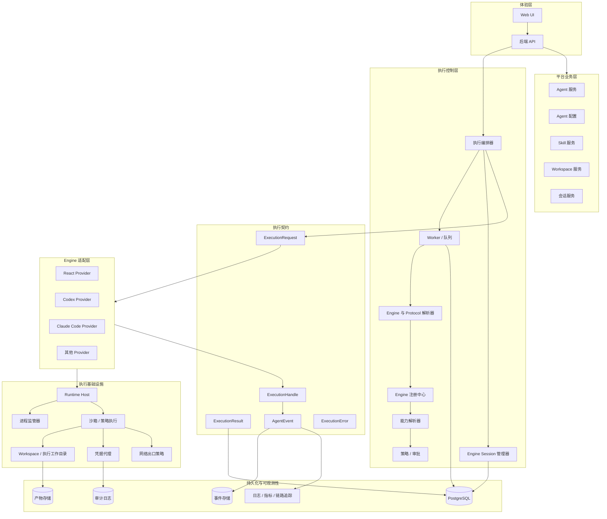
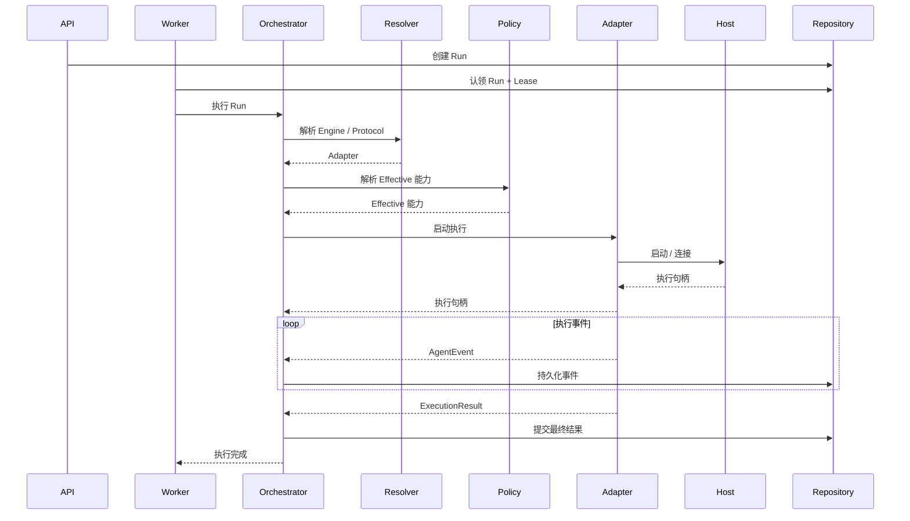

# NexusDesk Agent 执行平台

## 技术架构与演进方案 v2.0

| 项目 | 内容 |
|---|---|
| 项目 | NexusDesk |
| 架构 | 可扩展的 Agent 执行平台 |
| 状态 | 架构基线 |
| 版本 | 2.0 |
| 目标分支 | `integration` |
| 实施策略 | 渐进式重构、向后兼容、安全设计先行 |

> 本文定义目标架构和渐进式实施方案，不表示文中描述的每个组件都已存在。每个实施阶段开始前，都必须针对目标提交重新核验现有实现细节。

---

# 1. 背景与目标

## 1.1 当前架构约束

NexusDesk 已具备实用的执行基础：Agent Runtime、持久化 Worker 队列、Lease/Heartbeat、Run 生命周期管理、运行时事件、Agent 配置以及运行时组合。

但当前执行路径仍以 LangGraph ReAct Runtime 为中心：

- Runtime Engine 负责模型调用、推理循环、工具调用和执行预算。
- Worker 直接调用现有 Runtime，并依赖其输出及历史记录结构。
- Runtime Factory 构造固定的 Runtime 实现。
- 运行时扩展契约尚未提供完整、独立的 Engine Provider 契约。
- Engine Session、Run、Workspace 和 Engine 原生事件尚无完整的跨引擎生命周期模型。
- 外部 CLI 进程管理、凭据注入和隔离执行环境需要专门的抽象。

如果直接在此结构上增加 Codex、Claude Code、OpenClaw、ACP 或其他 Agent 引擎，可能形成并行执行路径，并使 Worker 和 Runtime 中出现引擎专属分支。

## 1.2 目标

从：

`平台 Runtime = LangGraph ReAct Engine`

演进为：

`平台 Runtime = Agent 执行平台`

平台负责执行治理与基础设施：

- Agent 与配置生命周期
- Engine / Protocol / Adapter 注册与解析
- 执行编排与生命周期
- Worker 调度与可靠性
- 能力解析与策略执行
- Engine Session 管理
- Runtime Host 与进程监管
- Workspace 与执行隔离
- 凭据管理
- 事件、产物、用量、审计与可观测性

每个 Engine 保留自己的推理循环、工具执行模型和原生协议。

**统一平台治理，不强制所有 Engine 使用相同的内部推理或工具调用实现。**

## 1.3 设计原则

| 原则 | 含义 |
|---|---|
| 引擎无关 | 平台不与某一个 Agent Engine 耦合 |
| 协议无关 | 一个 Engine 可以通过多种协议接入 |
| 渐进演进 | 重构现有组件，避免一次性整体重写 |
| 契约优先 | 增加 Provider 前先稳定公共执行契约 |
| 能力驱动 | 实际可用功能取决于引擎支持和平台策略 |
| 安全设计先行 | Workspace、凭据、沙箱和网络边界都是架构问题 |
| 事件驱动 | 统一事件外层结构，同时保留原生事件 |
| 向后兼容 | 现有 Agent 配置和历史 Run 保持可用 |
| 模块化单体优先 | 先建立模块边界，再考虑微服务 |

---

# 2. 目标架构

## 2.1 逻辑架构



## 2.2 分层职责

### 平台业务层

负责产品与领域概念：Agent / Agent Version、Agent 配置、会话、Skill Catalog / Binding、Workspace 和 Task。不启动 Engine 进程，也不实现协议细节。

### 执行控制层

负责 Engine 解析、能力与策略评估、Session 协调、Worker 集成以及 Execution 生命周期。决定运行哪个 Engine、哪些能力生效以及如何治理执行。

### 执行契约

定义平台与 Engine Adapter 之间的稳定边界：Request、Handle、Result、Event、Capabilities 和 Error。Engine 原生细节保留在 Adapter 自有的元数据或原生事件中。

### Engine 适配层

实现特定 Engine + Protocol 的集成。Adapter 负责转换请求、原生事件、取消操作和结果，不负责租户授权、全局调度或 Run 持久化。

### 执行基础设施

提供进程生命周期管理、工作目录、沙箱、凭据、网络策略和资源限制。

### 持久化与可观测性

持久化 Run / Execution、Session、Event、Artifact、Usage、Audit 和遥测数据。

---

# 3. 核心领域模型

## 3.1 Task、Execution 与 Run

应区分以下概念：

- **Task**：用户意图或请求的工作单元。
- **Execution**：执行某个 Task 的一次具体尝试。
- **Run**：NexusDesk 现有的运行时记录与生命周期抽象。

首次迁移时定义：

`Run = 一次 Execution 尝试`

暂不引入独立的 Task 表。复用现有 Run 模型并增加必要的执行元数据。当跨引擎重试、任务聚合或一个用户意图对应多次执行成为真实产品需求时，再引入一等 Task 实体。

可能的 Run 元数据：

- `engine_id`
- `protocol_id`
- `adapter_version`
- `engine_session_id`
- `workspace_id`
- `execution_config_snapshot`
- `effective_capabilities_snapshot`
- `execution_metadata`

## 3.2 Conversation、Engine Session 与 Run

| 实体 | 职责 | 生命周期 |
|---|---|---|
| Conversation | 用户与 Agent 之间的业务会话 | 长生命周期 |
| Engine Session | 特定 Engine 持有的原生会话 | 取决于 Engine |
| Run / Execution | 一次执行尝试 | 短生命周期 |

一个 Conversation 可以有多个 Engine Session，一个 Engine Session 可以关联多个 Run。不支持持久会话的 Engine 可以为每个 Run 创建新会话。Session 持久化与恢复属于可选能力，不是通用要求。

## 3.3 Workspace 与执行存储

以下概念应保持独立：

| 资源 | 职责 |
|---|---|
| Workspace | 用户或 Agent 的长期工作区域 |
| Execution Workdir | 单次执行的隔离目录 |
| Skill Store | 共享且带版本的 Skill 内容 |
| Runtime Cache | Engine 运行时缓存 |
| Artifact Store | 执行输出与生成的产物 |
| Credential Mount | 临时、经授权的凭据暴露 |

典型的逻辑布局：

```text
workspace/<tenant>/<workspace-id>/
execution/<execution-id>/{workdir,temp,logs}/
skills/{shared,tenant}/
artifacts/<execution-id>/
```

物理存储布局可以不同。执行目录不得与持久化 Workspace 数据混淆，并应定义明确的导出、保留和清理策略。

---

# 4. Engine、Protocol 与 Adapter

## 4.1 分离概念

Engine 与其连接协议不是同一概念。

例如，Codex 是一个 Engine，可以通过以下方式接入：

- Codex CLI Exec
- Codex App-Server

集成方式表示为：

`(engine_id, protocol_id, adapter_version)`

示例：

```text
(react, native, v1)
(codex, cli_exec, v1)
(codex, app_server, v1)
```

| 概念 | 职责 | 示例 |
|---|---|---|
| Engine | Agent 执行引擎 | `codex` |
| Protocol | 通信 / 调用机制 | `cli_exec`、`app_server` |
| Adapter | 该协议在 NexusDesk 中的实现 | `codex_cli_adapter` |

这样，一个 Engine 可以暴露多种协议，而无需重复定义 Engine 身份。

## 4.2 注册中心职责

引入 Engine Registry、Protocol Registry 和 Adapter Registry，它们应当：

1. 注册 Engine、Protocol 和 Adapter 元数据。
2. 校验受支持的 Engine / Protocol 组合。
3. 根据带版本的标识解析 Adapter。
4. 暴露 Adapter 可用性与健康状态。
5. 明确拒绝未知或不兼容的配置。

不要将所有发现、构造和执行逻辑都放入现有 Runtime Factory。

## 4.3 Adapter 契约

以下只是接口草图，不表示已经实现：

```python
class AgentEngineAdapter(Protocol):
    @property
    def engine_id(self) -> str: ...

    @property
    def protocol_id(self) -> str: ...

    @property
    def adapter_version(self) -> str: ...

    async def get_capabilities(self) -> EngineCapabilities: ...

    async def start(
        self, request: ExecutionRequest
    ) -> ExecutionHandle: ...

    async def stream_events(
        self, handle: ExecutionHandle
    ) -> AsyncIterator[AgentEvent]: ...

    async def cancel(self, handle: ExecutionHandle) -> None: ...

    async def collect_result(
        self, handle: ExecutionHandle
    ) -> ExecutionResult: ...
```

契约要求：

- Adapter 不操作 Worker 队列。
- Adapter 不决定租户权限。
- Adapter 不提交平台 Run 的最终状态。
- Adapter 不绕过 Runtime Host 管理宿主进程生命周期。
- Adapter 可以保留原生 Session 标识和元数据。
- Adapter 必须定义错误与取消语义。
- 不支持的能力必须显式表达。

具体方法形式可以进一步调整，以支持流式处理、长运行进程句柄和协议专属交互。

---

# 5. 执行契约

## 5.1 ExecutionRequest

建议的初始模型：

```python
class ExecutionRequest(BaseModel):
    execution_id: str
    tenant_id: str
    agent_id: str
    conversation_id: str | None = None

    engine_id: str
    protocol_id: str
    adapter_version: str

    engine_session_id: str | None = None
    workspace_id: str | None = None
    execution_workdir: str | None = None

    input: str
    config: dict
    effective_capabilities: dict

    timeout_seconds: int | None = None
    trace_id: str | None = None
```

安全与一致性规则：

- `config` 由经过校验的类型化配置生成。
- `effective_capabilities` 由平台计算，绝不信任客户端传入的值。
- `tenant_id` 来自可信认证上下文。
- 持久化每次 Execution 使用的配置与策略快照。
- 不向不可信客户端暴露宿主进程细节。

## 5.2 ExecutionHandle

表示正在运行的执行：

```python
class ExecutionHandle(BaseModel):
    execution_id: str
    engine_id: str
    protocol_id: str
    provider_session_id: str | None = None
    process_id: int | None = None
    status: str
    metadata: dict = {}
```

进程标识和宿主专属字段属于内部基础设施细节，不应通过公共 API 暴露。

## 5.3 ExecutionResult

```python
class ExecutionResult(BaseModel):
    execution_id: str
    status: str
    output: str | None = None
    artifacts: list[dict] = []
    usage: dict = {}
    engine_metadata: dict = {}
    error: dict | None = None
```

保持公共字段稳定，将 Engine 专属结果数据存放在 Adapter 自有的元数据中。

## 5.4 错误分类

| 错误 | 示例 | 默认重试 |
|---|---|---|
| ConfigurationError | Engine 配置无效 | 否 |
| EngineUnavailable | Engine 未安装 / 不可用 | 取决于策略 |
| ProtocolError | 协议响应无效 | 取决于策略 |
| AuthenticationError | 凭据无效 | 否 |
| PermissionDenied | 策略拒绝操作 | 否 |
| ResourceExhausted | 达到资源配额 | 可能延迟后重试 |
| Timeout | 执行超过截止时间 | 取决于 Task |
| Cancelled | 用户取消 | 否 |
| WorkspaceError | 工作目录准备 / 访问失败 | 取决于策略 |
| InternalError | 平台内部故障 | 视情况而定 |

重试策略必须考虑副作用。超时并不能证明 Engine 没有执行任何工作。

---

# 6. 能力模型

## 6.1 三层能力

不得将 Engine 声明的技术能力视为授权。

1. **Declared（已声明）**：Adapter 声称支持的能力。
2. **Available（可用）**：当前部署和运行时环境实际能够提供的能力。
3. **Effective（生效）**：经过策略评估后，平台允许本次 Execution 使用的能力。

```text
Declared（已声明）
   |
   v
Available（可用）
   |
   v
Policy Resolution（策略解析）
   |
   v
Effective（生效）
```

例如，Codex 技术上可能支持终端执行，但租户策略可能禁止任意 Shell 执行，此时 Effective 能力必须拒绝该操作。

## 6.2 初始能力模型

```python
class EngineCapabilities(BaseModel):
    streaming: bool = False
    persistent_session: bool = False
    session_resume: bool = False
    cancellation: bool = False
    human_approval: bool = False
    interactive_input: bool = False
    tool_calling: bool = False
    file_operations: bool = False
    terminal_execution: bool = False
    native_events: bool = False
    workspace_required: bool = False
```

布尔模型只是起点。更复杂的能力以后可能需要结构化参数、约束和协议版本元数据。

## 6.3 能力解析器

引入专门的解析器，用于：

1. 读取 Adapter 声明的能力。
2. 检查环境可用性与版本兼容性。
3. 加载租户、Agent 和 Execution 策略。
4. 计算 Effective 能力。
5. 持久化生效能力快照。
6. 向 UI 暴露任务可用功能。

**Capability 描述技术支持，Policy 决定平台是否允许。**

---

# 7. 执行编排器与 Worker

## 7.1 编排器职责

Execution Orchestrator 是平台的执行控制中心，负责协调：

- Run 生命周期
- Engine / Protocol 解析
- 能力与策略评估
- Session 协调
- Workspace 准备
- Adapter 调用
- 事件收集
- 结果提交
- 取消与超时

它不实现 Engine 的推理循环。

## 7.2 执行流程



## 7.3 Worker 迁移

保留现有 Worker 队列、Lease / Heartbeat、取消、超时、事件持久化和终态职责。

主要变化是：

**Worker 调用编排器，而不是直接调用具体的 Runtime Engine。**

目标交互方式：

```python
result = await orchestrator.execute(run_context)
```

Worker 无需知道当前 Engine 是 React 还是 Codex、使用 CLI 还是 App-Server，也无需了解其内部推理循环。

## 7.4 终态保护

已取消或超时的 Run 不得被迟到的成功结果覆盖。失去 Lease 的 Worker 不得提交有效的状态转换。通过 Repository 层条件更新实现这一点，并在可靠性阶段逐步引入 Lease Epoch / Fencing Token。

---

# 8. Runtime Host 与进程监管器

## 8.1 为什么需要 Runtime Host

基于 CLI 的 Engine 可能需要 OS 进程、stdin/stdout/stderr 处理、进程树清理、工作目录管理、环境变量注入、超时、资源控制和网络限制。

这些关注点不应嵌入每个 Engine Adapter。

## 8.2 职责边界

| 组件 | 职责 |
|---|---|
| Engine Adapter | 理解 Engine 与 Protocol |
| Runtime Host | 提供受管理的执行环境 |
| Process Supervisor | 负责进程生命周期与清理 |
| Sandbox | 实施隔离与执行策略 |
| Credential Broker | 授权并注入凭据 |
| Workspace Provider | 准备工作目录与挂载 |

建议的模块边界：

```text
agent_execution/host/
  runtime_host.py
  process_runner.py
  process_supervisor.py
  process_registry.py
  resource_manager.py
  host_models.py
```

## 8.3 进程生命周期

定义明确的状态：

```text
Start -> Ready -> Running
                  |
                  +-> Cancel Requested -> Terminating -> Exited
                  |
                  +-> Timeout -> Terminating -> Exited
```

协程取消不等于进程终止。取消操作必须：

1. 向 Engine 进程发送信号。
2. 超过截止时间后升级为强制终止。
3. 清理子进程和进程组。
4. 释放已分配资源。
5. 持久化正确的终态。

## 8.4 隔离

不得以 NexusDesk API 或 Worker 宿主的完整权限运行不可信 Agent 命令。

逐步建设：

- 隔离的 Runtime Host。
- 容器或等效沙箱。
- CPU、内存、PID、磁盘和时间限制。
- Workspace 路径限制。
- 网络出口策略。
- Task 级凭据。

如果不可信用户可以提交代码执行任务，那么沙箱、租户隔离、凭据隔离和网络策略是该能力上线的阻断条件，而不是可选的未来增强项。

---

# 9. Workspace 与文件管理

引入 Workspace Provider，负责 Workspace 访问、Execution Workdir 创建、文件挂载、Skill 挂载、产物导出和清理。

建议的边界：

```text
agent_execution/workspace/
  workspace_provider.py
  workspace_manager.py
  execution_workdir.py
  workspace_policy.py
```

执行生命周期：

```text
创建 / 解析 Workspace
          |
          v
准备 Execution Workdir
          |
          v
挂载代码仓库 / Skills
          |
          v
运行 Engine
          |
          v
收集变更 / 产物
          |
          v
持久化结果
          |
          v
清理或保留
```

初期在安全的前提下复用现有存储。只有在评估容量、延迟和成本后，才考虑专用卷、带执行子目录的租户卷、共享只读 Skill Store、Overlay / 快照和对象存储。

所有文件系统操作都必须防止路径穿越、符号链接逃逸、跨租户访问和未授权覆盖。

---

# 10. 凭据代理与安全

## 10.1 目标流程

```text
凭据保险库
       |
       v
凭据代理
       |
       v
租户 / Execution 授权
       |
       v
短期凭据
       |
       v
Runtime Host / 沙箱
```

保险库职责：

- 加密存储凭据。
- 凭据版本管理。
- 轮换与吊销。
- 未来与 KMS / Secret Manager 集成。

代理职责：

- 验证租户身份。
- 验证 Agent / Execution 授权。
- 验证目标 Engine 与凭据范围。
- 注入短期凭据。
- 记录使用审计。

## 10.2 安全要求

严禁：

- 在 Agent 配置中存储明文 API Key。
- 将 Token 写入日志或普通 Runtime Event。
- 默认将宿主的 `~/.codex/auth.json` 复制到租户执行环境。
- 在无隔离的情况下跨租户共享凭据目录。

初始实现可以使用受控的环境变量注入或 Secret 挂载，但接口应支持未来演进为独立的 Credential Broker。

---

# 11. Engine 指令与 Skill

## 11.1 Engine 指令 Provider

不同 Engine 可能使用不同的指令文件名、发现规则、Skill 格式和上下文注入机制。

引入 Instruction Provider 边界：

```text
agent_execution/instructions/
  instruction_provider.py
  react_instruction_provider.py
  codex_instruction_provider.py
  instruction_renderer.py
```

公共输入可以包括 System Prompt、Conversation Context、Memory / Summary、Skill Definitions 和 Workspace Context。每个 Provider 将这些输入渲染为其 Engine 所需的格式。

## 11.2 平台 Skill 与 Engine Skill Adapter

平台 Skill 至少应包含：

- 名称
- 描述
- 版本
- 内容
- 权限
- 来源
- 校验和

Engine Skill Adapter 将平台 Skill 转换为 Engine 专属的目录布局和指令格式。

不要将某一个 Engine 的 Skill 文件格式作为全平台标准。Skill 需要版本管理、来源验证和权限检查。

---

# 12. 事件架构

## 12.1 统一事件外层结构

扩展现有 Runtime Event，而不是整体替换事件系统。

建议的外层结构：

```python
class AgentEvent(BaseModel):
    event_id: str
    schema_version: str
    execution_id: str
    engine_session_id: str | None = None
    sequence: int
    event_type: str
    source: str
    timestamp: datetime
    payload: dict
    trace_id: str | None = None
```

字段说明：

- `event_id`：全局唯一的事件标识，用于去重。
- `schema_version`：事件模型版本。
- `sequence`：单次 Execution 内的顺序。
- `source`：platform 或 engine_native。
- `payload`：事件专属内容。

## 12.2 平台事件与原生事件

平台事件表示稳定的业务语义，例如：

```text
run.started
run.completed
run.failed
run.cancelled
engine.session.started
engine.session.completed
message.delta
tool.started
tool.completed
approval.required
approval.resolved
artifact.created
usage.updated
execution.error
```

原生事件保留 Engine 专属语义，例如：

```text
codex.turn.started
codex.command.started
codex.command.completed
codex.file.changed
codex.approval.requested
```

不要将每个原生命令或事件都转换为 ReAct Tool Calling 抽象。

## 12.3 可靠性改进

持续改进：

- 事件模型版本管理。
- 顺序与重复检测。
- 事件持久化与事务性 Outbox。
- SSE 重连与基于游标的重放。
- 原生事件保留。
- 解析失败诊断。
- 幂等用量聚合。
- Run 终态与最终事件的一致性。

---

# 13. Engine Session 管理

当第一个支持持久会话的 Engine 需要时，引入专门的 Session Manager 和 Repository。

建议表：`agent_engine_sessions`

| 字段 | 说明 |
|---|---|
| id | 平台 Session ID |
| tenant_id | 租户 |
| conversation_id | 关联会话 |
| engine_id | Engine |
| protocol_id | Protocol |
| adapter_version | Adapter 版本 |
| provider_session_id | Engine 原生 Session ID |
| workspace_id | Workspace |
| status | Session 状态 |
| metadata | Engine 专属元数据 |
| created_at / updated_at | 时间戳 |
| expires_at | 过期时间 |

要求：

- 每个 Engine 可以选择是否支持 Session 持久化。
- 恢复时必须重新检查授权与策略。
- 过期 Session 必须释放关联资源。
- Engine 专属元数据必须保持版本化并归 Adapter 管理。

---

# 14. Agent 配置演进

## 14.1 向后兼容

现有 Agent 配置包含 `system_prompt`、`tool_names`、`knowledge_base_ids`、`max_model_rounds`、模型 Profile 标识与版本、回复语言以及摘要 / 记忆设置等字段。

不得破坏现有已发布 Agent 快照，也不得强制用户修改所有现有配置。

## 14.2 目标配置结构

示例 YAML：

```yaml
engine:
  engine_id: react
  protocol_id: native
  adapter_version: v1

react:
  model_profile_id: default
  model_profile_version: 1
  max_model_rounds: 10

codex:
  approval_mode: on-request
  sandbox_mode: workspace-write
  timeout_seconds: 1800
```

要求：

- `engine` 选择通用 Engine / Protocol。
- Engine 专属部分使用类型化配置。
- 缺少 Engine 选择时默认使用 `react`。
- 通过兼容层映射旧字段。
- 避免使用无边界的通用配置字典。
- 为每次 Execution 快照保存解析后的配置、Adapter 版本、策略版本和 Effective 能力。

---

# 15. 与现有 NexusDesk 模块的映射

以下映射基于此前检查的 `integration` 分支。实施前必须针对目标提交重新核验。

| 现有模块 | 当前职责 | 目标演进 |
|---|---|---|
| `agent_runtime/engine.py` | LangGraph ReAct 执行 | 封装 / 迁移为 React Engine Provider |
| `agent_runtime/worker.py` | 队列、Lease、Run 生命周期 | 保留；改为调用编排器 |
| `agent_runtime/repository.py` | Run 与事件持久化 | 扩展执行元数据、Session 和事件可靠性 |
| `agent_runtime/schemas.py` | Runtime 模型 | 逐步分离公共执行契约 |
| `runtime_factory.py` | 构造固定 Runtime | Engine / Protocol 解析 |
| `runtime_composition.py` | Runtime 依赖组合 | 组合编排器、注册中心、Host 和 Provider |
| `extension_contracts/runtime.py` | Run / Runtime 契约 | 保持兼容；抽取 Engine 契约 |
| `agent_config/service.py` | Agent 配置与校验 | 增加类型化 Engine / Protocol 配置 |
| Runtime Events | Runtime 事件与 SSE | 增加带版本的外层结构和原生事件支持 |

约束：

1. 第一阶段不得删除当前 LangGraph Runtime。
2. 不得让 Worker 负责 Engine 解析和进程监管。
3. 不得将 Engine 建模为普通 Capability Plugin 的子类型。
4. 不得将 Extension Registry 变成容纳所有执行逻辑的容器。
5. 不得为了接入 Codex 而破坏现有 React 调用或历史数据。

---

# 16. 建议的代码结构

以下是目标逻辑结构，不要求一次性创建所有文件。

```text
backend/src/agent_platform/
├── core_platform/
│   ├── agent_runtime/
│   │   ├── worker.py
│   │   ├── repository.py
│   │   └── schemas.py
│   └── agent_execution/
│       ├── contracts/
│       │   ├── request.py
│       │   ├── handle.py
│       │   ├── result.py
│       │   ├── events.py
│       │   ├── capabilities.py
│       │   └── errors.py
│       ├── orchestration/
│       │   ├── orchestrator.py
│       │   ├── execution_context.py
│       │   └── execution_lifecycle.py
│       ├── registry/
│       │   ├── engine_registry.py
│       │   ├── protocol_registry.py
│       │   └── adapter_registry.py
│       ├── capability/
│       │   ├── capability_resolver.py
│       │   └── capability_policy.py
│       ├── session/
│       ├── host/
│       ├── workspace/
│       ├── credentials/
│       ├── instructions/
│       └── adapters/
│           ├── react/
│           ├── codex/
│           └── testing/
│               └── local_test_adapter.py
├── applications/
│   └── platform_runtime/
│       ├── runtime_factory.py
│       └── runtime_composition.py
├── extension_contracts/
│   └── runtime.py
└── business_capabilities/
    └── agent_config/
        └── service.py
```

从 `contracts`、`registry`、`orchestration` 和 `adapters/react` 开始，其他包在对应阶段启动时再增加。

---

# 17. 分阶段实施路线图

## 阶段 0 — 基线与盘点

**优先级：P0**

目标：重构前建立经过核验的基线。

工作：

1. 重新检查最新的 `integration` 分支。
2. 梳理 Runtime Engine、Worker、Repository、Factory 和组合依赖。
3. 记录 Run 状态转换与当前事件语义。
4. 盘点 Agent 配置和已发布快照的兼容性。
5. 确定 Engine / Protocol / Adapter 标识。
6. 记录测试覆盖率和当前 ReAct 行为。
7. 为现有执行行为建立回归测试。

交付物：

- 架构基线。
- Runtime 依赖图。
- Run 生命周期图。
- Agent 配置兼容方案。
- 重构检查清单。

验收：

- 现有 Run 从创建到终态的流程已记录。
- Worker / Runtime 职责明确。
- 现有 Agent 配置仍可加载。
- 现有 ReAct 行为有自动化回归覆盖。

## 阶段 1 — 执行契约与注册中心

**优先级：P0**

目标：建立标准集成边界。

工作：

1. 定义 ExecutionRequest、ExecutionHandle、ExecutionResult、ExecutionError、AgentEvent 和 EngineCapabilities。
2. 定义契约与 Adapter 版本管理。
3. 实现 Engine Registry。
4. 实现 Protocol Registry。
5. 实现 Adapter Registry。
6. 校验 Engine / Protocol 兼容性。
7. 构建 LocalTestAdapter 和初版契约测试。

暂不包含：

- Codex 集成。
- 完整 Runtime Host。
- 复杂调度器。
- 独立 Task / Execution 表。

验收：

- 无需修改公共契约即可增加新 Engine。
- Engine 和 Protocol 可以独立注册。
- 注册中心能够解析有效的 Adapter。
- 不支持的能力能够显式表达。
- 契约测试可以独立于外部 Engine 运行。

## 阶段 2 — React Provider 与执行编排器

**优先级：P0 — 首个主要重构里程碑**

目标：让现有 LangGraph Runtime 成为第一个 Engine Provider。

工作：

1. 保留现有 ReAct 推理实现。
2. 在其外部增加 React Engine Adapter。
3. 从固定 Runtime Factory 中抽取 Engine 选择逻辑。
4. 实现执行编排器。
5. 修改 Worker 以调用编排器。
6. 统一 ExecutionResult 和 ExecutionError。
7. 逐步将现有 Runtime Event 映射为 AgentEvent。
8. 保持现有 API 与 SSE 行为。
9. 增加功能开关，支持受控迁移和回滚。

验收：

- 现有 Agent 继续正常执行。
- Worker 不再直接依赖具体 Engine。
- React 通过注册中心解析。
- 编排器管理完整 Execution。
- 现有 Run 和事件行为无回归。
- 迁移期间可以切换新旧路径。

## 阶段 3 — 能力、配置与指令

**优先级：P0**

目标：支持多 Engine 配置与能力治理。

工作：

1. 在 Agent 配置中增加 Engine ID、Protocol ID 和 Adapter 版本。
2. 旧配置默认使用 React。
3. 引入类型化 Engine 专属配置。
4. 实现 Declared、Available 和 Effective 能力解析。
5. 增加能力解析器并集成策略。
6. 引入 Engine Instruction Provider。
7. 将现有 Context / Summary / Memory 注入适配为 Engine 专属格式。
8. 持久化解析后的配置与能力快照。

验收：

- 旧 Agent 无需手工修改即可运行。
- 新 Agent 可以选择 Engine 和 Protocol。
- Engine 专属设置通过类型化模型校验。
- 客户端不能指定 Effective 能力。
- 指令渲染可以因 Engine 而异。
- 每次 Execution 都可以追溯到其解析后的配置和策略。

## 阶段 4 — Runtime Host、进程监管器与 Workspace

**优先级：P1**

目标：为外部 Engine 提供受管理的执行环境。

工作：

1. 定义 Runtime Host 接口。
2. 实现 Process Runner 和 Process Supervisor。
3. 实现超时、取消和进程树清理。
4. 引入 Workspace Provider 和 Execution Workdir。
5. 定义挂载与清理策略。
6. 增加资源限制。
7. 定义 Sandbox Provider 接口。
8. 增加宿主健康状态与进程可观测性。

验收：

- 外部 Engine 生命周期不只绑定到 Worker 协程。
- 可以检测并清理孤儿进程。
- 取消操作会停止实际 Engine 进程。
- 每次 Execution 都获得隔离的工作目录。
- 阻止跨租户路径访问。
- CPU、内存、PID、磁盘和时间限制可配置。
- Runtime Host 独立于具体 Engine Adapter。

## 阶段 5 — Codex 集成

**优先级：P1**

目标：通过第一个外部 Engine 验证架构。

### 阶段 A：Codex CLI Exec

从较简单的 CLI 执行路径开始：

1. 实现 Codex CLI Adapter。
2. 验证受支持的 Codex 版本。
3. 映射请求与 Engine 配置。
4. 通过 Runtime Host 启动。
5. 在适当情况下将 stdout / stderr 解析为平台事件。
6. 保留原始或规范化后的原生事件。
7. 收集最终结果和用量。
8. 实现超时与取消。
9. 集成 Workspace。
10. 执行凭据与执行策略。

### 阶段 B：Codex App-Server

仅在 CLI 路径稳定后：

1. 实现 App-Server Protocol Adapter。
2. 管理 JSON-RPC 连接生命周期。
3. 管理原生 Session。
4. 映射 Session / Turn / Run。
5. 实现流式处理。
6. 适配审批与交互输入。
7. 在支持的情况下增加 Session Resume。
8. 管理协议版本兼容性。

将 App-Server 协议细节保留在 Provider 内部，不要将其私有 JSON-RPC 协议暴露为 NexusDesk 公共 API。

验收：

- Codex 在隔离的 Workspace 中执行。
- CLI 和 App-Server 共享 Codex Engine 身份。
- 各协议独立注册。
- 保留原生事件。
- 取消、超时和错误正确传播。
- React 不受影响。
- 凭据与文件访问受策略控制。

## 阶段 6 — 安全、可靠性与事件治理

**优先级：P1；不可信多租户代码执行前必须完成**

工作：

安全：
- 凭据保险库与代理。
- Execution 级凭据授权。
- Secret 脱敏。
- 沙箱与网络出口策略。
- 文件系统隔离。
- 凭据轮换、吊销与审计。

可靠性：
- Lease Epoch / Fencing Token。
- Worker 丢失检测。
- 迟到结果保护。
- 终态保护。
- 取消确认。
- 超时清理。
- 重试分类。
- 配额释放与恢复。

事件：
- 模型版本管理。
- 顺序与事件去重。
- Event Store / Outbox。
- SSE 重放与重连。
- 幂等用量聚合。
- 原生事件解析诊断。

验收：

- 过期 Worker 不能覆盖更新的执行结果。
- 重复事件不会导致重复计算用量或计费。
- 凭据不会泄漏到日志或事件。
- 租户 Workspace 保持隔离。
- Worker 故障后，执行进入可恢复状态或终态。
- 进程清理、配额释放和终态保持一致。

## 阶段 7 — 高级 Engine 能力与规模化

**优先级：P2**

目标：扩展 Engine 生态并支持高级工作流。

潜在工作：

- Claude Code、ACP、OpenClaw、远程及自定义 Engine Adapter。
- 多 Engine 路由与回退。
- Session Resume。
- 人工审批与交互输入。
- 动态模型选择。
- 统一 Engine 用量与成本报告。
- 租户公平性与全局配额。
- 共享 Skill Store 与 Artifact Store。
- Runtime Profile 以及 Adapter 健康检查 / 熔断。

验收：

- 增加 Engine 无需修改 Worker 核心逻辑。
- 增加 Protocol 无需修改公共 Engine 契约。
- 不具备高级能力的 Engine 仍可完成基本执行。
- UI 反映 Effective 能力。
- 回退不能绕过租户策略或安全边界。

---

# 18. 持续改进待办

以下事项应持续跟踪，并非首次迁移的全部前置条件。

## 18.1 Engine 生态

- [ ] 动态 Engine 发现。
- [ ] Engine / Protocol 兼容性矩阵。
- [ ] Adapter 版本生命周期。
- [ ] Adapter 健康检查。
- [ ] Adapter 金丝雀发布。
- [ ] Adapter 降级与熔断。
- [ ] Runtime Profile。
- [ ] Engine 成本与用量报告。
- [ ] Engine 能力文档。

## 18.2 执行可靠性

- [ ] 在有充分依据时实现一等 Task / Execution 分离。
- [ ] 幂等 Task 创建。
- [ ] Task 优先级。
- [ ] 租户公平性。
- [ ] 全局并发配额。
- [ ] Worker 恢复。
- [ ] 重试分类。
- [ ] 副作用幂等。
- [ ] 跨 Worker Fencing。
- [ ] 资源恢复与故障演练。

## 18.3 Session 管理

- [ ] Session 生命周期。
- [ ] Session 过期与清理。
- [ ] Session Resume。
- [ ] Session / Workspace 绑定。
- [ ] 恢复时重新校验权限。
- [ ] Engine 元数据版本管理。
- [ ] 多 Session 策略。

## 18.4 安全

- [ ] KMS / Secret Manager 集成。
- [ ] 凭据保险库。
- [ ] 凭据代理。
- [ ] 短期凭据。
- [ ] 凭据轮换与吊销。
- [ ] 网络出口策略。
- [ ] 强沙箱隔离。
- [ ] 容器镜像扫描。
- [ ] Workspace 逃逸测试。
- [ ] 跨日志、事件和产物的 Secret 扫描。
- [ ] Engine 命令审计。

## 18.5 Workspace、Skill 与 Artifact

- [ ] Workspace 快照。
- [ ] Execution Workdir 生命周期。
- [ ] Skill 版本与内容哈希。
- [ ] Skill 来源验证。
- [ ] 共享只读 Skill Store。
- [ ] Engine Skill Adapter。
- [ ] Artifact 授权。
- [ ] Artifact 保留。
- [ ] 大型 Artifact 对象存储。
- [ ] Workspace 成本分析。

## 18.6 可观测性

- [ ] OpenTelemetry。
- [ ] 跨 API / Worker / Engine 的链路传播。
- [ ] 执行时长。
- [ ] 队列等待时间。
- [ ] Engine 启动时间。
- [ ] Token 与用量指标。
- [ ] Runtime Host 资源指标。
- [ ] 进程退出监控。
- [ ] Adapter 错误率。
- [ ] 租户级成本分析。
- [ ] 审计保留。
- [ ] 运维仪表盘与告警。

## 18.7 开发者体验

- [ ] Adapter 开发指南。
- [ ] Adapter 模板。
- [ ] LocalTestAdapter。
- [ ] 契约测试套件。
- [ ] Engine 集成测试工具。
- [ ] Mock Runtime Host。
- [ ] 本地开发环境搭建。
- [ ] Engine 升级流程。
- [ ] 故障排查手册。
- [ ] Adapter 贡献指南。

---

# 19. 测试与质量门禁

## 19.1 契约测试

每个 Adapter 都必须通过公共契约测试套件：

- [ ] 启动执行。
- [ ] 流式事件。
- [ ] 收集结果。
- [ ] 取消执行。
- [ ] 超时。
- [ ] Engine 不可用。
- [ ] 配置无效。
- [ ] 协议错误。
- [ ] 重复事件。
- [ ] 延迟事件。
- [ ] 用量收集。

## 19.2 LocalTestAdapter

提供不依赖外部 Engine 的确定性测试 Adapter。它应能模拟成功、失败、流式处理、长运行执行、超时、取消、进程故障、重复与延迟事件以及资源耗尽。

用于编排器、Worker、事件、UI 和恢复测试。

## 19.3 集成测试

至少包括：

1. 完整 React 执行。
2. 完整 Codex CLI 执行。
3. Worker 重启与恢复。
4. Engine 进程崩溃。
5. 执行超时。
6. 用户取消。
7. Workspace 隔离。
8. 凭据注入与吊销。
9. 租户授权。
10. 平台事件 / 原生事件关联。

## 19.4 CI 质量门禁

每个阶段都必须保留适用的检查：

- 后端单元测试。
- 契约测试。
- 类型检查。
- Lint。
- 数据库迁移测试。
- 集成测试。
- 执行隔离与凭据安全测试。

架构重构 PR 应保持小巧。不要将核心迁移和多个 Engine 功能实现合并到一个大型 PR 中。

---

# 20. 首次迁移的明确非目标

在需求得到验证前，避免引入额外复杂度。

1. **暂不拆微服务**：先采用模块化单体。
2. **暂不整体重写调度器**：复用现有 Worker 队列、Lease 和 Heartbeat。
3. **暂不采用 Task / Execution 双表模型**：初期将 Run 定义为一次 Execution 尝试。
4. **不强制支持 Session**：Session Resume、审批和交互输入属于可选能力。
5. **不强制规范化原生事件**：统一外层结构，保留 Engine 语义。
6. **不提前优化共享存储**：更改租户存储边界前先进行基准测试。
7. **不允许不可信任务直接在宿主执行**：隔离是不可信代码执行的上线要求。

---

# 21. 建议的 PR 顺序

| 顺序 | PR 范围 | 优先级 |
|---|---|---|
| 1 | 执行契约模型 | P0 |
| 2 | Engine / Protocol / Adapter 注册中心 | P0 |
| 3 | LocalTestAdapter 与契约测试 | P0 |
| 4 | React Engine Adapter | P0 |
| 5 | 执行编排器 | P0 |
| 6 | Worker 与编排器集成 | P0 |
| 7 | Agent 配置的 Engine / Protocol 兼容 | P0 |
| 8 | 能力解析器 | P0 |
| 9 | Instruction Provider | P0 |
| 10 | Runtime Host / 进程监管器 | P1 |
| 11 | Workspace Provider | P1 |
| 12 | Codex CLI Adapter | P1 |
| 13 | 凭据代理 / 沙箱 | P1 |
| 14 | 事件可靠性 / Fencing Token | P1 |
| 15 | Codex App-Server Adapter | P1 |
| 16 | Claude / ACP / 其他 Engine Adapter | P2 |

每个 PR 都应说明：

- 范围与非目标。
- 变更的文件 / 模块。
- 兼容性要求。
- 自动化测试。
- 数据库迁移（如有）。
- 功能开关与回滚策略（如适用）。
- 验收标准。

---

# 22. 架构验收标准

不要仅以集成 Engine 的数量衡量成功。

## 解耦

- [ ] React 不再是唯一固定的 Runtime 实现。
- [ ] Worker 不直接依赖具体 Engine。
- [ ] Engine、Protocol 和 Adapter 是独立概念。
- [ ] 编排器管理公共 Execution 生命周期。
- [ ] 增加 Engine 无需修改 Worker 核心逻辑。

## 执行治理

- [ ] Run / Execution 具有公共生命周期。
- [ ] 在支持的情况下独立管理 Engine Session。
- [ ] 事件具有带版本的公共外层结构。
- [ ] 取消、超时和失败具有明确语义。
- [ ] 结果具有幂等性和终态保护。

## 安全

- [ ] 不可信 Engine 不以不受限的 API 宿主权限运行。
- [ ] Workspace 访问按租户隔离。
- [ ] 每次 Execution 都有受控的工作目录。
- [ ] 凭据不会进入普通日志或事件。
- [ ] 执行权限经过策略检查。
- [ ] 网络与资源访问受到控制。

## 可扩展性

- [ ] React 通过公共契约运行。
- [ ] Codex 可以通过多种 Protocol 接入。
- [ ] 新 Engine 可以实现独立 Adapter。
- [ ] 根据 Engine 和任务解析能力。
- [ ] 原生事件不会破坏公共契约。
- [ ] 契约测试验证新 Adapter。

## 可运维性

- [ ] 可以监控并回收 Engine 进程。
- [ ] Worker 故障可恢复。
- [ ] 事件可追踪、可去重。
- [ ] 执行可审计。
- [ ] 用量可聚合。
- [ ] 关键故障有仪表盘和告警。

---

# 23. 最终架构定位

NexusDesk 的目标是成为一个**可扩展的 Agent 执行平台**。

它不只是一个 LangGraph ReAct Runtime，也不是几个 CLI Agent 外面的薄 API 包装，而是一个治理 Agent Engine、Protocol、Execution、Session、Workspace、Capability、Policy 和 Runtime 基础设施的平台。

核心子系统：

1. **Agent Engine 注册中心**——注册并解析 Engine / Protocol / Adapter 实现。
2. **执行契约**——定义平台与 Engine 之间的稳定边界。
3. **执行编排器**——协调执行生命周期与治理。
4. **能力与策略**——解析能力并执行权限与审批。
5. **Runtime Host**——管理进程、运行时环境和隔离。
6. **Workspace 与凭据基础设施**——治理文件、工作目录和凭据。
7. **可观测性**——管理事件、用量、审计、日志和链路追踪。

指导原则：

> 统一平台治理，而不是统一 Engine 内部实现。
> 扩展 Engine 之前，先稳定执行契约。
> 先迁移 React，再接入 Codex。
> 启用不可信代码执行之前，先建立安全边界。
> 考虑服务拆分之前，先完成模块化。
> 让每个阶段都可测试、可回退、可演进。
