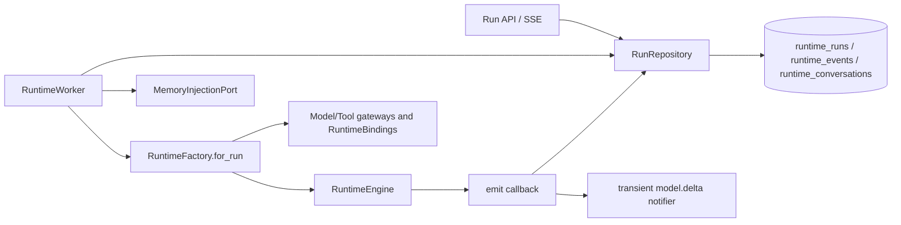

# Phase 0 · Baseline and Inventory — Technical Design

> Status: In progress (implementation started on 2026-11-07)
> Created: 2026-11-02
> Basis: `02-requirements.md` (FR-1–FR-6, AC-1–AC-6), architecture Sections 15 and 17
> Verification boundary: planning inspected `integration` at `fb3f424`; this current-state baseline is bound to `c6c47dec39025ebd4d1176c1e9925bac9c99c4fd`, with the later artifact commit recorded separately

## Change Overview

| Layer | File | Change |
|---|---|---|
| Baseline artifact | `docs/requirement/agent-execution-platform-v2/phase-0-baseline-inventory/baseline/runtime-dependencies.md` (+`.en.md`) | Target commit, dependency graph, interfaces, and test mappings |
| Baseline artifact | `baseline/run-lifecycle-events.md` (+`.en.md`) in the same directory | Actual transitions, event semantics, races, and differences from target behavior |
| Baseline artifact | `baseline/configuration-compatibility.md` (+`.en.md`) in the same directory | Fixture provenance, coverage matrix, compatibility results, and existing defects |
| Baseline artifact | `baseline/regression-baseline.md` (+`.en.md`) in the same directory | Commands, environment, two runs, coverage/duration, and CI links |
| Baseline artifact | `baseline/refactoring-checklist.md` (+`.en.md`) in the same directory | Identifiers, phase checks, open items, and entry conditions |
| Tests | `backend/tests/test_runtime_baseline.py` | Freeze Worker/Engine result, event, and error behavior; split by current conventions if needed |
| Tests | `backend/tests/test_runtime_postgres.py` | Add missing lifecycle/race baselines without duplicating existing coverage |
| Tests | `backend/tests/test_agent_config_execution_compat.py` | Historical configuration, published-snapshot, and boundary-fixture compatibility |
| Test data | `backend/tests/fixtures/agent_execution_baseline/` | Sanitized, versioned, minimal JSON fixtures and inventory |
| Test tooling | `backend/scripts/runtime_baseline.py` | Parse JUnit counts, skip reasons, and `(classname, name)` outcomes; exit nonzero for added/missing/changed nodes between runs |
| Dev dependencies | `backend/pyproject.toml`, `backend/uv.lock` | Add `pytest-cov` to the dev group only; production dependencies remain unchanged |
| Current dependencies | `core_platform/agent_runtime/{engine,worker,repository,schemas}.py` | Read-only inspection; no production refactoring in this phase |
| Current composition | `applications/platform_runtime/{runtime_factory,runtime_composition}.py`, `business_capabilities/agent_config/service.py`, `extension_contracts/runtime.py` | Read-only inspection and interface mapping |

**Data model and migrations**: no new table, column, or backfill; no migration number is assigned. The actual target head is `0057_industry_pack_runtime` and must remain unchanged after this phase; later phases revalidate their own implementation-time head. Do not alter existing `agents.draft`, `agent_versions.config`, or `runtime_runs.config` structures to fit a future model.

## Current Execution Dependency Baseline (Revalidate During Execution)



Add exact references for actual API, Composition, and test entry points, distinguishing construction-time from per-Run dependencies. Record compatibility exports under `modules/` if present, but do not treat them as a second implementation.

## Core Flows

### 1. Pin the Commit and Build Inventory Evidence

```text
Confirm clean target commit and SHA
  → Run existing affected tests and preserve raw results
  → Trace API/Composition to Worker/Repository/Factory/Engine in both directions
  → Register interfaces, owners, events, data access, and test mappings
  → Before later phases, compare the new SHA and append deltas rather than overwriting history
```

Every finding includes `path:line` or a test node as evidence. Use `unknown` where verification is impossible; never infer current support from target architecture.

### 2. Freeze the Actual Run and Event State Machine

Inspect at least these current paths:

| Start | Trigger | Currently recorded outcome/behavior |
|---|---|---|
| `queued` | Successful `claim` | `running`, with owner/lease set |
| `running` | Normal return | `completed`, with output/history and `run.completed` |
| `running` | RuntimeFault/general exception/execution timeout | `failed`, mapped to existing error codes |
| `queued` | Cancel | Directly `cancelled` |
| `running` | Cancel | Cancellation request; Worker/Repository cooperate toward `cancelled`; late completion cannot overwrite it |
| `running` | Lease loss or reaper | `failed(worker_lost)` or the corresponding existing behavior |
| `queued` | Queue deadline/reaper | `failed(queue_timeout)`; freeze cancellation precedence from code |
| Any terminal state | Ordinary late finish | The conditional `finish` update does not match and silently does nothing; it cannot overwrite the terminal state |
| `running`/terminal | Ordinary illegal append | `append` fails its status/owner/lease/cancellation checks and raises `CancelledError` |
| Any state | `DurableToolReplayCache.put` | Special internal `tool.replay` write path without all ordinary append protections; document separately rather than claiming uniform terminal protection |

The event inventory separately records durable events and transient `model.delta` notifications, sequence origins, strict-greater-than SSE `after`/`Last-Event-ID` replay, terminal-event fields, and secret boundaries. The internal `tool.replay` cache event may consume a durable sequence number; public SSE hides its payload while advancing the cursor. This does not establish that ordinary execution events can bypass protection. If this table differs from actual code, revise it with evidence before writing tests.

### 3. Build Configuration Compatibility Fixtures

```text
Extract and sanitize authorized historical draft/published configs
  + construct default, minimal, maximum-boundary, unknown/invalid-field fixtures
  → Inventory fixture version, source category, covered fields, expected result (never secrets)
  → AgentConfig.model_validate + existing publish/snapshot paths
  → Compare raw reads, publication materialization, and Run snapshots separately
  → Assert source drafts/existing versions are not rewritten by later operations; retain existing defaults and error semantics
```

Create/update/publish currently materialize defaults. Raw draft/version reads and `snapshot()` return stored JSON without guaranteeing that validation defaults are materialized in the returned object. Valid publication integration fixtures must retain the core keys that `snapshot()` reads before Pydantic validation; record the limitation of extremely sparse raw versions rather than rewriting samples to claim compatibility. Fixtures contain no real tokens, URL credentials, customer content, or identifiable personal information. If a real sample cannot enter the repository, retain only field shapes and sanitized values and document the evidence limitation.

### 4. Establish and Measure the Regression Baseline

- Run existing `test_runtime_engine.py`, `test_runtime_postgres.py`, `test_runtime_availability.py`, `test_runtime_scope.py`, and Agent Config/API/SSE tests before filling gaps, avoiding duplication.
- Mock models/tools cover success, empty output, budgets, errors, and cancellation; PostgreSQL cases construct lease/cancellation/terminal races directly rather than waiting in real time.
- The project initially has no coverage tooling. Add `pytest-cov` to the dev group and measure with `--cov=agent_platform --cov-report=term --cov-report=json:<external-evidence-path>`. Never record unmeasured coverage as 0%; do not add meaningless tests for a percentage. Report behavioral coverage alongside line coverage.
- `runtime_baseline.py summary` reads tests/failures/errors/skipped/time and node outcomes from JUnit XML; missing counts must not default to zero. `compare` aligns `(classname, name)` nodes and reports added, missing, pass/failure/error/skipped/xfail/xpass changes, and skip-reason changes. Node differences exit nonzero; duration differences are not behavioral differences.
- Execute twice in the same clean environment, each against its own migrated, isolated PostgreSQL database. Preserve full commands, UTC timestamps, dependency versions, `-rA`, `--durations=0`, JUnit XML, coverage JSON, pass/fail/skip/xfail counts, and duration. Keep environment-calibration failures separate from the formal double run. Add CI links when available.

### 5. Freeze Identifiers and the Checklist

- Initial production identifier: `(react, native, v1)`; Engine, Protocol, and Adapter dimensions are named independently, not by Python class name.
- LocalTestAdapter uses the fixed independent test tuple `(local-test,scripted,v1)`, which must not collide with production React, become a production Agent default, or serve as evidence of real process supervision.
- Initially `Run = one Execution attempt`; Phase 1 defines the mapping between `execution_id` and the existing Run ID without creating a Task table.
- Map checklist entries to Phase 1–7 compatibility, rollback, migration, security, and regression requirements, identifying mandatory baseline tests.

## Configuration

No settings or AgentConfig fields are added. Tests provide model, lease, event-cursor, and similar inputs through existing constructors/fixtures without introducing production flags.

## Model Invocation Path

Baseline tests use the existing model-gateway and mock/demo boundaries and never call external paid models directly. Real models may be used only for separately labeled non-blocking compatibility observations, never in the deterministic baseline. Usage remains in existing `gateway_calls`; no new usage model is introduced.

## Test Overview

| Layer | Cases |
|---|---|
| Unit | Engine result/error/budget, Worker invocation shape, configuration normalization and invalid inputs |
| Integration | PostgreSQL lifecycle/lease/cancellation/terminal states, event persistence and SSE cursors, draft→publish→snapshot |
| Regression | Existing runtime, agent config, API/SSE suites; two-run and skip/xfail differences |
| Non-functional | Coverage/duration baseline, fixture secret scanning, test determinism |

See `04-test-plan.md` for detailed cases.

## Rollout and Rollback

- Tests and documents can merge independently, with no database migration or production-path switch.
- If new tests expose existing failures, do not skip them; use the defect-decision process. Revert only the affected test/document changes to roll back this phase.
- Any necessary production-defect fix requires a separate small commit, before/after evidence, and a baseline update; do not mix it into bulk inventory changes.
- Phase 1 entry requires AC-1–AC-6, zero unresolved P0/P1 items, and confirmation that target-SHA deltas were reviewed.
