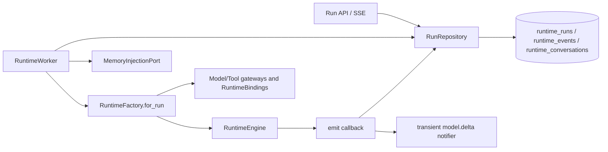

# Phase 0 · 基线与盘点 — 技术落地文档

> 状态：进行中（2026-11-07 开始实施）
> 创建：2026-11-02
> 依据：`02-requirements.md`（FR-1–FR-6、AC-1–AC-6）、架构文档第 15、17 节
> 核查边界：规划时核查点为 `integration` 的 `fb3f424`；本次现状基线绑定 `c6c47dec39025ebd4d1176c1e9925bac9c99c4fd`，含新增测试的产物提交另行记录

## 改动总览

| 层 | 文件 | 改动 |
|---|---|---|
| 基线产物 | `docs/requirement/agent-execution-platform-v2/phase-0-baseline-inventory/baseline/runtime-dependencies.md`（+`.en.md`） | 目标提交、依赖图、接口和测试映射 |
| 基线产物 | 同目录 `baseline/run-lifecycle-events.md`（+`.en.md`） | 实际状态转换、事件语义、竞态与目标差异 |
| 基线产物 | 同目录 `baseline/configuration-compatibility.md`（+`.en.md`） | fixture 来源、覆盖矩阵、兼容结果与既有缺陷 |
| 基线产物 | 同目录 `baseline/regression-baseline.md`（+`.en.md`） | 命令、环境、两次结果、覆盖率/耗时和 CI 链接 |
| 基线产物 | 同目录 `baseline/refactoring-checklist.md`（+`.en.md`） | 标识、分阶段检查项、未决项和入口条件 |
| 测试 | `backend/tests/test_runtime_baseline.py` | 固定 Worker/Engine 的结果、事件和错误行为；按现状拆分文件亦可 |
| 测试 | `backend/tests/test_runtime_postgres.py` | 补充缺失的生命周期/竞态基线，不复制既有覆盖 |
| 测试 | `backend/tests/test_agent_config_execution_compat.py` | 历史配置、发布快照和边界 fixture 兼容 |
| 测试数据 | `backend/tests/fixtures/agent_execution_baseline/` | 脱敏、版本化、最小化 JSON fixture 与清单 |
| 测试工具 | `backend/scripts/runtime_baseline.py` | 解析 JUnit 计数、skip 原因与 `(classname, name)` 节点结果；双跑有新增/缺失/结果差异时非零退出 |
| 开发依赖 | `backend/pyproject.toml`、`backend/uv.lock` | 仅 dev group 增加 `pytest-cov`，生产依赖不变 |
| 现状依赖 | `core_platform/agent_runtime/{engine,worker,repository,schemas}.py` | 只读核查；本阶段不做生产重构 |
| 现状组合 | `applications/platform_runtime/{runtime_factory,runtime_composition}.py`、`business_capabilities/agent_config/service.py`、`extension_contracts/runtime.py` | 只读核查并建立接口映射 |

**数据模型与迁移**：无新增表、列或数据回填；不分配迁移号。目标提交实际 head 为 `0057_industry_pack_runtime`，本阶段完成后必须保持不变；后续阶段实施时重核各自 head。不得为让 fixture 符合未来模型而修改 `agents.draft`、`agent_versions.config` 或 `runtime_runs.config` 的现有结构。

## 当前执行依赖基线（待执行时复核）



必须补充实际 API、Composition 和测试入口的精确引用，区分构造期依赖与每次 Run 依赖。`modules/` 下的兼容导出若仍存在，也应记录但不能当作第二实现。

## 核心流程

### 1. 锁定提交与建立盘点证据

```text
确认干净目标提交与 SHA
  → 运行现有受影响测试，保存原始结果
  → 从 API/Composition 向 Worker/Repository/Factory/Engine 双向追踪
  → 登记接口、owner、事件、数据读写与测试映射
  → 后续阶段开工前比较新 SHA，更新差异而非覆盖历史基线
```

所有结论带 `path:line` 或测试节点证据。无法验证的项目使用 `unknown`，禁止由架构目标反推“当前已支持”。

### 2. 固化 Run 与事件实际状态机

至少核查以下现有路径：

| 起点 | 触发 | 当前记录终点/行为 |
|---|---|---|
| `queued` | 成功 `claim` | `running`，设置 owner/lease |
| `running` | 正常返回 | `completed`，写 output/history 与 `run.completed` |
| `running` | RuntimeFault/普通异常/执行超时 | `failed`，映射既有 error code |
| `queued` | cancel | 直接 `cancelled` |
| `running` | cancel | 设置取消请求，Worker/Repository 协同到 `cancelled`，禁止迟到 completed 覆盖 |
| `running` | lease 丢失或 reaper | `failed(worker_lost)` 或既有对应行为 |
| `queued` | queue deadline/reaper | `failed(queue_timeout)`；取消优先规则按代码固化 |
| 任意终态 | 普通迟到 finish | `finish` 的条件更新不匹配，静默 no-op，不覆盖终态 |
| `running`/终态 | 普通非法 append | `append` 的状态/owner/lease/取消检查失败并抛 `CancelledError` |
| 任意状态 | `DurableToolReplayCache.put` | 特殊内部 `tool.replay` 写入路径，不具备普通 append 的全部防护；单独记录，不概括为统一终态保护 |

事件清单需分别记录持久事件与 `model.delta` 瞬态通知、序号来源、SSE `after`/`Last-Event-ID` 严格大于游标的重放语义、终态事件字段和敏感信息边界。`tool.replay` 的内部缓存事件可能消耗持久序号，公开 SSE 隐藏其 payload 但仍推进游标；该现状不用于证明普通执行事件可绕过保护。发现表中所列与实际代码不符时，以证据修订本文后再写测试。

### 3. 建立配置兼容 fixture

```text
经授权提取并脱敏历史 draft/published config
  + 构造缺省、最小、最大边界、未知/非法字段样本
  → 清单记录 fixture 版本、来源类别、覆盖字段、预期结果（不记录秘密）
  → AgentConfig.model_validate + 现有 publish/snapshot 路径
  → 分别比较 raw 读取、发布物化和 Run snapshot 的返回形状
  → 断言源 draft/既有 version 不被后续操作隐式改写，保留既有默认值与错误语义
```

create/update/publish 当前会物化默认值；raw draft/version 读取及 `snapshot()` 返回存储 JSON，不保证把校验默认值写回返回对象。合法的发布集成 fixture 必须保留当前 `snapshot()` 在 Pydantic 校验前直接读取的核心键；极稀疏 raw version 的现有限制单独记录，不能通过改写样本伪报兼容。fixture 不存放真实 Token、URL 凭据、客户内容或可识别个人信息。真实样本无法入库时，只保存字段形状和脱敏值，并在覆盖报告中说明证据边界。

### 4. 建立与度量回归基线

- 先运行现有 `test_runtime_engine.py`、`test_runtime_postgres.py`、`test_runtime_availability.py`、`test_runtime_scope.py` 及 Agent Config/API/SSE 相关测试，再补空白，避免重复。
- mock 模型/工具覆盖成功、空输出、预算、异常与取消；PostgreSQL 用例直接构造租约/取消/终态竞态，不依赖秒级真实等待。
- 项目原先没有覆盖率工具；本阶段在 dev group 增加 `pytest-cov`，以 `--cov=agent_platform --cov-report=term --cov-report=json:<外部证据路径>` 测量。不得把未测量写成 0%，不为追求百分比添加无意义测试；报告同时列行为覆盖清单。
- `runtime_baseline.py summary` 从 JUnit XML 读取 tests/failures/errors/skipped/time 和节点结果；缺失计数不得默认填 0。`compare` 以 `(classname, name)` 对齐，比较新增、缺失、pass/failure/error/skipped/xfail/xpass 变化和 skip 原因变化，有节点差异时非零退出，耗时变化不计作行为差异。
- 同一干净环境连续执行两次，各自使用已迁移的隔离 PostgreSQL 数据库，保存完整命令、UTC 时间、依赖版本、`-rA`、`--durations=0`、JUnit XML、覆盖率 JSON、通过/失败/skip/xfail 数量和耗时；环境校准失败单独保留，不混入正式双跑。CI 链接在可用后补入。

### 5. 冻结标识与检查清单

- 初始生产标识：`(react, native, v1)`；Engine、Protocol、Adapter 三个维度分别命名，不以 Python 类名作为公共标识。
- LocalTestAdapter 固定使用独立测试三元组 `(local-test,scripted,v1)`，不与生产 React 冲突；不得作为生产 Agent 默认解析值或真实进程监管能力证明。
- 首次迁移保持 `Run = 一次 Execution 尝试`，`execution_id` 与现有 Run ID 的映射在 Phase 1 明确，不创建 Task 表。
- 检查清单逐项映射 Phase 1–7 的兼容、回滚、迁移、安全和回归要求，并指定必须重跑的基线测试。

## 配置

本阶段不新增 settings 或 AgentConfig 字段。测试所需的模型、租约、事件游标等输入通过现有构造参数/fixture 提供，不引入新的生产开关。

## 模型调用路径

基线测试沿用现有模型网关与 mock/demo 模型边界，不直接调用外部付费模型。真实模型仅可用于单独标识的非阻断兼容性观测，结果不得混入确定性基线；用量沿用现有 `gateway_calls` 记录，不新增用量模型。

## 测试方案

| 层 | 用例 |
|---|---|
| 单测 | Engine 结果/错误/预算、Worker 调用形状、配置 fixture 规范化与非法输入 |
| 集成 | PostgreSQL 生命周期/租约/取消/终态、事件持久化与 SSE 游标、草稿→发布→快照 |
| 回归 | 现有 runtime、agent config、API/SSE 相关套件；两次结果与 skip/xfail 差异 |
| 非功能 | 覆盖率与耗时基线、fixture 敏感信息扫描、测试确定性 |

详细用例见 `04-test-plan.md`。

## 上线与回滚

- 本阶段测试和文档可独立合并，无数据库迁移、无生产路径切换。
- 若仅新增测试导致 CI 暴露既有失败，不得跳过；先按缺陷流程裁定。测试本身的回滚为 revert 对应测试/文档提交。
- 如确需修复生产缺陷，必须另起小提交，附前后行为证据并更新基线；不得与本阶段盘点批量混合。
- Phase 1 入口要求：AC-1–AC-6 通过，P0/P1 未决项清零，后续阶段确认目标 SHA 差异已复核。
