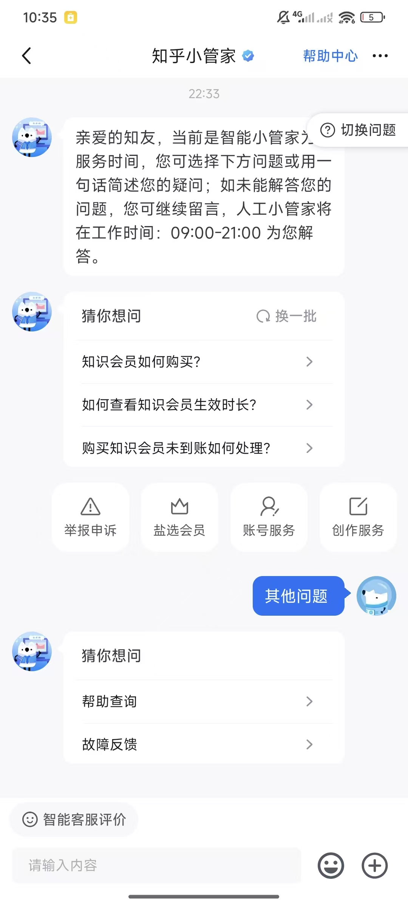
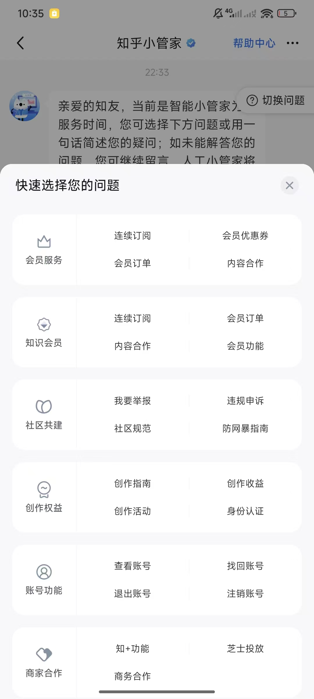
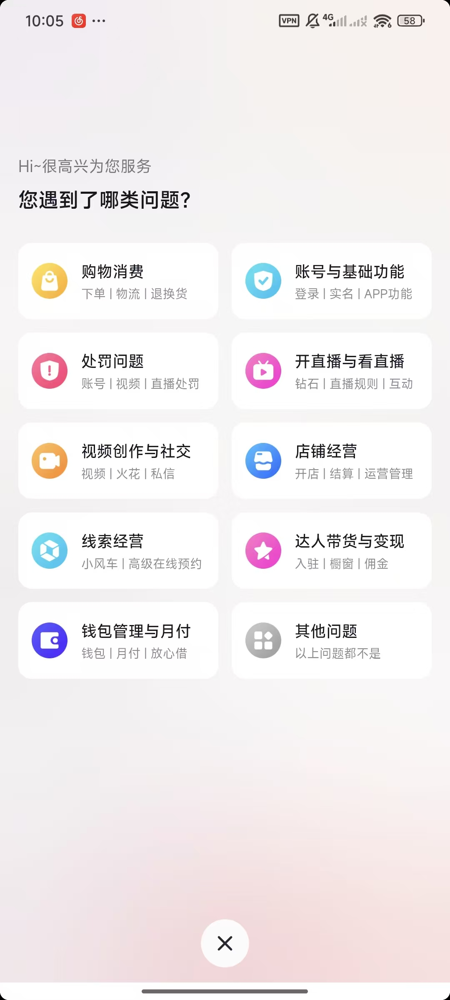
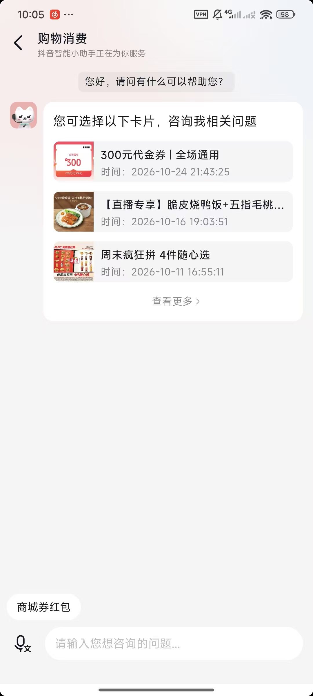
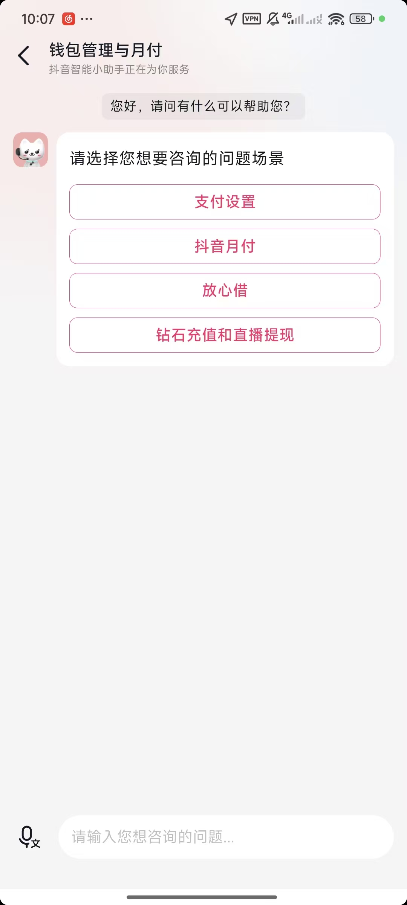
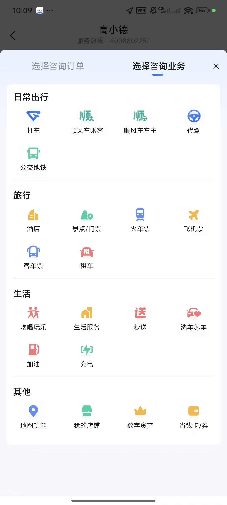
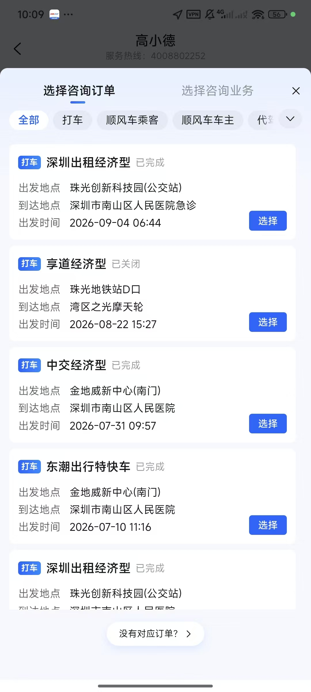
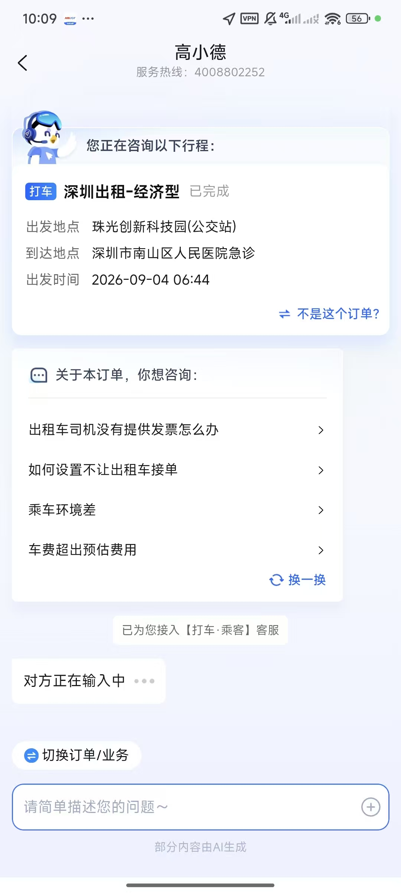

# Zhihu / Douyin / Gaode Smart Customer Service Case Analysis

> Type: product case study (not a phase implementation plan)
> Evidence: 8 customer-client screenshots from three products: Zhihu, Douyin and Gaode
> Purpose: extract the common pattern of "business scenario → product capability → handling" in smart customer service, giving NexusDesk's service scenario model and the later Direct / Interaction / business context design a product basis
> Boundary: the screenshots only reflect what the client shows; they cannot tell us whether the internals use rules, a model, a workflow or manual configuration. The "mechanisms" described here are generalisations at the level of product behaviour

## 0. Summary of conclusions

The three products serve different businesses, but none of them drops the user straight into a "universal chat box". They share the same product structure:

**The service catalogue helps the user find the task, the business object establishes the context, and the conversation carries the rest of the handling.**

More concretely, the commonality is not "they all have shortcut buttons" but the following six mechanisms:

1. **Narrow the problem domain first, then land on a specific task.** Zhihu, Douyin and Gaode all offer problem categories; the categories lower the cost of expressing a problem rather than replacing natural language.
2. **One scenario allows multiple entry points.** Users can enter from a category, from a recommended question, from an order or trip card, or simply type freely.
3. **Business objects are introduced only when a task needs them.** Some tasks need nothing but a knowledge answer and no order; others cannot be answered until the user has selected an order or trip.
4. **Once an object is bound, the conversation context changes with it.** Gaode's "You are asking about the following trip" is the most complete context-binding example of the three cases.
5. **Recommended questions inside a scenario are dynamic.** Recommendations depend on the current business domain, object status and object fields rather than on a globally fixed FAQ.
6. **A wrong object, no object, another question and handoff to a human are all first-class product paths.** Gaode's "No matching order?", "Not this order?" and "Switch order/business" show that the exceptional cases are not patches but part of the main flow.

The three products have different emphases:

| Product | Most distinctive product feature | Most worth borrowing |
|---|---|---|
| Zhihu | A multi-level service catalogue spanning knowledge, membership, community and creator services | Category navigation + FAQ recommendations + free text side by side |
| Douyin | Industry problem domains + recent business object cards + scenario buttons | Using the user's most recent business objects to lower lookup cost |
| Gaode | Dual entry points (business catalogue and order list), recommended questions after an order is bound | Business object selection, context binding, exception fallback and handoff with context |

The most important product judgement in this document is:

> **Do not model around an "Interaction Flow / process engine"; model around the service scenario behind the customer task.**
>
> A flow is only one way to implement a scenario; the same scenario may need nothing more than a single Direct answer, or it may need to look up a business object, call tools, enter an Agent and finally hand off to a human. The scenario should stay stable while the execution method stays replaceable.

---

## 1. Analysis framework

To keep the screenshot analysis from turning into a page-by-page UI description, this document uses a five-stage framework:

```text
Customer task → Business object → Business facts → User decisions → Handling
```

| Layer | Question it answers | Example |
|---|---|---|
| Customer task | What the user actually wants to get done, not which menu they clicked into | Look up a recent order, ask about invoicing rules, report the ride environment |
| Business object | Which business entity the task revolves around | Order, trip, membership, account, creator content, store |
| Business facts | The minimum information the user needs in order to confirm the object and decide | Order status, origin/destination, time, amount, membership expiry |
| User decisions | Which explicit choices the user has to make in the product | Select an order, select a question, confirm "not this one", switch business |
| Handling | Which capability completes the request after the choice | Direct answer, knowledge retrieval, tool query, Agent reasoning, human agent |

This document also separates "product mechanism" from "technical implementation":

- Product mechanism answers what the user sees, how they choose, how fallback works and what the administrator configures.
- Technical implementation answers whether to use rules or a model, synchronous or asynchronous, how the tables are built and how the APIs are called.
- This document covers only the former; the latter has to be mapped once there is consensus on the scenarios.

> Note: the screenshots from the three products are not one continuous user journey. The two Zhihu screenshots are two states of one entry point; the three Douyin ones show the problem domains, the shopping object cards and the wallet scenario selection; the three Gaode ones show the business catalogue, the order list and the conversation after an order is bound. This document analyses them state by state and does not force them into a single path.

---

## 2. Case 1: Zhihu Assistant

### 2.1 Screenshots and observations

<p>
  
</p>

*Figure 1: the Zhihu Assistant home screen, with service hours, "you may want to ask", problem domain entry points, free-text input and "Other questions".*

The home screen shows four kinds of entry point at once:

- **Service notice**: states that this is the smart assistant, the human service hours, and that the user can leave a message and wait.
- **Recommended questions**: "How do I buy a Knowledge Membership?", "How do I check how long my Knowledge Membership is valid?", "What if a Knowledge Membership purchase has not arrived?"
- **Top-level problem domains**: reporting and appeals, Yanxuan membership, account services, creator services.
- **Free-text input**: the user can describe the problem in one sentence or just send "Other questions".

This is not simply "chat plus shortcut buttons". It is doing three things at once:

1. telling the user the bot's capability boundary and the human service hours;
2. lowering the cost of expressing a problem with high-frequency questions and domain entry points;
3. keeping free-text input so the user is not boxed in by the catalogue.

<p>
  
</p>

*Figure 2: the "Quickly select your question" panel, which expands into more specific tasks per service domain.*

The panel is structured as:

```text
Service domain (icon + name) → specific tasks (2–4)
```

For example:

| Service domain | Specific tasks |
|---|---|
| Membership services | Recurring subscription, membership orders, membership coupons, content partnerships |
| Knowledge membership | Recurring subscription, membership orders, content partnerships, membership features |
| Community co-governance | Report a problem, appeal a violation, community guidelines, anti-harassment guide |
| Creator rights | Creator guide, creator earnings, creator campaigns, identity verification |
| Account features | View account, recover account, sign out, close account |
| Merchant partnerships | Zhi+ features, Cheese ad delivery, business partnerships |

### 2.2 Product abstraction

| Layer | How it appears in the Zhihu case |
|---|---|
| Customer task | Buying membership, checking membership duration, chasing an undelivered purchase, reporting, appealing, account recovery, creator rights, etc. |
| Business object | Membership, order, account, reported object, creator content, merchant partnership project |
| Business facts | Membership status, order status, account status, content/account object; the screenshots do not show any detail page |
| User decisions | Pick a service domain, then a specific task, or type freely |
| Handling | Knowledge answers, business lookups, appeal/feedback flows, human message drop-off; the screenshots do not show the internal implementation |

### 2.3 Design worth borrowing

1. **A layered catalogue reduces cognitive load.** The home screen shows only top-level domains; the specific tasks appear after a tap. The user never faces dozens of questions at once.
2. **Recommended questions sit alongside the catalogue.** High-frequency questions can be tapped directly, low-frequency ones can be found through the catalogue, and unclear ones can be typed freely.
3. **"Other questions" is an explicit exit.** It keeps users from leaving because they cannot find a category.
4. **Service hours and the message drop-off come first.** Before asking for a human, the user already knows whether anyone is online and whether they will have to wait, which avoids wrong expectations.
5. **Category names use the user's language.** "Reporting and appeals", "account services" and "creator rights" are business words users understand, not internal system module names.

### 2.4 Limitations and what cannot be copied directly

- The screenshots show entry points and task selection; they do not show task execution, object confirmation, failure fallback or handoff details.
- With a wide catalogue the user may still not know which domain to pick, so "you may want to ask" and free-text input must stay.
- Membership, account, community and creator businesses are handled very differently; a single generic "submit a question" action cannot handle them all.
- If every specific task only jumps to a static FAQ, the catalogue becomes a "longer help centre"; a real scenario also needs object lookup, status judgement and action handling.

### 2.5 Implications for NexusDesk

The Zhihu case is the best reference for the combination of **service catalogue + FAQ recommendations + free input**, especially for advisory scenarios. It reminds us:

- The first level of the catalogue should be the business domain, not a technical module;
- Under each domain should be customer tasks, not API names;
- Recommended questions should be configurable per tenant, channel and scenario;
- The catalogue is not the only entry point; "Other questions" and natural language must stay.

---

## 3. Case 2: Douyin smart assistant

### 3.1 Screenshots and observations

<p>
  
</p>

*Figure 3: the Douyin problem-domain home screen, "What kind of problem did you run into?".*

The Douyin home screen uses nine problem-domain cards:

| Problem domain | Sub-tasks revealed by the card subtitle |
|---|---|
| Shopping and spending | Ordering, logistics, returns and exchanges |
| Account and basic features | Sign-in, real-name verification, app features |
| Penalties | Account, video and livestream penalties |
| Going live and watching live | Diamonds, livestream rules, interaction |
| Video creation and social | Videos, Sparks, direct messages |
| Store operations | Opening a store, settlement, operations management |
| Lead generation | Little Windmill, advanced online booking |
| Creator commerce and monetisation | Onboarding, showcase window, commission |
| Wallet management and monthly pay | Wallet, monthly pay, Fangxin Jie |
| Other questions | None of the above |

Two details matter here:

- **The problem-domain cards are not just titles.** The subtitle lists the keywords inside the domain, which helps the user decide "which one should I tap".
- **"Other questions" sits alongside the business domains.** It is not a small text link but an explicit choice.

<p>
  
</p>

*Figure 4: after entering "Shopping and spending", the assistant shows cards for the orders/coupons the user can ask about recently, while keeping "View more" and free-text input.*

This screenshot shows another key mechanism: **give the object first, then let the user ask.**

The assistant does not start with "what exactly is your problem"; it shows:

- a CNY 300 voucher;
- a livestream-exclusive product;
- the "Weekend Madness" 4-item pick;
- "View more" on the right;
- the shortcut keyword "mall coupon red packet" at the bottom.

The user can tap a card and settle "which business object am I asking about" up front. The object card itself carries a name, thumbnail, time and an identifiable description, which lowers the cost of "how do I describe my order".

<p>
  
</p>

*Figure 5: after entering "Wallet management and monthly pay", four scenario buttons narrow the problem down further.*

The follow-up choices in the wallet scenario are:

- Payment settings
- Douyin Monthly Pay
- Fangxin Jie
- Diamond top-up and livestream withdrawal

It uses button-based "domain → sub-scenario" selection instead of dropping straight into chat. Free-text input is still available at the bottom, which shows that structured selection need not exclude natural language.

### 3.2 Product abstraction

| Layer | How it appears in the Douyin case |
|---|---|
| Customer task | Asking about a coupon/order, resolving a shopping and spending problem, managing payments and monthly pay, learning about livestreaming and withdrawal |
| Business object | Coupon, order, product, wallet, monthly pay account, livestream diamonds |
| Business facts | Coupon name, product name, time, order/spending object; the card shows the facts needed for identification first |
| User decisions | Pick a problem domain, pick an object card, pick a sub-scenario, view more or type freely |
| Handling | Product/order enquiries, knowledge answers, business actions, human agents; the internal implementation is not visible |

### 3.3 Design worth borrowing

1. **Problem-domain cards carry a "sub-task hint".** The user does not have to tap in to find out whether a domain covers their problem.
2. **Recent-object cards are a very strong low-cost entry point.** In transaction businesses, "pick an object" is usually easier than "describe the problem".
3. **Object cards are paired with "View more".** Recent objects come first, but the user is not limited to what the platform recommends.
4. **Free-text input survives the selection.** The structured entry point narrows the scope, while chat handles open questions.
5. **Different domains can use different interaction forms.** Shopping and spending can use object cards, wallet management can use scenario buttons, and not every domain needs the same form.

### 3.4 Limitations and what cannot be copied directly

- "Recent objects" require the business system to provide a stable, explainable candidate list; inaccurate recommendations create new cognitive load.
- Object cards show only a few fields, so the user may still need "View more" or search; the no-result case and fallback for old objects must be designed.
- The screenshots cannot establish whether the cards come from the current account's real orders, nor whether permission filtering exists; product-wise, "show only objects the user is allowed to see" must be a hard constraint, not a recommendation-ranking concern.
- The wallet scenario buttons are still a static catalogue and cannot replace the status lookup, failure handling and human escalation that follow.

### 3.5 Implications for NexusDesk

The Douyin case is the best reference for the combination of **problem domains + recent business objects + scenario buttons**, especially for transaction and account scenarios. It reminds us:

- A business object can be an entry point in its own right; there is no need to always ask for the intent first;
- The object candidate list should be ordered by "recent, relevant, actionable" rather than being a plain exhaustive list;
- Scenario buttons suit narrow sub-domains but must come with "View more / Other questions";
- For order enquiries, have the user confirm "which object" first, then ask "what exactly is the problem".

---

## 4. Case 3: Gaode's "Gaoxiao De"

### 4.1 Screenshots and observations

<p>
  
</p>

*Figure 6: the Gaode support entry offers two tabs, "Select an order to ask about" and "Select a business to ask about".*

Gaode splits the entry point into two explicit dimensions:

- **Select an order to ask about**: around the transaction object the user already has;
- **Select a business to ask about**: around business types and rules.

The catalogue under the business tab is grouped by area of daily life:

| Area | Business |
|---|---|
| Daily travel | Ride-hailing, carpool passenger, carpool driver, designated driver, bus and metro |
| Travel | Hotels, attractions/tickets, train tickets, flight tickets, coach tickets, car rental |
| Life | Food and entertainment, life services, instant delivery, car wash and maintenance, refuelling, charging |
| Other | Map features, my store, digital assets, savings cards/coupons |

The value of this design is that **"I have an order" and "I want to ask about business rules" are two different starting points.** The former should bind an object first, while the latter can go straight into knowledge or business enquiries.

<p>
  
</p>

*Figure 7: the order list supports filtering by business; order cards show the status and key facts, and offer "Select" and "No matching order?".*

The component hierarchy of the order selection page is very clear:

1. **Horizontal business filter**: all, ride-hailing, carpool passenger, carpool driver, designated driver, etc.;
2. **Order card**: business type, product type, status, origin, destination, departure time;
3. **Per-object action**: select;
4. **No-result exit**: no matching order?

Here "status" and "origin/destination/time" are the minimum business facts the user needs to confirm the object; the card does not pile up every order field.

<p>
  
</p>

*Figure 8: after a trip is selected, the assistant shows the object being asked about, context-driven recommended questions, the business support queue it connects to, and "Switch order/business".*

This screenshot is the most complete example of "context binding" among the three cases:

- The top states clearly "You are asking about the following trip";
- It shows the trip status, origin, destination and time;
- It offers "Not this order?" for correction;
- It recommends questions based on the current trip: "What if the taxi driver did not provide an invoice", "How do I stop taxis from accepting my orders", "Poor ride environment", "Fare exceeded the estimate";
- It supports "Shuffle";
- It states "Connected to [Ride-hailing · Passenger] support";
- It offers "Switch order/business";
- The bottom still allows a free-text description of the problem.

### 4.2 Product abstraction

| Layer | How it appears in the Gaode case |
|---|---|
| Customer task | Asking about a particular trip, invoicing, setting order-acceptance preferences, reporting the ride environment, handling a fare dispute, asking about business rules |
| Business object | Trip/order, business type, support queue |
| Business facts | Product type, order status, origin, destination, departure time, fare-related context |
| User decisions | Select order/business, filter by business, select a specific order, confirm it is not that order, select a recommended question, switch object |
| Handling | Context-driven recommended questions, business knowledge, order-related tool queries, transfer to business support, free-text input |

### 4.3 Design worth borrowing

1. **Dual entry points for orders and businesses.** One support entry supports both "start from the object" and "start from the business rules" instead of forcing every user to pick an order first.
2. **Filtering combined with object cards.** When there are many orders, filter by business first and then choose among the cards, so a long list stays readable.
3. **Show the binding explicitly once the object is bound.** "You are asking about the following trip" tells the user what the AI currently understands and prevents answers to the wrong question.
4. **Allow the object to be corrected.** "Not this order?" is an extremely important product exit; without it, a wrong binding poisons the whole conversation.
5. **Recommended questions are driven by the current object.** Invoicing, order-acceptance settings, the ride environment and fare disputes all relate to the trip type and status; they are not generic FAQs.
6. **Handoff carries business context.** The user is connected to the "Ride-hailing · Passenger" support queue, not a generic human queue.
7. **The context can be switched at any time.** "Switch order/business" saves the user from re-entering support for a new question.
8. **Free-text input is always kept.** Structured recommendations are an accelerator, not a fence.

### 4.4 Limitations and what cannot be copied directly

- The screenshots cover only the ride-hailing scenario and cannot prove that every business domain has consistent object selection and context binding.
- The fields, filters and statuses of the order list depend on the business system, and different business objects have different "minimum identification facts".
- The recommended questions look context-dependent, but the screenshots cannot show how they are generated; product-wise they should be configurable, previewable and covered by fallback.
- The queue mapping, queue status and out-of-hours handling of the handoff are invisible in the screenshots and have to be designed separately.

### 4.5 Implications for NexusDesk

The Gaode case is the best benchmark for **"look up my order/trip"** and the best reference for **object binding + context-driven recommendations + handoff with context**. It reminds us:

- "An order problem" is not one scenario; it should be split into at least "check order status", "ask about order rules", "handle after-sales" and "report a service problem";
- Object selection is not a step in a generic flow but an interaction capability of a specific scenario;
- Once an object is bound, an object summary must be shown, along with correction and switching;
- A handoff should carry the business domain, the object reference, the question the user already selected and the necessary business facts.

---

## 5. Side-by-side comparison of the three cases

| Dimension | Zhihu | Douyin | Gaode |
|---|---|---|---|
| Primary entry points | Free chat + recommended questions + service domains | Problem-domain cards + recent-object cards + scenario buttons | Order/business dual tabs + business catalogue |
| Catalogue levels | Service domain → specific task | Problem domain → sub-scenario/object | Business area → business → order |
| Natural language | Stressed on the home screen ("describe it in one sentence") | An input box is kept at every stage | Free description survives object binding |
| Business objects | Has membership, account and content objects, but the screenshots show no picker | Objects bound via recent order/coupon cards | Explicit selection and binding from the order list |
| When the object is chosen | Most tasks can start with the question | Some domains pick a recent object first | The order entry picks the object first, the business entry picks the rule first |
| Context display | No explicit object summary | The object card itself hints at the context | "You are asking about the following trip" + object summary |
| Context-driven recommendations | "You may want to ask" on the home screen | Enquiries continue after the object card | Questions recommended from order status and type |
| Error correction | Not shown | Not shown | "Not this order?" / "Switch order/business" |
| No-result fallback | "Other questions" | "View more" / free-text input | "No matching order?" |
| Handoff to a human | States human service hours and allows a message | Not shown in the screenshots | Connects to a specific business support queue |
| Best-fit business modes | Advisory | Lookup, selection, advisory | Lookup, selection, transaction, tracking |

### 5.1 They share no single "correct path"

The three cases show that no single fixed order works for every business.

There are at least three common orders:

```text
Problem domain → Specific task → (optional) object → Answer/handling
Problem domain → Recent object → Object binding → Specific question
Order/business → Object selection → Object binding → Context-driven recommendations → Answer/handling/handoff
```

The product model therefore should not hard-code the order as "pick a category, then an order, then a question". A better formulation is:

> **A scenario defines the required inputs and the optional inputs; the interaction decides from context what to ask first and what to ask later.**

This is also why a "scenario card" suits the admin side better than a "generic flowchart": the administrator configures scenario constraints and materials, not a single line that every user must walk.

---

## 6. Extracting the common patterns

### 6.1 The service scenario is the smallest product unit

All three products express "what the customer wants to get done" in some way:

- Zhihu: membership orders, account recovery, reporting and appeals;
- Douyin: shopping and spending, wallet management, livestream penalties;
- Gaode: ride-hailing trips, invoicing, fare disputes.

These are not technical modules and not single FAQs but **a customer task + a business object + an acceptable handling result**.

We suggest treating the "service scenario" as the basic unit of product configuration, containing at least:

- who the customer is;
- what task they want to get done;
- which business object it revolves around;
- which business facts are needed;
- which choices the user has to make;
- which capability handles it;
- how it falls back on failure;
- how completion is measured.

### 6.2 One scenario, many entry points

The same scenario can have all of these at once:

- a natural language entry point;
- a question catalogue entry point;
- a recommended question entry point;
- a business object entry point;
- a recent activity entry point;
- an external system redirect entry point.

An entry point is "how you reach the scenario", not the scenario itself. The product should let one scenario be reused by many entry points instead of duplicating a flow for each entry point.

### 6.3 Business objects are introduced as tasks need them

The three cases use business objects to different degrees, but the logic is the same:

| Object strategy | When it applies | Example |
|---|---|---|
| No object needed | Generic rules, how to buy, feature descriptions | Zhihu "How do I buy a Knowledge Membership" |
| Implicit object | Current account, current membership, current conversation | Zhihu account services, Douyin wallet |
| Optional object | More accurate with an object, still answerable without one | Order rule enquiries |
| Required object | Cannot be judged or executed without binding an object | Gaode "Fare exceeded the estimate" |
| Multi-object selection | The same user has several related objects | Gaode order list, Douyin recent cards |

The key question is not "should we do object selection" but **declaring in the scenario card whether the object is required, optional or not needed**.

### 6.4 Business facts serve identification and decision-making

An object card is not an order detail page. It shows only the minimum facts the user needs to confirm the object and make a decision:

- Gaode: status + origin + destination + time;
- Douyin: object name + thumbnail + time;
- Zhihu: task name + service domain.

Product design principles:

1. Answer "is this the object I meant" first;
2. then "what state is this object in now";
3. then "what can I do with it";
4. never cram every field into the entry point.

### 6.5 Recommended questions must be context-dependent

Zhihu's "you may want to ask" is a home-screen-level recommendation, whereas Gaode's recommended questions clearly depend on the current trip. They are not the same kind of recommendation.

We suggest splitting recommended questions into three layers:

| Layer | Basis | Example |
|---|---|---|
| Globally frequent | Tenant, channel, time window | How to reach a human, service hours |
| Scenario-frequent | Current service scenario | How to buy a membership, how to get an invoice |
| Object-specific | Object type, status, fields | Something is wrong with this trip's fare, this order has not arrived |

Object-specific recommendations must refresh when the object changes and must offer "Shuffle" or "View more", so the recommendation set does not become too narrow.

### 6.6 Failure and fallback are first-class product objects

All three cases provide some kind of exit:

- Zhihu: other questions, free-text input, human message drop-off;
- Douyin: view more, free-text input, other questions;
- Gaode: no matching order, not this order, switch order/business, specific business support.

This shows that mature products do not treat "the user cannot find it" as an exception but as a normal path.

We suggest every scenario define at least the following fallbacks:

| Fallback type | Product question |
|---|---|
| No object | What happens when the user has no order/record |
| Object mismatch | What happens when the recommendation was wrong or the user picked the wrong one |
| Object no longer valid | What happens when the order is closed, deleted or past the handling window |
| Unclear intent | What happens when the user only picked a domain and did not state the problem |
| Insufficient capability | The scenario does not support the question, so route to knowledge, Agent or a human |
| Service unavailable | What happens out of hours, on system failure or when an API fails |
| Human unreachable | What the queueing, message drop-off, callback and degradation options are |

### 6.7 Handling needs layers, not just "chat" and "handoff to a human"

Judging by product behaviour, the handling modes the three cases may use include:

| Handling mode | Product characteristics | Where it applies |
|---|---|---|
| Direct fixed answer | No object lookup, no tool calls, an immediate deterministic reply | Service hours, how to buy, rule descriptions |
| Knowledge answer | Answer after retrieving FAQs/documents | Membership benefits, account rules, creator guides |
| Lookup | Read order, trip, logistics or membership status | Look up my order, look up progress |
| Transaction | Submit a refund, appeal or feedback, change settings | Request after-sales, report, set order-acceptance preferences |
| Agent | Multi-step reasoning, several tool calls, clarifying questions | Complex disputes, cross-system problems |
| Human | Transfer with context, or take a message | High risk, high emotion, beyond permissions, explicit user request |

One common mistake to avoid here:

> Having a catalogue does not mean everything is a fixed flow; having chat does not mean everything goes through an Agent.

What actually needs modelling is **which capabilities a scenario needs and how to escalate when a capability fails**.

### 6.8 The service catalogue is not a decision tree

The catalogue is about discovery and narrowing the scope, not about writing every user behaviour into a tree. The problems with decision-tree design are:

- the user has to answer many questions unrelated to the current problem;
- when a business rule changes, the tree has to be redrawn;
- the same task entered from different entry points produces duplicate branches;
- free-text input and object changes cannot be handled naturally.

A better structure is:

```text
Service catalogue (discovery)
    ↓
Service scenario (task + object + rules)
    ↓
Interaction orchestration (decide from context what to ask first)
    ↓
Handling (Direct / knowledge / lookup / transaction / Agent / human)
```

---

## 7. Suggested product model

### 7.1 Four core product objects

| Object | Definition | What it is not responsible for |
|---|---|---|
| Service scenario | A manageable unit of customer task | Not responsible for concrete page flows or model calls |
| Service mode | How the scenario is handled, e.g. advisory, lookup, selection, transaction, tracking | Not the same as an execution tier or a channel |
| Business object | The entity the scenario revolves around, e.g. order, trip, membership, account | Not copied into the conversation as an authoritative snapshot |
| Business context | The scenario, object, selected questions and necessary facts bound to the current conversation | Does not perform permission checks or write to business systems |

### 7.2 Five business modes

| Mode | The customer's question | Typical product capabilities | Example |
|---|---|---|---|
| Advisory | "What is the rule, how do I do this" | Knowledge answers, FAQ, Direct scripts | Zhihu membership purchase, account rules |
| Lookup | "How is my thing doing right now" | Object selection, status lookup, result summary | Gaode trips, order status |
| Selection | "Which one is it / which should I pick" | Lists, filters, cards, confirm/correct | Douyin recent order cards, Gaode order list |
| Transaction | "Do something for me" | Forms, confirmation, submission, result receipt | After-sales, reporting, setting order-acceptance preferences |
| Tracking | "Where is it up to" | Task status, progress, notifications, handoff to a human | Complaints, appeals, refund progress |

These five modes can be combined. For example, "look up my order" usually involves lookup + selection, while "request after-sales" usually involves selection + transaction + tracking.

### 7.3 Service scenario card

We suggest the admin side use a "scenario card" rather than a "flowchart" as the main configuration object. A scenario card contains at least:

| Field | Description |
|---|---|
| Scenario name | A business name the administrator can read; not an API name |
| Customer task | What the user wants to get done |
| Channels | App, web, WeCom, Feishu, etc. |
| Entry points | Natural language, catalogue, object card, external redirect |
| Business object | Order, trip, membership, account, etc.; declares not needed/optional/required |
| Facts shown | The minimum fields needed to identify the object and decide |
| User decisions | Select object, select question, confirm, submit, switch |
| Handling | Direct, knowledge, lookup, transaction, Agent, human |
| Post-completion handling | Result page, keep asking, tracking, follow-up |
| Exception fallbacks | No object, wrong object, no permission, service unavailable, human unreachable |
| Configurable items | Copy, ordering, recommended questions, fields, queue mapping |
| Metrics | Completion rate, selection rate, correction rate, handoff rate, etc. |

An example scenario card:

```text
Scenario: look up my order/trip
Customer task: find the most recent order or trip, confirm its status, and keep asking
Entry points: order entry, home-screen recommendation, natural language "check order"
Business object: order/trip (required)
Facts shown: business type, status, time, key locations/object name
User decisions: select order, not this one, no matching order, switch business
Handling: Direct list display → bind object → recommended questions → lookup/knowledge/Agent/human
Exception fallbacks: no order, object no longer valid, object mismatch, service unavailable, human unreachable
Metrics: list hit rate, selection rate, mis-selection rate, problem resolution rate, handoff rate, repeat enquiry rate
```

---

## 8. Benchmark scenario: look up my order/trip

Drawing on the Gaode and Douyin cases, we suggest making "look up my order/trip" the first scenario to deepen. It is not simply "listing orders" but a complete service loop.

### 8.1 Recommended product flow

```text
Entry
  ├─ natural language "check my order"
  ├─ home screen / order page entry
  └─ recent object card
        ↓
Determine the business domain (optional)
        ↓
Show candidate objects (recent first + filter + view more)
        ↓
User selects an object
        ↓
Show "asking about this object" + summary of the minimum facts
        ↓
Recommend questions based on object status
        ↓
Direct / knowledge / lookup / transaction / Agent
        ↓
Result, keep asking, switch object or hand off to a human
```

### 8.2 Key product decisions

1. **Do not use "an order problem" to force the user to pick an order.** First distinguish tasks such as "check an order", "ask about rules", "handle after-sales" and "report a service problem".
2. **The object list must show status.** Only with states such as "completed / closed / in progress" can the user judge what to ask.
3. **Object cards carry identification facts only.** Do not copy the full order detail into the list.
4. **Show an object summary once bound.** Let the user know which object the AI currently understands.
5. **There must be a correction path.** "Not this order" is more natural than starting over.
6. **There must be an empty state.** "No matching order?" should lead to a broader business selection, a historical lookup or a human.
7. **Recommended questions change with the object.** A completed order is more likely to need an invoice, fare details or a review; an order in progress is more likely to need cancellation, rescheduling or contacting the driver.
8. **A handoff carries context.** At minimum the scenario, the object reference, the question the user already selected and the necessary facts, so the user does not have to describe everything again.

### 8.3 What not to do in this scenario

- Do not put every order field on the card;
- Do not go straight into a long ReAct reasoning loop before the user has expressed the task;
- Do not let the model guess which order the user means;
- Do not copy an order snapshot into the conversation as the "truth";
- Do not make "select an order" a mandatory step in every order-related scenario.

---

## 9. Administrator visibility and configuration

The customer-client designs of the three cases already demonstrate the product capabilities, but administrators also need to know why the system routes this way and what they can change. We suggest four layers on the admin side:

### 9.1 Layer 1: platform invariants (read-only)

These are platform-level hard rules that an ordinary tenant cannot switch off at will, but they must be explained to administrators:

- what happens when the conversation is already closed;
- what happens when the user explicitly asks for a human;
- what happens when the blacklist/risk control is hit;
- what happens when no model is configured;
- what happens when permissions are insufficient;
- audit and compliance requirements.

The admin side should show "rule description + recent hits" rather than just a switch.

### 9.2 Layer 2: service catalogue (tenant-configurable)

- business domain, scenario and task hierarchy;
- names, icons, descriptions, ordering;
- channels;
- where entry points are displayed;
- navigation between scenarios;
- disabling, hiding, gradual rollout.

### 9.3 Layer 3: scenario policy (tenant-configurable, but bounded)

- business object types and how objects are obtained;
- the fields shown for an object;
- recommended questions and copy;
- the scope in which Direct / knowledge / lookup / transaction / Agent / human apply;
- exception fallbacks and human queue mapping;
- effective time, version, draft/publish/rollback.

This is not about letting administrators configure every routing direction. Platform invariants are read-only and tenants configure only the policy inside their business scenarios, so the system does not turn into a pile of incomprehensible low-level switches.

### 9.4 Layer 4: runtime evidence (read-only)

- recent decision records;
- scenario entry point hit rate;
- object selection rate, correction rate, empty-state rate;
- recommended question click-through rate;
- auto-resolution rate, handoff rate;
- repeat enquiry rate;
- handling time and failure reasons.

### 9.5 Five questions the admin side has to answer

1. **Which scenarios exist?** The service catalogue and scenario cards.
2. **How does the user get in?** Entry point preview and multi-entry configuration.
3. **Which object does the system answer around?** Object binding and a preview of the fact fields.
4. **Why was it handled this way?** Decision records, reasons and context snapshots (after masking).
5. **How well does it work?** Conversion, resolution, correction, handoff and repeat-enquiry metrics.

We suggest providing a "scenario simulator":

- enter a single user question;
- select or simulate a business object;
- show which scenario would be hit, which facts are needed, which recommendations would be given and which handling mode would run;
- let administrators spot misrouting and empty states before publishing.

This helps administrators understand the mechanism far better than exposing raw rule JSON, and makes pre-publish validation easier.

---

## 10. Suggested landing order for NexusDesk

### Step 1: look up my order/trip

Build one closed loop first and validate four capabilities:

- service scenario card;
- business object list and selection;
- object binding and context summary;
- layered handling across Direct/lookup/Agent/human.

### Step 2: ask about order rules

Reuse the same business objects and scenario catalogue, but do not force object selection:

- invoicing rules;
- cancellation rules;
- after-sales time limits;
- fare explanations.

This step validates whether splitting by "same object, different tasks" is right.

### Step 3: transaction and tracking

Once lookup and advisory are stable, add:

- request after-sales;
- submit feedback;
- check handling progress;
- escalation to a human.

This step validates write operations, confirmation, receipts and long-running task state.

### Step 4: abstract platform capabilities afterwards

Abstract only after the same pattern shows up repeatedly across several scenarios:

- a generic object picker;
- generic recommended questions;
- generic confirmation/receipt;
- generic status tracking;
- a generic handoff context.

Do not start with a "universal Flow engine". Validate with scenarios first, then crystallise the stable commonalities into platform capabilities.

### Relationship to request routing

Natural language messages and structured entry points should not become two unrelated systems:

- natural language messages enter Routing, where the disposition and whether to continue are decided first;
- structured entry points go straight into Interaction, but they cannot bypass scenario, object and permission constraints;
- both share the same service scenarios, business objects and business context;
- not every UI action has to go through the natural language routing decision table, but all of them must land on an explainable scenario and execution policy.

---

## 11. Anti-pattern list

1. **Treating "an order problem" as one scenario.** It covers at least different tasks such as checking status, asking about rules, handling after-sales and reporting a service problem.
2. **Making the user pick an order before they can state the problem.** This does not work for rule enquiries.
3. **Building a static FAQ only.** Without objects and status it cannot answer "how is my order doing".
4. **Building free chat only.** Users do not know what they can ask and administrators cannot configure it reliably.
5. **Turning the catalogue into an infinitely deep tree.** Users get lost in the categories; search, recommendations, other questions and free-text input are mandatory.
6. **Object selection with no empty state.** No order, expired order and object mismatch are all normal situations.
7. **No summary after binding an object.** The user cannot confirm whether the AI understood correctly.
8. **Recommended questions unrelated to the object.** This produces answers to the wrong question and repeated taps.
9. **Handoff that transfers a queue without context.** The user has to describe everything again and the experience falls off a cliff.
10. **Exposing technical rules directly to business administrators.** They should configure scenario cards, object policies and fallbacks, not write low-level routing expressions.

---

## 12. Suggested metrics

| Metric | Description | Purpose |
|---|---|---|
| Scenario entry hit rate | Share of users entering the scenario from natural language, the catalogue or an object card | Judge whether the entry point design works |
| Catalogue click-through rate | Click distribution across top-level domains and second-level tasks | Judge whether the catalogue structure matches the user's language |
| Object list hit rate | Share of cases where the target object appears in the candidate list | Judge the ordering and candidate range |
| Object selection rate | Share of users who select an object from the candidate list | Judge whether the object entry point is worth it |
| Mis-selection/correction rate | Share of corrections such as "not this order" | Judge binding accuracy |
| Empty-state rate | Share of cases with no object and no matching result | Judge data coverage and fallback design |
| Recommended question click-through rate | Share of recommended questions inside the scenario that are clicked | Judge whether recommendations are relevant |
| Auto-resolution rate | Share of tasks completed without a human | Judge the value of automation |
| Handoff rate | Share of handoffs and their reasons | Judge the capability boundary |
| Handoff-with-context rate | Share of handoffs that carry scenario and object information | Judge context continuity |
| Repeat enquiry rate | Share of cases where the same user asks about the same task again in a short time | Judge whether the problem was really solved |
| First response/handling time | Time from entering to receiving a result | Judge efficiency |

Metrics should be broken down by "scenario × entry point × channel × business object type"; otherwise the aggregate numbers hide specific problems.

---

## 13. Product questions to confirm

1. Which business objects should NexusDesk support first? Orders, trips, tickets, memberships, accounts, or just one of them?
2. Is the object bound automatically, selected by the user, or a combination? May different scenarios use different strategies?
3. Who defines the granularity of a "scenario": platform presets, tenant configuration, or a combination?
4. Are recommended questions templates, knowledge base entries or generated by a model? How must they be reviewed and rolled back?
5. Of the handling modes Direct, knowledge, lookup, transaction, Agent and human, which may tenants configure and which are platform invariants?
6. How are business queues mapped for a handoff? Are business domain, object type and priority required?
7. What does the product show when an order/trip object is no longer valid, when permissions are insufficient, and on cross-tenant access?
8. When the object is switched within one conversation, how are the old recommended questions and earlier conclusions kept or cleared?
9. In a multilingual setting, are the service catalogue, object fields and recommended questions configured separately?
10. How does the admin side preview "what the user will see", and how does it prove that a configuration change did not break existing scenarios?

---

## 14. Evidence boundary

This document is based on the following visible information:

- Zhihu: the chat home screen and the quick question selection panel;
- Douyin: the problem-domain home screen, the shopping recent-object cards and the wallet scenario selection;
- Gaode: the business catalogue, the order list and the support conversation after an order is bound.

What cannot be concluded directly from the screenshots:

- whether each entry point is backed by rules, a model or manual configuration;
- the ordering, filtering and permission policy of the object list;
- whether recommended questions are configured statically or generated dynamically;
- the queue, queueing and offline policy of the handoff;
- whether the admin side has draft, publish, simulation and audit capabilities;
- whether the three products share a common underlying platform.

The conclusions here should therefore be read as **product pattern hypotheses** that guide the later scenario design and user validation, not as assertions about the competitors' internal implementations.

---

## 15. One-sentence summary

The three cases together show that **the competitiveness of smart customer service is not about how human the chat box looks, but about whether it lets the user find the task at low cost, establish the business context accurately, and switch smoothly among objects, rules, execution and humans.**

For NexusDesk, the most valuable next step is not another abstraction layer but to run one complete scenario end to end with "look up my order/trip":

```text
Find the task → pick the right object → see the facts clearly → make a choice → get a result → back out on failure → reach a human
```

Once that loop works, crystallise object selection, recommended questions, confirmation receipts, tracking and handoff context into reusable capabilities.
