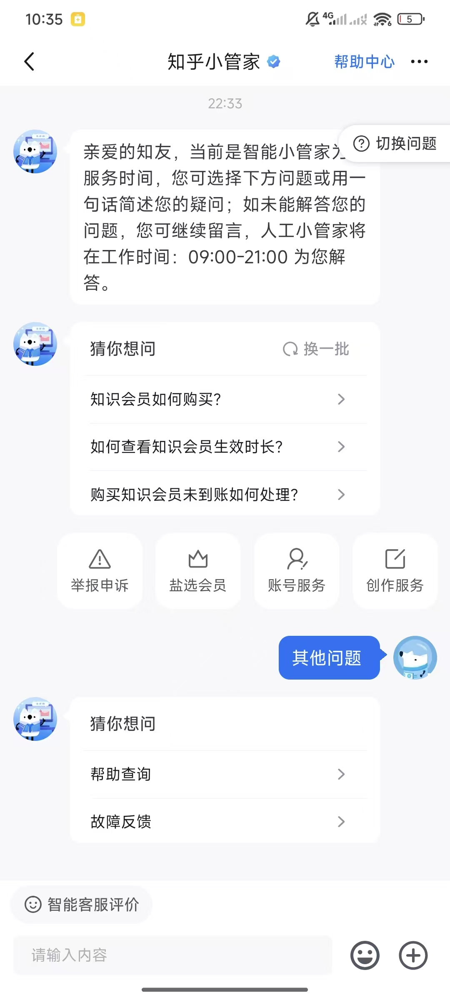
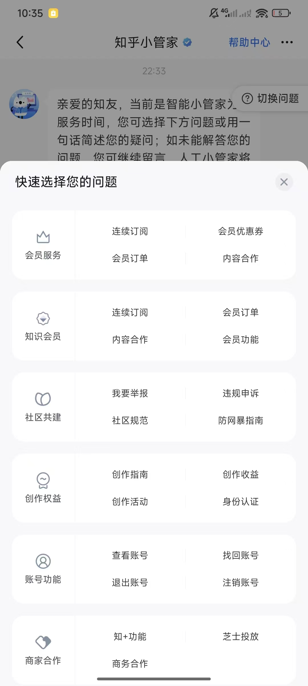
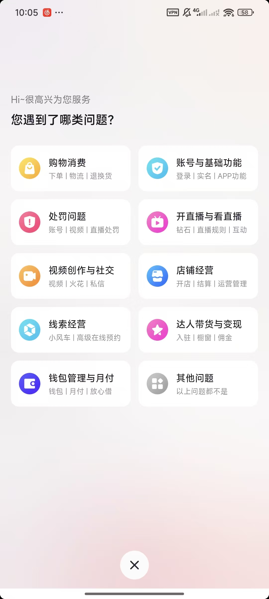
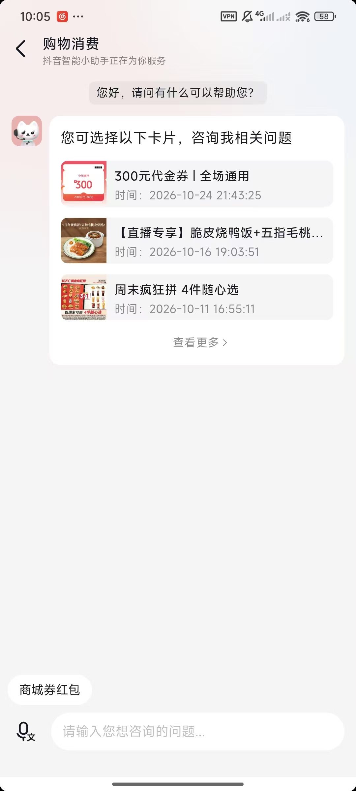
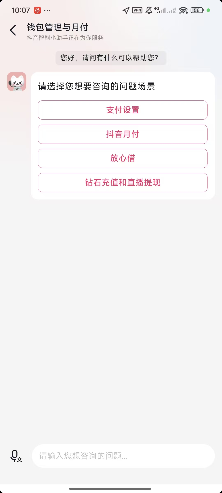
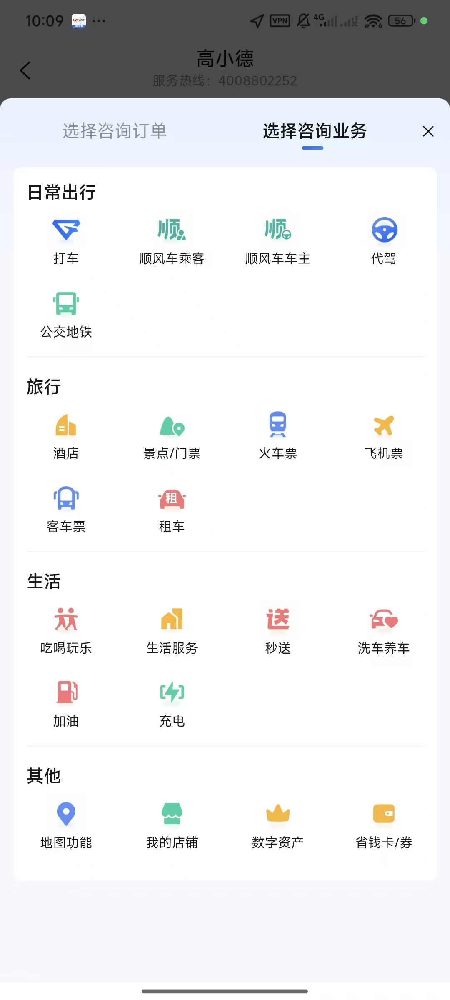
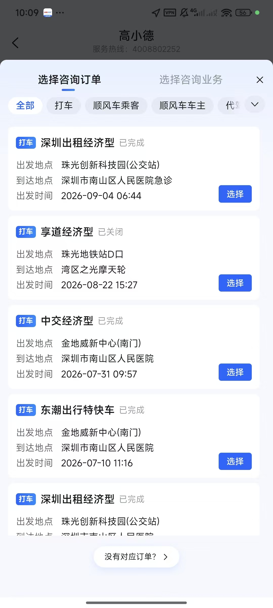
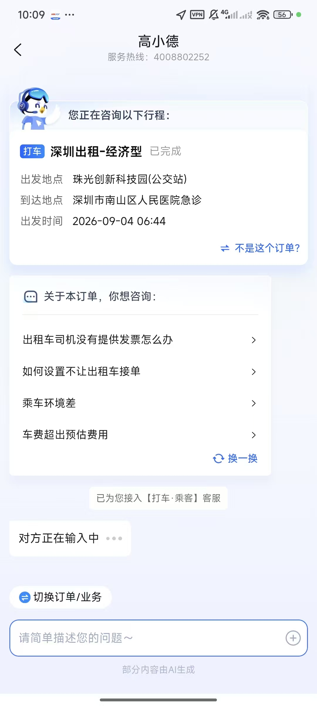

# 知乎 / 抖音 / 高德智能客服案例分析

> 类型：产品案例研究（不是阶段实施方案）
> 证据：8 张客户端截图，来自知乎、抖音、高德三个产品
> 目的：抽取智能客服“业务场景 → 产品能力 → 处理承接”的共性，为 NexusDesk 的服务场景模型和后续 Direct / Interaction / 业务上下文设计提供产品依据
> 边界：截图只反映客户端呈现，不能据此推断其内部是规则、模型、工作流还是人工配置；本文的“机制”均为产品行为层面的归纳

## 0. 结论摘要

三个产品虽然业务不同，但都不是把用户直接丢进一个“万能聊天框”。它们共同采用了同一种产品结构：

**服务目录负责让用户找到任务，业务对象负责建立上下文，会话负责承接后续处理。**

更具体地说，共性不是“都有快捷按钮”，而是以下六个机制：

1. **先限定问题域，再落到具体任务。** 知乎、抖音、高德都提供问题分类；分类用于降低表达成本，而不是替代自然语言。
2. **同一场景允许多个入口。** 用户可以从分类进入、从推荐问题进入、从订单或行程卡片进入，也可以直接自由输入。
3. **业务对象按任务需要引入。** 有些任务只需要知识回答，不需要订单；有些任务必须先选择订单或行程，否则无法回答。
4. **对象一旦绑定，会话上下文随之改变。** 高德的“您正在咨询以下行程”是三个案例中最完整的上下文绑定示例。
5. **场景内的推荐问题是动态的。** 推荐项与当前业务域、对象状态和对象字段相关，而不是全局固定 FAQ。
6. **错误对象、无对象、其他问题、转人工都是一等产品路径。** 高德的“没有对应订单？”“不是这个订单？”“切换订单/业务”说明异常不是补丁，而是主流程的一部分。

三个产品的侧重点不同：

| 产品 | 最突出的产品特征 | 最值得借鉴的部分 |
|---|---|---|
| 知乎 | 知识、会员、社区和创作服务的多层服务目录 | 分类导航 + FAQ 推荐 + 自由文本并存 |
| 抖音 | 行业问题域 + 近期业务对象卡片 + 场景按钮 | 用用户最近的业务对象降低查询成本 |
| 高德 | 业务目录与订单列表双入口，订单绑定后推荐问题 | 业务对象选择、上下文绑定、异常回退和带上下文转人工 |

本文最重要的产品判断是：

> **不要以“Interaction Flow / 流程引擎”为中心建模，而应以“客户任务对应的服务场景”为中心。**
>
> 流程只是场景的一种实现方式；同一场景可能只需要一次 Direct 回答，也可能需要查业务对象、调工具、进入 Agent，最后转人工。场景应稳定存在，执行方式应可替换。

---

## 1. 分析框架

为了避免把截图分析变成逐页 UI 描述，本文使用五段式框架：

```text
客户任务 → 业务对象 → 业务事实 → 用户决策 → 处理承接
```

| 层次 | 要回答的问题 | 例子 |
|---|---|---|
| 客户任务 | 用户到底想完成什么，而不是他点进了哪个菜单 | 查询最近订单、咨询发票规则、反馈乘车环境 |
| 业务对象 | 完成任务需要围绕哪个业务实体 | 订单、行程、会员、账号、创作内容、店铺 |
| 业务事实 | 用户需要看到哪些最少信息，才能确认对象并做决定 | 订单状态、出发地/目的地、时间、金额、会员有效期 |
| 用户决策 | 用户在产品中需要做哪些明确选择 | 选订单、选问题、确认“不是这个”、切换业务 |
| 处理承接 | 选择之后由什么能力完成 | Direct 回答、知识检索、工具查询、Agent 推理、人工客服 |

此外，本文把“产品机制”和“技术实现”分开看：

- 产品机制回答“用户看到什么、怎么选择、如何兜底、管理者配置什么”。
- 技术实现回答“用规则还是模型、同步还是异步、表怎么建、接口怎么调”。
- 本文只做前者；后者需要在场景共识形成后再映射。

> 说明：三个产品的截图并非一条连续的用户旅程。知乎两张是一个入口的两个状态；抖音三张分别展示问题域、购物消费对象卡片和钱包场景选择；高德三张展示业务目录、订单列表和订单绑定后的会话。本文按“状态”分析，不强行拼成一条路径。

---

## 2. 案例一：知乎小管家

### 2.1 截图与观察

<p>
  
</p>

*图 1：知乎小管家首屏，包含服务时间说明、猜你想问、问题域入口、自由输入和“其他问题”。*

首屏同时出现了四类入口：

- **服务说明**：告知当前是智能小管家、人工服务时间、可以留言等待。
- **推荐问题**：“知识会员如何购买？”“如何查看知识会员生效时长？”“购买知识会员未到账如何处理？”
- **一级问题域**：举报申诉、盐选会员、账号服务、创作服务。
- **自由输入**：用户可以一句话描述问题，或者直接发“其他问题”。

这不是简单的“聊天 + 快捷按钮”。它实际上在同时做三件事：

1. 告知用户机器人的能力边界和人工服务时间；
2. 用高频问题和领域入口降低表达成本；
3. 保留自由输入，避免用户被目录限制。

<p>
  
</p>

*图 2：“快速选择您的问题”面板，以服务域为单位展开更具体的任务。*

面板中的结构是：

```text
服务域（图标 + 名称） → 具体任务（2~4 个）
```

例如：

| 服务域 | 具体任务 |
|---|---|
| 会员服务 | 连续订阅、会员订单、会员优惠券、内容合作 |
| 知识会员 | 连续订阅、会员订单、内容合作、会员功能 |
| 社区共建 | 我要举报、违规申诉、社区规范、防网暴指南 |
| 创作权益 | 创作指南、创作收益、创作活动、身份认证 |
| 账号功能 | 查看账号、找回账号、退出账号、注销账号 |
| 商家合作 | 知+功能、芝士投放、商务合作 |

### 2.2 产品抽象

| 层次 | 知乎案例中的体现 |
|---|---|
| 客户任务 | 购买会员、查看会员时长、处理未到账、举报、申诉、找账号、创作权益等 |
| 业务对象 | 会员、订单、账号、举报对象、创作内容、商家合作项目 |
| 业务事实 | 会员状态、订单状态、账号状态、内容/账号对象；截图未展示具体详情页 |
| 用户决策 | 先选服务域，再选具体任务，或直接自由输入 |
| 处理承接 | 知识回答、业务查询、申诉/反馈流程、人工留言；截图未展示内部实现 |

### 2.3 值得借鉴的设计

1. **分层目录降低认知负担。** 首屏只放一级域，点开后再看具体任务。用户不需要一次面对几十个问题。
2. **推荐问题与目录并行。** 高频问题可以直接点，低频问题可以走目录，表达不清可以自由输入。
3. **“其他问题”是显式出口。** 它避免用户因为找不到分类而退出。
4. **服务时间与留言机制前置。** 用户在选择人工前就知道是否在线、是否需要等待，减少错误预期。
5. **分类名使用用户语言。** “举报申诉”“账号服务”“创作权益”是用户能理解的业务词，而不是内部系统模块名。

### 2.4 局限与不能直接照搬的部分

- 截图展示的是入口和任务选择，没有展示任务执行、对象确认、失败回退和转人工细节。
- 目录较宽时，用户仍可能不知道选哪个域；因此“猜你想问”和自由输入必须保留。
- 会员、账号、社区、创作等业务的处理差异很大，不能用一个统一的“问题提交”动作承接。
- 如果每个具体任务都只是跳转到静态 FAQ，目录会变成“更长的帮助中心”；真正的场景还需要对象查询、状态判断和动作承接。

### 2.5 对 NexusDesk 的启示

知乎案例最适合借鉴“**服务目录 + FAQ 推荐 + 自由输入**”的组合，尤其适合咨询型场景。它提醒我们：

- 目录的第一层应是业务域，不应是技术模块；
- 每个域下面应是客户任务，不应是接口名称；
- 推荐问题应能按租户、渠道和场景配置；
- 目录不是唯一入口，必须保留“其他问题”和自然语言。

---

## 3. 案例二：抖音智能小助手

### 3.1 截图与观察

<p>
  
</p>

*图 3：抖音“您遇到了哪类问题？”问题域首页。*

抖音的首屏采用九个问题域卡片：

| 问题域 | 卡片副标题揭示的子任务 |
|---|---|
| 购物消费 | 下单、物流、退换货 |
| 账号与基础功能 | 登录、实名、APP 功能 |
| 处罚问题 | 账号、视频、直播处罚 |
| 开直播与看直播 | 钻石、直播规则、互动 |
| 视频创作与社交 | 视频、火花、私信 |
| 店铺经营 | 开店、结算、运营管理 |
| 线索经营 | 小风车、高级在线预约 |
| 达人带货与变现 | 入驻、橱窗、佣金 |
| 钱包管理与月付 | 钱包、月付、放心借 |
| 其他问题 | 以上问题都不是 |

这里有两个细节很重要：

- **问题域卡片不只是标题。** 副标题直接把域内的关键词展示出来，帮助用户判断“我该点哪个”。
- **“其他问题”与业务域并列。** 它不是小小的文字链接，而是一个明确的选择。

<p>
  
</p>

*图 4：进入“购物消费”后，助手直接展示用户近期可咨询的订单/优惠卡片，并保留“查看更多”和自由输入。*

这张截图展示了另一个关键机制：**先给对象，再让用户问。**

助手没有先问“你具体遇到什么问题”，而是展示：

- 300 元代金券；
- 某直播专享商品；
- 周末疯狂拼 4 件随心选；
- 右侧的“查看更多”；
- 底部快捷词“商城券红包”。

用户可以直接点一个卡片，把“我正在咨询哪个业务对象”这件事先确定下来。对象卡片本身包含名称、缩略图、时间和可识别描述，降低了“我要怎么描述我的订单”的成本。

<p>
  
</p>

*图 5：进入“钱包管理与月付”后，用四个场景按钮继续缩小问题范围。*

钱包场景的后续选择是：

- 支付设置
- 抖音月付
- 放心借
- 钻石充值和直播提现

它采用的是“域 → 子场景”的按钮式选择，而不是直接进入聊天。底部仍保留自由输入，说明结构化选择并不排斥自然语言。

### 3.2 产品抽象

| 层次 | 抖音案例中的体现 |
|---|---|
| 客户任务 | 咨询券/订单、处理购物消费问题、管理支付和月付、了解直播与提现 |
| 业务对象 | 优惠券、订单、商品、钱包、月付账户、直播钻石 |
| 业务事实 | 券名称、商品名称、时间、订单/消费对象；卡片先展示识别所需事实 |
| 用户决策 | 选问题域、选对象卡片、选子场景、查看更多或自由输入 |
| 处理承接 | 商品/订单相关咨询、知识回答、业务动作、人工客服；内部实现不可见 |

### 3.3 值得借鉴的设计

1. **问题域卡片带“子任务提示”。** 用户不用点进去才知道这个域是否包含自己的问题。
2. **近期对象卡片是非常强的降本入口。** 对交易类业务，“选对象”通常比“描述问题”更容易。
3. **对象卡片与“查看更多”组合。** 近期对象优先，但不限制用户只能选平台推荐的对象。
4. **选择后仍保留自由输入。** 结构化入口负责缩小范围，聊天负责承接开放问题。
5. **不同域可以使用不同交互形态。** 购物消费可以用对象卡片，钱包管理可以用场景按钮，不需要所有域共用一种表单。

### 3.4 局限与不能直接照搬的部分

- “近期对象”需要业务系统能提供稳定、可解释的候选列表；推荐不准确会制造新的认知负担。
- 对象卡片只展示少量字段，用户可能仍需“查看更多”或搜索；必须设计无结果和旧对象回退。
- 截图不足以判断卡片是否来自当前账号的真实订单，也不足以判断是否存在权限过滤；产品上必须把“只展示用户可见对象”视为硬约束，而不是推荐排序问题。
- 钱包场景按钮仍是静态目录，不能替代后续的状态查询、失败处理和人工升级。

### 3.5 对 NexusDesk 的启示

抖音案例最适合借鉴“**问题域 + 近期业务对象 + 场景按钮**”的组合，尤其适合交易和账户类场景。它提醒我们：

- 业务对象本身可以成为入口，不必总是先问意图；
- 对象候选列表应按“近期、相关、可处理”排序，而不是简单全量列表；
- 场景按钮适合范围明确的子域，但必须配“查看更多 / 其他问题”；
- 对订单类咨询，应先让用户确认“是哪一个对象”，再问“具体什么问题”。

---

## 4. 案例三：高德“高小德”

### 4.1 截图与观察

<p>
  
</p>

*图 6：高德咨询入口提供“选择咨询订单”和“选择咨询业务”双标签。*

高德把入口明确拆成两个维度：

- **选择咨询订单**：围绕用户已经发生的交易对象；
- **选择咨询业务**：围绕业务种类和规则。

业务标签下的目录按生活领域分组：

| 领域 | 业务 |
|---|---|
| 日常出行 | 打车、顺风车乘客、顺风车车主、代驾、公交地铁 |
| 旅行 | 酒店、景点/门票、火车票、飞机票、客车票、租车 |
| 生活 | 吃喝玩乐、生活服务、秒送、洗车养车、加油、充电 |
| 其他 | 地图功能、我的店铺、数字资产、省钱卡/券 |

这个设计的价值在于：**“我有订单”与“我想问业务规则”是两类不同的起点。** 前者应先绑定对象，后者可以先进入知识或业务咨询。

<p>
  
</p>

*图 7：订单列表支持业务筛选，订单卡片展示状态和关键事实，并提供“选择”与“没有对应订单？”。*

订单选择页的组件层次非常清晰：

1. **横向业务筛选**：全部、打车、顺风车乘客、顺风车车主、代驾等；
2. **订单卡片**：业务类型、产品类型、状态、出发地、目的地、出发时间；
3. **单对象动作**：选择；
4. **无结果出口**：没有对应订单？

其中“状态”与“出发地/目的地/时间”是用户确认对象所需的最小业务事实，而不是把所有订单字段都堆在卡片上。

<p>
  
</p>

*图 8：选定行程后，助手显示当前咨询对象、上下文推荐问题、业务客服接入和“切换订单/业务”。*

这张截图是三个案例中最完整的“上下文绑定”：

- 顶部明确显示“您正在咨询以下行程”；
- 展示行程状态、出发地、目的地、时间；
- 提供“不是这个订单？”用于纠正；
- 基于当前行程推荐问题：“出租车司机没有提供发票怎么办”“如何设置不让出租车接单”“乘车环境差”“车费超出预估费用”；
- 支持“换一换”；
- 提示“已为您接入【打车·乘客】客服”；
- 提供“切换订单/业务”；
- 底部仍可自由描述问题。

### 4.2 产品抽象

| 层次 | 高德案例中的体现 |
|---|---|
| 客户任务 | 咨询某次行程、开发票、设置接单偏好、反馈乘车环境、处理费用争议、咨询业务规则 |
| 业务对象 | 行程/订单、业务类型、客服队列 |
| 业务事实 | 产品类型、订单状态、出发地、目的地、出发时间、费用相关上下文 |
| 用户决策 | 选订单/业务、筛选业务、选择具体订单、确认不是该订单、选择推荐问题、切换对象 |
| 处理承接 | 上下文推荐问题、业务知识、订单相关工具查询、业务客服转接、自由输入 |

### 4.3 值得借鉴的设计

1. **订单与业务双入口。** 同一个客服入口同时支持“从对象开始”和“从业务规则开始”，而不是强迫所有用户先选订单。
2. **筛选与对象卡片结合。** 订单多时先按业务筛选，再在卡片中选择，避免长列表失去可读性。
3. **对象绑定后明确展示。** “您正在咨询以下行程”让用户知道 AI 当前理解了什么，避免答非所问。
4. **允许纠正对象。** “不是这个订单？”是一个极重要的产品出口；没有它，错误绑定会污染整段对话。
5. **推荐问题由当前对象驱动。** 发票、接单设置、乘车环境、费用争议都与行程类型和状态相关，不是通用 FAQ。
6. **转人工带业务上下文。** 接入的是“打车·乘客”客服，而不是泛化的人工队列。
7. **随时可切换上下文。** “切换订单/业务”避免用户为了换一个问题重新进入客服。
8. **自由输入始终保留。** 结构化推荐是加速器，不是围栏。

### 4.4 局限与不能直接照搬的部分

- 截图只展示打车场景，不能证明所有业务域都有一致的对象选择和上下文绑定。
- 订单列表的字段、筛选和状态依赖业务系统；不同业务对象的“最小识别事实”不同。
- 推荐问题看起来是上下文相关的，但截图不能证明其生成方式；产品上应允许配置、预览和兜底。
- 转人工的队列映射、排队状态、非工作时间处理在截图中不可见，需要另行设计。

### 4.5 对 NexusDesk 的启示

高德案例最适合作为“**查询我的订单/行程**”的标杆，也最适合借鉴“对象绑定 + 上下文推荐 + 带上下文转人工”。它提醒我们：

- “订单问题”不是一个场景，至少应拆成“查询订单状态”“咨询订单规则”“办理售后”“反馈服务问题”等任务；
- 对象选择不是通用流程的一步，而是具体场景的交互能力；
- 绑定对象后必须显示对象摘要，并提供纠正和切换；
- 转人工时应携带业务域、对象引用、用户已选问题和必要的业务事实。

---

## 5. 三个案例的横向对比

| 维度 | 知乎 | 抖音 | 高德 |
|---|---|---|---|
| 主导入口 | 自由聊天 + 推荐问题 + 服务域 | 问题域卡片 + 近期对象卡片 + 场景按钮 | 订单/业务双标签 + 业务目录 |
| 目录层级 | 服务域 → 具体任务 | 问题域 → 子场景/对象 | 业务领域 → 业务 → 订单 |
| 自然语言 | 首屏即强调“一句话简述” | 每个阶段都保留输入框 | 绑定对象后仍保留自由描述 |
| 业务对象 | 有会员、账号、内容等对象，但截图未展示选择器 | 用近期订单/券卡片建立对象上下文 | 订单列表显式选择并绑定 |
| 对象选择时机 | 多数任务可先问问题 | 部分域先选近期对象 | 订单入口先选对象，业务入口先选规则 |
| 上下文展示 | 未见明确对象摘要 | 对象卡片即上下文提示 | “您正在咨询以下行程” + 对象摘要 |
| 上下文推荐 | 首屏“猜你想问” | 对象卡片后继续咨询 | 基于订单状态和类型推荐问题 |
| 错误纠正 | 未展示 | 未展示 | “不是这个订单？”“切换订单/业务” |
| 无结果兜底 | “其他问题” | “查看更多”/自由输入 | “没有对应订单？” |
| 转人工 | 告知人工服务时间，可留言 | 截图未展示 | 接入具体业务客服队列 |
| 最适合的业务模式 | 咨询型 | 查询型、选择型、咨询型 | 查询型、选择型、办理型、跟踪型 |

### 5.1 它们没有共同的“唯一正确路径”

三个案例证明：不存在一种固定顺序适用于所有业务。

常见顺序至少有三类：

```text
问题域 → 具体任务 → （可选）对象 → 回答/办理
问题域 → 近期对象 → 对象绑定 → 具体问题
订单/业务 → 对象选择 → 对象绑定 → 上下文推荐 → 回答/办理/转人工
```

因此，产品模型不应把顺序写死为“必须先选分类，再选订单，再选问题”。更合理的表达是：

> **场景定义必需的输入和可选的输入；交互根据上下文决定先问什么、后问什么。**

这也是“场景卡”比“通用流程图”更适合管理端的原因：管理者配置的是场景约束和素材，不是每个用户都必须走同一条线。

---

## 6. 共性抽取

### 6.1 服务场景是最小产品单元

三个产品都在用某种方式表达“客户要完成什么”：

- 知乎：会员订单、账号找回、举报申诉；
- 抖音：购物消费、钱包管理、直播处罚；
- 高德：打车行程、开发票、费用争议。

这些不是技术模块，也不是单条 FAQ，而是**客户任务 + 业务对象 + 可接受的处理结果**。

建议把“服务场景”作为产品配置的基本单元，至少包含：

- 客户是谁；
- 想完成什么任务；
- 围绕哪个业务对象；
- 需要哪些业务事实；
- 用户要做哪些选择；
- 由什么能力承接；
- 失败时怎么兜底；
- 如何衡量是否完成。

### 6.2 一个场景，多个入口

同一个场景可以同时拥有：

- 自然语言入口；
- 问题目录入口；
- 推荐问题入口；
- 业务对象入口；
- 最近记录入口；
- 外部系统跳转入口。

入口是“到达场景的方式”，不是场景本身。产品上应允许一个场景被多个入口复用，而不是为每个入口复制一套流程。

### 6.3 业务对象按任务需要引入

三个案例对业务对象的使用程度不同，但逻辑一致：

| 对象策略 | 适用情况 | 例子 |
|---|---|---|
| 不需要对象 | 通用规则、购买方式、功能说明 | 知乎“知识会员如何购买” |
| 隐式对象 | 当前账号、当前会员、当前会话 | 知乎账号服务、抖音钱包 |
| 可选对象 | 有对象更准确，没有对象也能回答 | 订单规则咨询 |
| 必需对象 | 不绑定对象就无法判断或执行 | 高德“车费超出预估费用” |
| 多对象选择 | 同一用户有多个相关对象 | 高德订单列表、抖音近期卡片 |

关键不是“要不要做对象选择”，而是**在场景卡中声明对象是必需、可选还是不需要**。

### 6.4 业务事实服务于“识别”和“决策”

对象卡片不是订单详情页。它只展示用户确认对象和做决定所需的最少事实：

- 高德：状态 + 出发地 + 目的地 + 时间；
- 抖音：对象名称 + 缩略图 + 时间；
- 知乎：任务名称 + 服务域。

产品设计原则：

1. 先回答“这是不是我说的那个对象”；
2. 再回答“这个对象现在是什么状态”；
3. 再回答“我能对它做什么”；
4. 不把全部字段塞进入口。

### 6.5 推荐问题必须是上下文相关的

知乎的“猜你想问”是首屏级推荐；高德的推荐问题则明显依赖当前行程。两者不是同一种推荐。

建议把推荐问题分成三层：

| 层级 | 依据 | 例子 |
|---|---|---|
| 全局高频 | 租户、渠道、时间段 | 如何联系人工、服务时间 |
| 场景高频 | 当前服务场景 | 会员如何购买、如何开发票 |
| 对象相关 | 对象类型、状态、字段 | 这笔行程费用有问题、这个订单未到账 |

对象相关推荐必须能随对象切换而刷新，并且要有“换一换”或“查看更多”，避免推荐集过窄。

### 6.6 失败与兜底是一等产品对象

三个案例都提供了某种出口：

- 知乎：其他问题、自由输入、人工留言；
- 抖音：查看更多、自由输入、其他问题；
- 高德：没有对应订单、不是这个订单、切换订单/业务、具体业务客服。

这说明成熟产品不会把“用户找不到”当作异常情况，而是把它当作正常路径。

建议每个场景至少定义以下兜底：

| 兜底类型 | 产品问题 |
|---|---|
| 无对象 | 用户没有订单/记录时怎么办 |
| 对象不匹配 | 推荐错了或用户选错了怎么办 |
| 对象失效 | 订单已关闭、已删除、已超过可处理期怎么办 |
| 意图不明确 | 用户只选了域，没有说具体问题怎么办 |
| 能力不足 | 场景不支持该问题，转知识、Agent 或人工 |
| 服务不可用 | 非工作时间、系统故障、接口失败怎么办 |
| 人工不可达 | 排队、留言、回呼、降级方案是什么 |

### 6.7 处理承接需要分层，而不是只有“聊天”和“转人工”

从产品行为看，三个案例可能使用的承接方式包括：

| 承接方式 | 产品特征 | 适用场景 |
|---|---|---|
| Direct 固定回答 | 不查对象、不调工具、直接给确定性答复 | 服务时间、购买方式、规则说明 |
| 知识回答 | 检索 FAQ/文档后回答 | 会员权益、账号规则、创作指南 |
| 查询 | 读取订单、行程、物流、会员状态 | 查询我的订单、查询进度 |
| 办理 | 提交退款、申诉、反馈、修改设置 | 申请售后、举报、设置接单偏好 |
| Agent | 多步推理、调用多个工具、澄清问题 | 复杂争议、跨系统问题 |
| 人工 | 带上下文转接或留言 | 高风险、高情绪、权限外、用户明确要求 |

这里要避免一个常见误区：

> “有目录”不代表“全部是固定流程”；“有聊天”也不代表“全部走 Agent”。

真正需要建模的是：**场景需要什么能力，以及能力失败后如何升级。**

### 6.8 服务目录不是决策树

目录承担的是“发现和缩小范围”，不是把所有用户行为写成树。决策树式设计的问题是：

- 用户必须回答很多与当前问题无关的问题；
- 业务规则一变，树就要重画；
- 同一任务从不同入口进入时会出现重复分支；
- 无法自然承接自由输入和对象变化。

更合适的结构是：

```text
服务目录（发现）
    ↓
服务场景（任务 + 对象 + 规则）
    ↓
交互编排（按上下文决定先问什么）
    ↓
处理承接（Direct / 知识 / 查询 / 办理 / Agent / 人工）
```

---

## 7. 建议的产品模型

### 7.1 四类核心产品对象

| 对象 | 定义 | 不负责什么 |
|---|---|---|
| 服务场景 | 一个可被管理的客户任务单元 | 不负责具体页面流程和模型调用 |
| 服务模式 | 场景的处理方式，如咨询、查询、选择、办理、跟踪 | 不等于执行档位，也不等于渠道 |
| 业务对象 | 场景围绕的实体，如订单、行程、会员、账号 | 不复制为会话中的权威快照 |
| 业务上下文 | 当前会话绑定的场景、对象、已选问题和必要事实 | 不承担权限判断和业务系统写入 |

### 7.2 五种业务模式

| 模式 | 客户问题 | 典型产品能力 | 案例 |
|---|---|---|---|
| 咨询型 | “规则是什么、怎么操作” | 知识回答、FAQ、Direct 话术 | 知乎会员购买、账号规则 |
| 查询型 | “我的东西现在怎么样” | 对象选择、状态查询、结果摘要 | 高德行程、订单状态 |
| 选择型 | “是哪一个 / 选哪个” | 列表、筛选、卡片、确认/纠正 | 抖音近期订单卡片、高德订单列表 |
| 办理型 | “帮我做一件事” | 表单、确认、提交、结果回执 | 售后、举报、设置接单偏好 |
| 跟踪型 | “处理到哪了” | 任务状态、进度、通知、转人工 | 投诉、申诉、退款进度 |

这五种模式可以组合。比如“查询我的订单”通常包含“查询 + 选择”；“申请售后”通常包含“选择 + 办理 + 跟踪”。

### 7.3 服务场景卡

建议管理端以“场景卡”而不是“流程图”作为主要配置对象。场景卡至少包含：

| 字段 | 说明 |
|---|---|
| 场景名称 | 管理者可读的业务名称，不用接口名 |
| 客户任务 | 用户想完成什么 |
| 适用渠道 | APP、网页、企微、飞书等 |
| 入口方式 | 自然语言、目录、对象卡片、外部跳转 |
| 业务对象 | 订单、行程、会员、账号等；声明非必需/可选/必需 |
| 展示事实 | 识别对象和做决定所需的最少字段 |
| 用户决策 | 选对象、选问题、确认、提交、切换 |
| 处理承接 | Direct、知识、查询、办理、Agent、人工 |
| 完成后承接 | 结果页、继续咨询、跟踪、回访 |
| 异常兜底 | 无对象、错对象、无权限、服务不可用、人工不可达 |
| 可配置项 | 文案、排序、推荐问题、字段、队列映射 |
| 衡量指标 | 完成率、选择率、纠正率、转人工率等 |

一个场景卡示例：

```text
场景：查询我的订单/行程
客户任务：找到最近一次订单或行程，确认其状态，并继续咨询
入口：订单入口、首页推荐、自然语言“查订单”
业务对象：订单/行程（必需）
展示事实：业务类型、状态、时间、关键地点/对象名称
用户决策：选订单、不是这个、没有对应订单、切换业务
处理承接：列表 Direct 展示 → 绑定对象 → 推荐问题 → 查询/知识/Agent/人工
异常兜底：无订单、对象失效、对象不匹配、服务不可用、人工不可达
指标：列表命中率、选择率、错选率、问题解决率、转人工率、重复咨询率
```

---

## 8. 标杆场景：查询我的订单/行程

结合高德和抖音的案例，建议把“查询我的订单/行程”作为第一个深化场景。它不是简单地“列出订单”，而是一个完整的服务闭环。

### 8.1 推荐产品流程

```text
入口
  ├─ 自然语言“查我的订单”
  ├─ 首页/订单页入口
  └─ 近期对象卡片
        ↓
确定业务域（可选）
        ↓
展示候选对象（近期优先 + 筛选 + 查看更多）
        ↓
用户选择对象
        ↓
显示“正在咨询此对象” + 最小事实摘要
        ↓
基于对象状态推荐问题
        ↓
Direct / 知识 / 查询 / 办理 / Agent
        ↓
结果、继续咨询、切换对象或人工
```

### 8.2 关键产品决策

1. **不要用“订单问题”直接强制用户选订单。** 先区分“查订单”“问规则”“办售后”“反馈服务”等任务。
2. **对象列表必须有状态。** 只有“已完成/已关闭/进行中”等状态，用户才能判断该问什么。
3. **对象卡片只放识别事实。** 不要把完整订单详情复制到列表中。
4. **绑定后必须显示对象摘要。** 让用户知道 AI 当前理解的是哪个对象。
5. **必须有纠错路径。** “不是这个订单”比重新开始更自然。
6. **必须有空状态。** “没有对应订单？”应连接到更宽的业务选择、历史查询或人工。
7. **推荐问题随对象变化。** 已完成订单更可能需要发票、费用、评价；进行中订单更可能需要取消、改期、联系司机。
8. **转人工携带上下文。** 至少携带场景、对象引用、用户已选问题和必要事实；避免用户重复描述。

### 8.3 不应在这个场景里做的事

- 不把所有订单字段都放进卡片；
- 不在用户还没表达任务时，直接进入 ReAct 长推理；
- 不让模型自行猜测用户指的是哪一单；
- 不把订单快照复制成会话内的“真相”；
- 不让“选订单”成为每个订单相关场景的强制步骤。

---

## 9. 管理者可见性与配置

三个案例的客户端设计已经给出了产品能力，但管理者还需要知道“系统为什么这样分流、自己能改什么”。建议管理端分为四层：

### 9.1 第一层：平台不变量（只读）

这些是平台级硬规则，不能由普通租户随意关闭，但必须向管理者解释：

- 会话已关闭时的处理；
- 用户明确要求人工时的处理；
- 黑名单/风控命中时的处理；
- 模型未配置时的处理；
- 权限不足时的处理；
- 审计和合规要求。

管理端应显示“规则说明 + 最近命中记录”，而不是只显示一个开关。

### 9.2 第二层：服务目录（租户可配置）

- 业务域、场景、任务层级；
- 名称、图标、描述、排序；
- 适用渠道；
- 入口展示位置；
- 场景之间的跳转；
- 停用、隐藏、灰度。

### 9.3 第三层：场景策略（租户可配置，但有边界）

- 业务对象类型与对象获取方式；
- 对象展示字段；
- 推荐问题与文案；
- Direct / 知识 / 查询 / 办理 / Agent / 人工的适用范围；
- 异常兜底和人工队列映射；
- 生效时间、版本、草稿/发布/回滚。

不是让管理者配置所有路由方向。平台不变量只读，租户只配置业务场景内的策略，避免把系统变成一堆不可理解的底层开关。

### 9.4 第四层：运行证据（只读）

- 最近决策记录；
- 场景入口命中率；
- 对象选择率、纠正率、空状态率；
- 推荐问题点击率；
- 自动解决率、转人工率；
- 用户重复咨询率；
- 处理时长和失败原因。

### 9.5 管理端需要回答的五个问题

1. **有哪些场景？** 服务目录和场景卡。
2. **用户怎么进入？** 入口预览和多入口配置。
3. **系统围绕什么对象回答？** 对象绑定和事实字段预览。
4. **为什么这样处理？** 决策记录、原因和上下文快照（脱敏后）。
5. **效果如何？** 转化、解决、纠正、转人工和重复咨询指标。

建议提供“场景模拟器”：

- 输入一句用户问题；
- 选择或模拟一个业务对象；
- 展示会命中哪个场景、需要哪些事实、会给出哪些推荐、走哪种承接；
- 允许管理者在发布前发现误分流和空状态。

这比暴露原始规则 JSON 更能让管理者理解机制，也更容易做发布前验证。

---

## 10. 对 NexusDesk 的落地顺序建议

### 第一步：查询我的订单/行程

先做一个闭环，验证四个能力：

- 服务场景卡；
- 业务对象列表与选择；
- 对象绑定和上下文摘要；
- Direct/查询/Agent/人工的分层承接。

### 第二步：咨询订单规则

复用同一业务对象和场景目录，但不需要强制选对象：

- 开发票规则；
- 取消规则；
- 售后时效；
- 费用说明。

这一步验证“同一对象、不同任务”的拆分是否正确。

### 第三步：办理和跟踪

在查询和咨询稳定后，再加入：

- 申请售后；
- 提交反馈；
- 查看处理进度；
- 人工升级。

这一步验证写操作、确认、回执和长任务状态。

### 第四步：再抽象平台能力

只有多个场景重复出现相同模式后，才抽象：

- 通用对象选择器；
- 通用推荐问题；
- 通用确认/回执；
- 通用状态跟踪；
- 通用转人工上下文。

不要一开始做“万能 Flow 引擎”。先用场景验证，再把稳定共性沉淀为平台能力。

### 与请求路由的关系

自然语言消息和结构化入口不应成为两套互不相干的系统：

- 自然语言消息进入 Routing，先判断处置和是否继续；
- 结构化入口直接进入 Interaction，但不能绕过场景、对象和权限约束；
- 两者共享同一套服务场景、业务对象和业务上下文；
- 不是所有 UI 动作都要走自然语言路由决策表，但最终都要落到可解释的场景与执行策略。

---

## 11. 反模式清单

1. **把“订单问题”当成一个场景。** 它至少包含查状态、问规则、办售后、反馈服务等不同任务。
2. **先让用户选订单，再允许他说问题。** 对规则咨询不成立。
3. **只做静态 FAQ。** 没有对象和状态，无法回答“我的这一单怎么样”。
4. **只做自由聊天。** 用户不知道能问什么，管理者也无法稳定配置。
5. **把目录做成无限深的树。** 用户会在分类里迷路，必须有搜索、推荐、其他问题和自由输入。
6. **对象选择没有空状态。** 没有订单、订单过期、对象不匹配都是正常情况。
7. **绑定对象后不显示摘要。** 用户无法确认 AI 是否理解正确。
8. **推荐问题与对象无关。** 会造成答非所问和重复点击。
9. **转人工只转队列，不带上下文。** 用户需要重新描述，体验断崖式下降。
10. **把技术规则直接暴露给业务管理者。** 应配置场景卡、对象策略和兜底，而不是让管理者写底层路由表达式。

---

## 12. 建议衡量的指标

| 指标 | 说明 | 用途 |
|---|---|---|
| 场景入口命中率 | 用户从自然语言、目录、对象卡片进入场景的比例 | 判断入口设计是否有效 |
| 目录点击率 | 一级域、二级任务的点击分布 | 判断目录结构是否符合用户语言 |
| 对象列表命中率 | 候选列表中出现目标对象的比例 | 判断排序和候选范围 |
| 对象选择率 | 用户从候选列表选择对象的比例 | 判断对象入口是否有价值 |
| 错选/纠正率 | “不是这个订单”等纠正行为比例 | 判断绑定准确性 |
| 空状态率 | 没有对象、没有匹配结果的比例 | 判断数据覆盖和回退设计 |
| 推荐问题点击率 | 场景内推荐问题被点击的比例 | 判断推荐是否相关 |
| 自动解决率 | 无需人工即完成的任务比例 | 判断自动化价值 |
| 转人工率 | 进入人工的比例及原因 | 判断能力边界 |
| 带上下文转人工比例 | 转人工时携带场景和对象信息的比例 | 判断上下文连续性 |
| 重复咨询率 | 同一用户短时间重复咨询同一任务的比例 | 判断是否真正解决 |
| 首次响应/处理时长 | 从进入到给出结果的时间 | 判断效率 |

指标应按“场景 × 入口 × 渠道 × 业务对象类型”拆分，否则整体数字会掩盖具体问题。

---

## 13. 待确认的产品问题

1. NexusDesk 第一批要支持哪些业务对象？订单、行程、工单、会员、账号，还是只选一个？
2. 对象是自动绑定、用户选择，还是两者结合？不同场景是否允许不同策略？
3. “场景”的粒度由谁定义：平台预置、租户配置，还是两者结合？
4. 推荐问题是模板、知识库条目，还是由模型生成？必须如何审核和回滚？
5. Direct、知识、查询、办理、Agent、人工这些承接方式，哪些允许租户配置，哪些是平台不变量？
6. 转人工的业务队列如何映射？是否需要业务域、对象类型和优先级？
7. 订单/行程对象失效、权限不足、跨租户访问时，产品上分别显示什么？
8. 同一会话中切换对象时，旧的推荐问题和历史结论如何保留或清理？
9. 多语言场景下，服务目录、对象字段和推荐问题是否分别配置？
10. 管理端如何预览“用户会看到什么”，以及如何证明配置没有破坏已有场景？

---

## 14. 证据边界

本文基于以下可见信息：

- 知乎：聊天首屏、快速选择问题面板；
- 抖音：问题域首页、购物消费近期对象卡片、钱包场景选择；
- 高德：业务目录、订单列表、订单绑定后的咨询会话。

不可从截图直接得出：

- 每个入口背后是规则、模型还是人工配置；
- 对象列表的排序、过滤和权限策略；
- 推荐问题是静态配置还是动态生成；
- 转人工的队列、排队和离线策略；
- 管理端是否存在草稿、发布、模拟和审计能力；
- 三个产品是否采用了统一的底层平台。

因此，本文的结论应作为**产品模式假设**，用于指导后续场景设计和用户验证，而不是对竞品内部实现的断言。

---

## 15. 一句话总结

三个案例共同说明：**智能客服的竞争力不在“聊天框有多像人”，而在于能否让用户低成本找到任务、准确建立业务上下文，并在对象、规则、执行和人工之间平滑切换。**

对 NexusDesk 而言，下一步最值得做的不是继续增加抽象层，而是先用“查询我的订单/行程”跑通一个完整场景：

```text
找到任务 → 选对对象 → 看清事实 → 做出选择 → 得到结果 → 失败可退 → 人工可接
```

这个闭环成立后，再把对象选择、推荐问题、确认回执、跟踪和转人工上下文沉淀为可复用能力。
