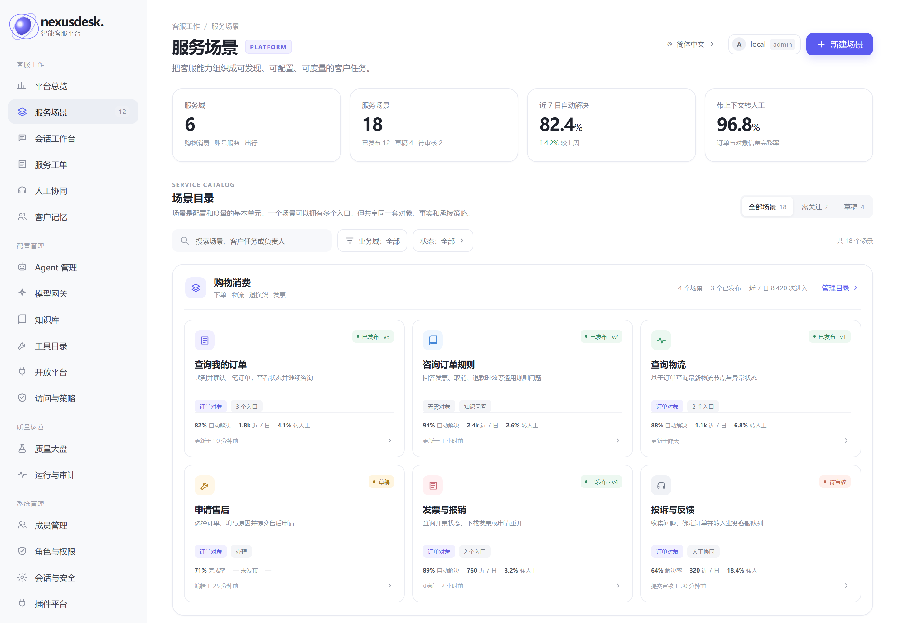
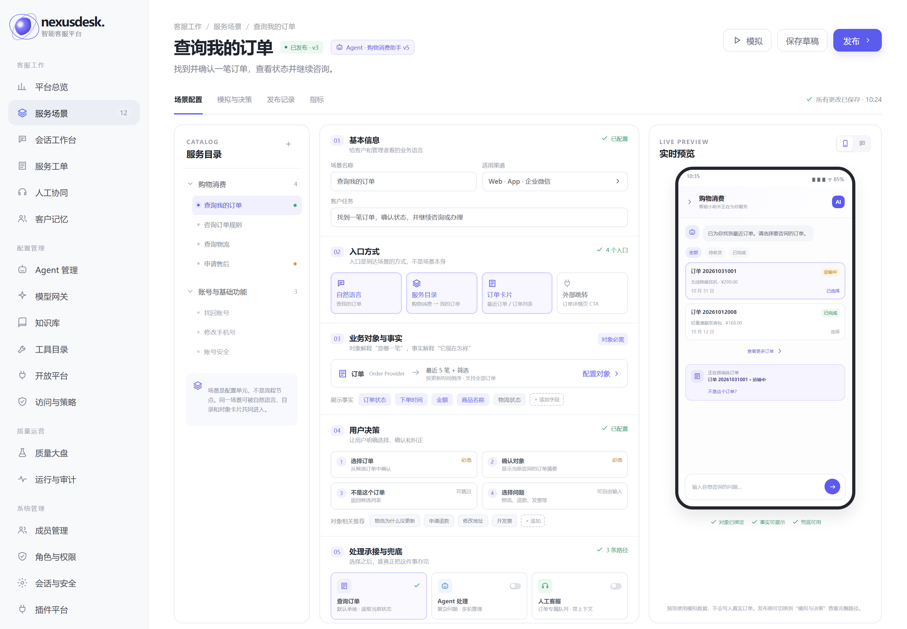
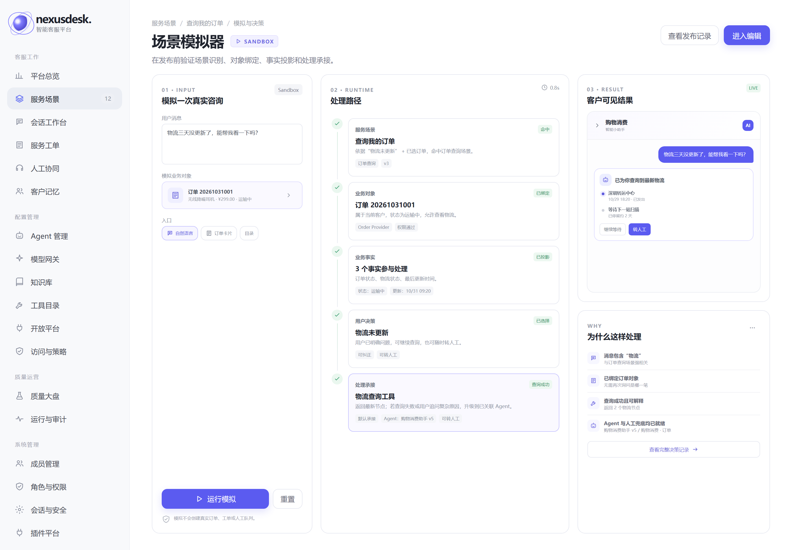
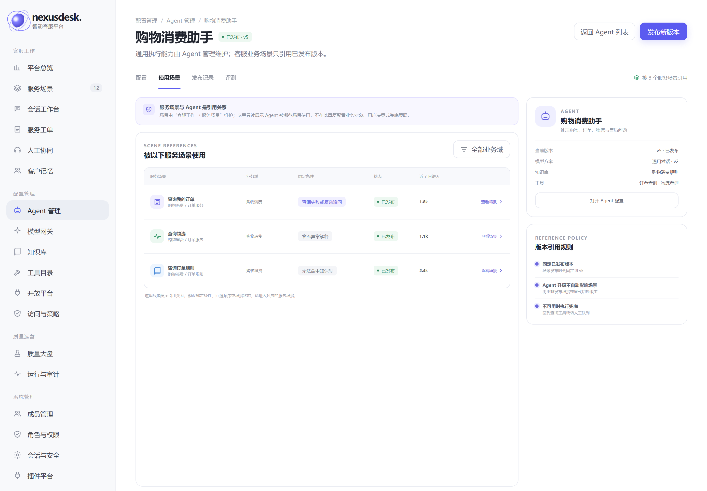
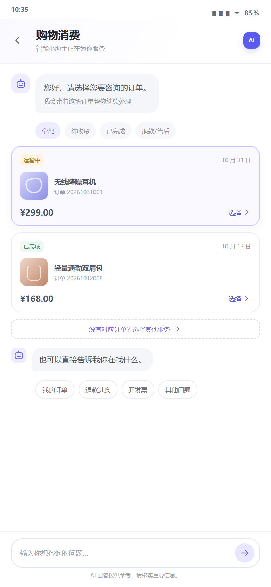
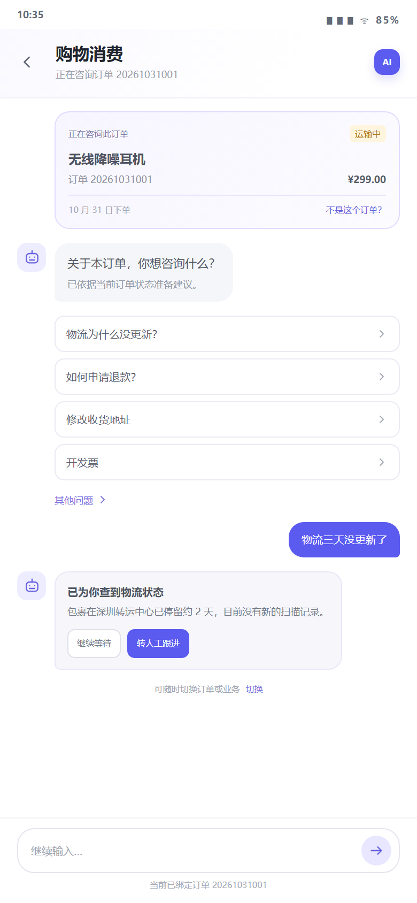

# Service Scenario Platform · UI Design Mockups

> Status: V1 review draft
> Reference UI: the current NexusDesk workbench (https://120.78.135.217:8080)
> Scope: the "Service Scenarios" entry in the admin console, the scenario workbench, simulation and decision explanation, and the customer-client order lookup loop
> Note: this directory is a static design mockup that is not yet wired into the production frontend; it is not a shippable business page

## 1. Design goals

This set of screens has to answer two questions at once:

1. How does a customer find the task at low cost, pick the right business object and complete the service;
2. How does an administrator configure a scenario, and understand why the system handled it this way.

So the design does not use a "universal flow designer". Instead it uses:

```text
generic scenario shell
  + configurable scenario cards
  + a limited set of scenario templates
  + live preview
  + decision explanation
```

## 2. Visual alignment with the current product

The mockups follow the structure and visual language of the current NexusDesk console:

| Item | Design convention |
|---|---|
| Navigation | Left-hand grouped navigation; "Service Scenarios" belongs to Customer Service, "Agent Management" stays under Configuration |
| Primary colour | `#5b5bf0` / `#5865f2`, with light purple for selected and emphasis backgrounds |
| Fonts | Inter, Microsoft YaHei, PingFang SC |
| Content area | White background, light grey cards, thin borders, low shadows |
| Corner radius | 14–18px for page cards, 7–10px for inputs and buttons |
| Status colours | Green = published/success, yellow = draft/waiting, red = pending/failure, purple = objects and interactions |
| Information hierarchy | 27px titles, 14–17px panel titles, 10–13px body text, 8–10px supporting information |

### 2.1 Information architecture ownership

Service scenarios are not an accessory configuration of a general-purpose Agent; they are the organisational layer of the customer-service business capability, so their navigation ownership is separated explicitly:

```text
Customer Service
├── Platform Overview
├── Service Scenarios   ← business orchestration, customer interaction, fallback
├── Conversation Workbench
├── Service Tickets
├── Human Collaboration
└── Customer Memory

Configuration
├── Agent Management    ← prompt, model, tools, knowledge base, memory
├── Model Gateway
├── Knowledge Base
└── ...
```

The two are linked by **reference**, not by copying configuration:

- A service scenario stores only `agent_id + version`; it does not maintain prompts, models, tools or knowledge bases;
- Publishing a scenario pins the Agent's published version, so later Agent upgrades do not automatically affect existing scenarios;
- The scenario side shows "linked Agent, version, view configuration", while the Agent side offers a read-only "used by the following service scenarios";
- Business objects, user decisions and fallback order are maintained only in service scenarios and are not configured again on the Agent page.

## 3. Page previews

### 3.1 Service scenario overview

Entry point: Customer Service → Service Scenarios.

Page goals:

- Let administrators see which business domains and scenarios exist;
- See each scenario's object type, number of entry points, publish status and outcome metrics;
- Be able to jump quickly into scenario editing, creation and filtering.

<p></p>

Key design decisions:

- Use "business domain groups + scenario cards" rather than a spreadsheet-style admin menu;
- Cards show the customer task, business object, entry points and metrics directly;
- Status is expressed with lightweight tags so it does not compete with business information;
- "New scenario" is the single primary action.

### 3.2 Scenario workbench

Page goals:

- The admin console configures a complete service scenario on a single "scenario card";
- Scenarios switch on the left, configuration sits in the middle, live preview on the right;
- Five configuration sections: basic information, entry points, objects and facts, user decisions, and handling and fallback.

<p></p>

Key design decisions:

- The left tree only switches scenarios and does not express an execution flow;
- The middle always has the same five sections, so each scenario does not grow its own configuration page;
- The right pane previews in real time what the current user would see;
- "Simulate", "Save draft" and "Publish" form a complete publishing chain;
- Scenario status and the current version are always visible.

### 3.3 Scenario simulation and decision explanation

Page goals:

- Validate scenario detection, object binding, fact projection, user decisions and handling before publishing;
- Let administrators see why a particular handling ended up here;
- Reduce the risk of misconfiguration and misrouting.

<p></p>

Key design decisions:

- Enter the simulated message and object on the left;
- The middle shows the five-stage run path;
- The right pane shows both the customer-visible result and "why it was handled this way";
- Administrators never see the underlying routing expressions; they see business-readable reasons instead;
- The simulation environment is clearly labelled Sandbox and does not write to real orders, tickets or human queues.

### 3.4 Agent Management: used by service scenarios

Page goals:

- Confirm from the Agent side "who references this Agent", so the blast radius of a capability upgrade stays visible;
- Keep the Agent a general-purpose execution capability and do not stuff customer-service orchestration back into Agent configuration;
- Show binding conditions, scenario status and traffic volume, but do not allow scenarios to be edited on the Agent page.

<p></p>

Key design decisions:

- The breadcrumb stays at "Configuration → Agent Management";
- "Used by scenarios" is a read-only tab on the Agent detail page;
- State the reference rules explicitly: the published version is pinned, upgrades do not take effect automatically, and a fallback runs when the Agent is unavailable;
- "View scenario" takes the administrator back to "Customer Service → Service Scenarios" to make the change.

### 3.5 Customer client: order selection

<p align="center"></p>

Page goals:

- After entering "Shopping and Spending", the user sees recent orders first instead of an empty chat box;
- Filtering by order status is supported;
- Selecting an order opens a conversation bound to that order's context;
- "No matching order", "Other questions" and free-text input are preserved.

Key design decisions:

- Order cards show status, product, order number, amount and date;
- Only the minimum facts needed to identify the order are shown;
- "Select" is an explicit action;
- "No matching order" is a first-class product path, not an exception patch;
- The input box at the bottom is always available.

### 3.6 Customer client: conversation after an order is bound

<p align="center"></p>

Page goals:

- Users know exactly which order they are currently asking about;
- The system recommends questions based on the current order status;
- Query results offer a next action;
- Errors can be corrected, the order switched, or the conversation handed off to a human at any time.

Key design decisions:

- The order context card at the top states clearly "you are asking about this order";
- "Not this order?" provides immediate correction;
- Recommended questions relate to the current order;
- Query results explain status in business language;
- "Hand off to a human" is a result-level action, not a hidden entry point;
- The bottom repeats which order is bound.

## 4. How to view the static mockups

Open directly:

```text
mockups.html?view=catalog
mockups.html?view=editor
mockups.html?view=simulator
mockups.html?view=agent-usage
mockups.html?view=picker
mockups.html?view=context
```

All pages share:

- `mockups.css`: design tokens, layout, components and responsive rules;
- `mockups.js`: navigation injection, page switching and demo interactions;
- `screens/`: the exported review screenshots.

## 5. Corresponding product model

| Product layer | Admin UI | Customer UI |
|---|---|---|
| Service catalogue | Business domain groups, scenario tree, entry point configuration | Business domains, task entry points, recommended questions |
| Business object | Object type, provider, candidate strategy | Order list, object selection |
| Business facts | Display fields, formatting, masking | Order summary, status, amount, time |
| User decisions | Decision points, required/optional, confirmation and correction | Select order, not this order, select question |
| Handling | Direct / knowledge / lookup / Agent / human / fallback | Query results, receipt, handoff to a human |

## 6. Suggested implementation path

We suggest moving to a production frontend in this order:

1. Add "Service Scenarios" to the "Customer Service" navigation and a read-only "Used by scenarios" tab on the Agent detail page;
2. Build read-only versions of the service scenario overview and the scenario workbench first;
3. Wire up the scenario configuration read API and the live preview;
4. Add draft, publish, rollback and audit;
5. Split the customer client into reusable components: catalogue, object picker, context card, decision area and result card;
6. Connect the simulator and real decision tracing last.

The production implementation should reuse the existing React + Ant Design stack rather than copying this directory's static HTML into production code.

## 7. Review focus

- Is "Used by scenarios" on the Agent detail page enough for administrators to judge the blast radius of an upgrade;
- Does the three-column scenario workbench suit day-to-day configuration;
- Should the live preview be expanded by default;
- Should the five configuration sections be merged into fewer sections;
- Are the fields shown on the customer order card sufficient;
- Should recommended questions after order binding be operationally configurable;
- Does the simulator need to support "compare two versions";
- Is the decision explanation readable enough for business administrators.
