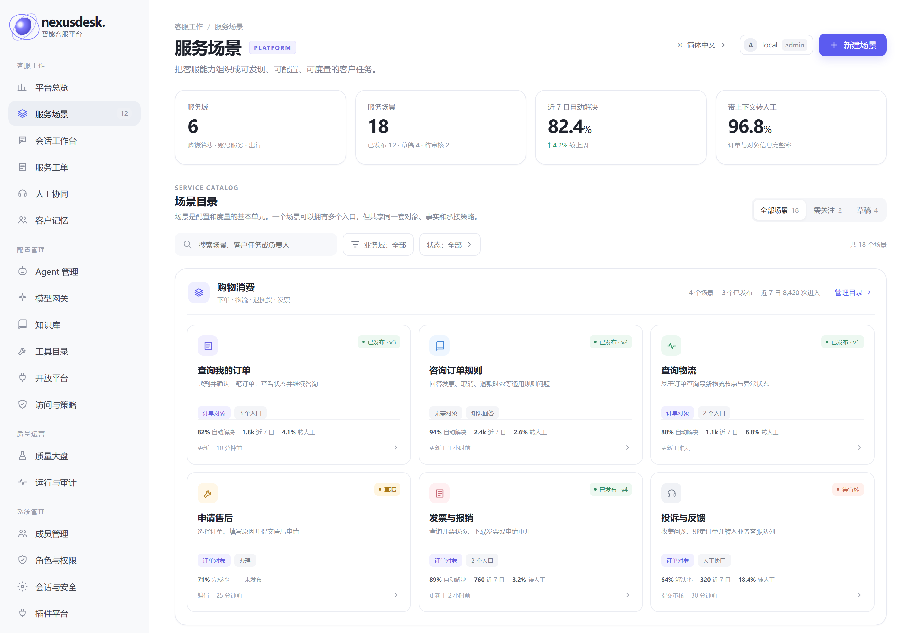
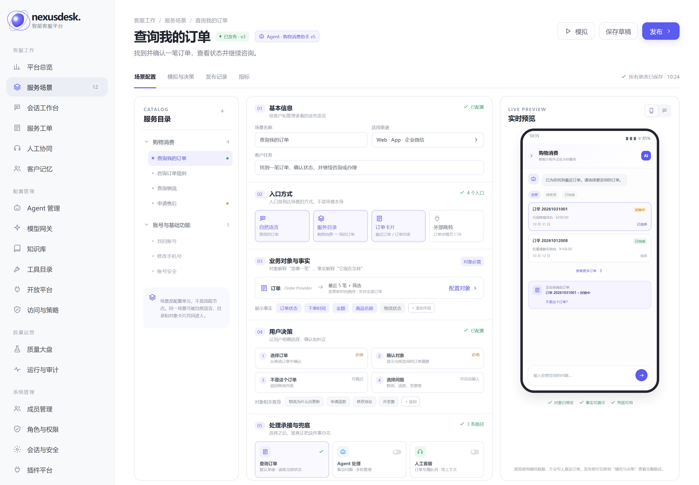
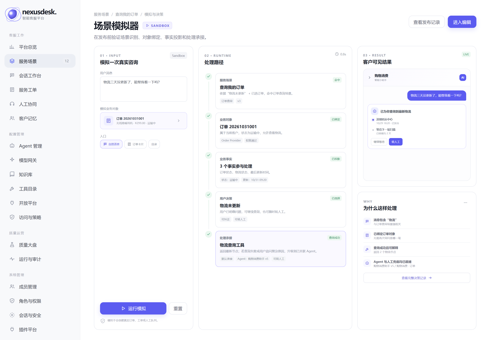
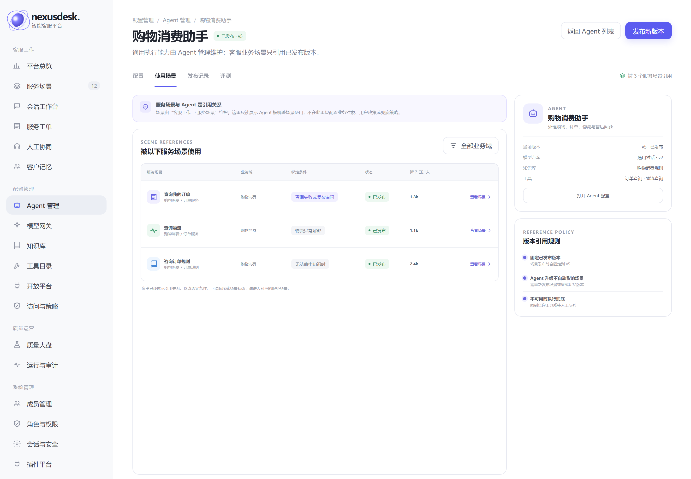
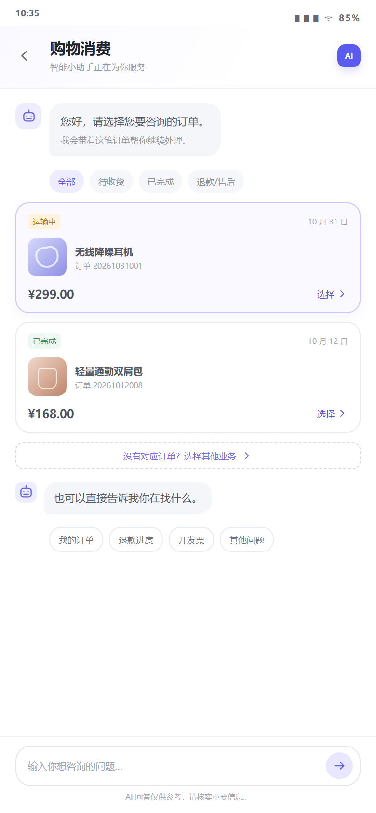
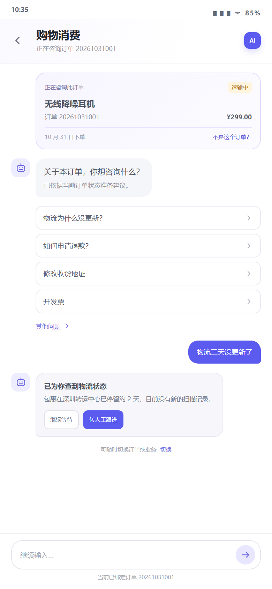

# 服务场景平台 · UI 设计稿

> 状态：V1 评审稿
> 参考界面：当前 NexusDesk 工作台（https://120.78.135.217:8080）
> 范围：管理端“服务场景”入口、场景工作台、模拟与决策解释，以及客户端订单查询闭环
> 说明：本目录是静态设计稿，尚未接入生产前端；不是可上线的业务页面

## 1. 设计目标

这组界面要同时回答两个问题：

1. 客户如何低成本找到任务、选对业务对象并完成服务；
2. 管理者如何配置一个场景，并看懂系统为什么这样处理。

因此界面没有采用“万能流程设计器”，而是采用：

```text
通用场景壳
  + 可配置场景卡
  + 有限场景模板
  + 实时预览
  + 决策解释
```

## 2. 与当前产品的视觉对齐

设计稿沿用当前 NexusDesk 控制台的结构和视觉语言：

| 项目 | 设计约定 |
|---|---|
| 导航 | 左侧分组导航；“服务场景”归属客服工作，“Agent 管理”保留在配置管理 |
| 主色 | `#5b5bf0` / `#5865f2`，浅紫作为选中和强调背景 |
| 字体 | Inter、Microsoft YaHei、PingFang SC |
| 内容区 | 白色背景、浅灰卡片、细边框、低阴影 |
| 圆角 | 页面卡片 14–18px，输入与按钮 7–10px |
| 状态色 | 绿色=已发布/成功，黄色=草稿/等待，红色=待处理/失败，紫色=对象与交互 |
| 信息层级 | 标题 27px、面板标题 14–17px、正文 10–13px、辅助信息 8–10px |

### 2.1 信息架构归属

服务场景不是通用 Agent 的附属配置，而是客服业务能力的组织层，因此导航归属明确拆开：

```text
客服工作
├── 平台总览
├── 服务场景       ← 业务编排、客户交互、兜底
├── 会话工作台
├── 服务工单
├── 人工协同
└── 客户记忆

配置管理
├── Agent 管理     ← Prompt、模型、工具、知识库、记忆
├── 模型网关
├── 知识库
└── ...
```

二者采用**引用关系**，不复制配置：

- 服务场景只保存 `agent_id + version`，不维护 Prompt、模型、工具和知识库；
- 场景发布时固定 Agent 的已发布版本，Agent 后续升级不会自动影响存量场景；
- 场景侧展示“关联 Agent、版本、查看配置”，Agent 侧提供只读的“被以下服务场景使用”；
- 业务对象、用户决策、兜底顺序只在服务场景维护，不在 Agent 页面重复配置。

## 3. 页面预览

### 3.1 服务场景总览

入口位置：客服工作 → 服务场景。

页面目标：

- 让管理者看到有哪些业务域和场景；
- 看到每个场景的对象类型、入口数量、发布状态和效果指标；
- 能快速进入场景编辑、创建和筛选。

<p></p>

关键设计：

- 使用“业务域分组 + 场景卡片”，不是后台表格式菜单；
- 卡片直接展示客户任务、业务对象、入口和指标；
- 状态用轻量标签表达，不抢夺业务信息；
- “新建场景”作为唯一主动作。

### 3.2 场景工作台

页面目标：

- 管理端用一张“场景卡”配置完整服务场景；
- 左侧切换场景，中间配置，右侧实时预览；
- 五个配置区对应：基本信息、入口、对象与事实、用户决策、承接与兜底。

<p></p>

关键设计：

- 左侧目录树只负责切换场景，不表达执行流程；
- 中间固定五个配置区，避免每个场景长出不同的配置页面；
- 右侧实时预览当前用户会看到什么；
- “模拟”“保存草稿”“发布”形成完整发布链路；
- 场景状态和当前版本始终可见。

### 3.3 场景模拟与决策解释

页面目标：

- 发布前验证场景识别、对象绑定、事实投影、用户决策和处理承接；
- 让管理者看懂一次处理为什么走到这里；
- 降低误配置和误分流风险。

<p></p>

关键设计：

- 左侧输入模拟消息和对象；
- 中间展示五段式运行路径；
- 右侧同时展示客户可见结果和“为什么这样处理”；
- 不向管理者暴露底层路由表达式，而是展示业务可读的原因；
- 模拟环境明确标注 Sandbox，不写入真实订单、工单或人工队列。

### 3.4 Agent 管理：被服务场景使用

页面目标：

- 从 Agent 侧确认“谁在引用这个 Agent”，避免能力升级影响范围不可见；
- 保持 Agent 作为通用执行能力，不把客服业务编排塞回 Agent 配置；
- 展示绑定条件、场景状态和进入量，但不允许在 Agent 页面修改场景。

<p></p>

关键设计：

- 面包屑保留在“配置管理 → Agent 管理”；
- “使用场景”是 Agent 详情的只读页签；
- 明确展示引用规则：固定发布版本、升级不自动生效、不可用时执行兜底；
- “查看场景”把管理者带回“客服工作 → 服务场景”完成修改。

### 3.5 客户端：选择订单

<p align="center"></p>

页面目标：

- 用户进入“购物消费”后，先看到近期订单而不是空白聊天框；
- 支持按订单状态筛选；
- 选择订单后进入绑定上下文的会话；
- 保留“没有对应订单”“其他问题”和自由输入。

关键设计：

- 订单卡片展示状态、商品、订单号、金额和日期；
- 只展示识别订单所需的最少事实；
- “选择”是明确动作；
- “没有对应订单”是正式产品路径，不是异常补丁；
- 底部输入框始终可用。

### 3.6 客户端：订单绑定后的会话

<p align="center"></p>

页面目标：

- 用户明确知道当前正在咨询哪一笔订单；
- 系统基于当前订单状态推荐问题；
- 查询结果给出下一步动作；
- 可以随时纠错、切换订单或转人工。

关键设计：

- 顶部订单上下文卡明确展示“正在咨询此订单”；
- “不是这个订单？”提供及时纠错；
- 推荐问题与当前订单相关；
- 查询结果用业务语言解释状态；
- “转人工跟进”是结果级动作，不是隐藏入口；
- 底部再次提示当前绑定的订单。

## 4. 静态稿如何查看

直接打开：

```text
mockups.html?view=catalog
mockups.html?view=editor
mockups.html?view=simulator
mockups.html?view=agent-usage
mockups.html?view=picker
mockups.html?view=context
```

所有页面共用：

- `mockups.css`：设计 token、布局、组件和响应式规则；
- `mockups.js`：导航注入、页面切换和演示交互；
- `screens/`：已导出的评审截图。

## 5. 对应产品模型

| 产品层次 | 管理端界面 | 客户端界面 |
|---|---|---|
| 服务目录 | 业务域分组、场景树、入口配置 | 业务域、任务入口、推荐问题 |
| 业务对象 | 对象类型、Provider、候选策略 | 订单列表、对象选择 |
| 业务事实 | 展示字段、格式、脱敏 | 订单摘要、状态、金额、时间 |
| 用户决策 | 决策点、必选/可选、确认与纠正 | 选择订单、不是这个订单、选择问题 |
| 处理承接 | Direct/知识/查询/Agent/人工/兜底 | 查询结果、回执、转人工 |

## 6. 后续实现建议

建议按以下顺序转为生产前端：

1. 在“客服工作”导航中新增“服务场景”，在 Agent 详情中增加只读“使用场景”；
2. 先实现服务场景总览和场景工作台的只读版；
3. 接入场景配置读接口和实时预览；
4. 增加草稿、发布、回滚和审计；
5. 将客户端组件拆成可复用的目录、对象选择器、上下文卡、决策区和结果卡；
6. 最后接入模拟器和真实决策追踪。

生产实现应复用现有 React + Ant Design 体系，不直接复制本目录静态 HTML 作为生产代码。

## 7. 评审关注点

- Agent 详情中的“使用场景”是否足以让管理者判断升级影响范围；
- 场景工作台三栏布局是否适合日常配置；
- 实时预览是否应默认展开；
- 五段式配置是否需要合并为更少的分区；
- 客户端订单卡片展示字段是否足够；
- 订单绑定后的推荐问题是否需要运营配置；
- 模拟器是否需要支持“对比两个版本”；
- 决策解释是否对业务管理员足够可读。
